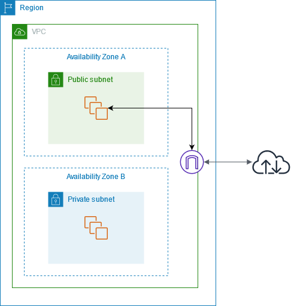
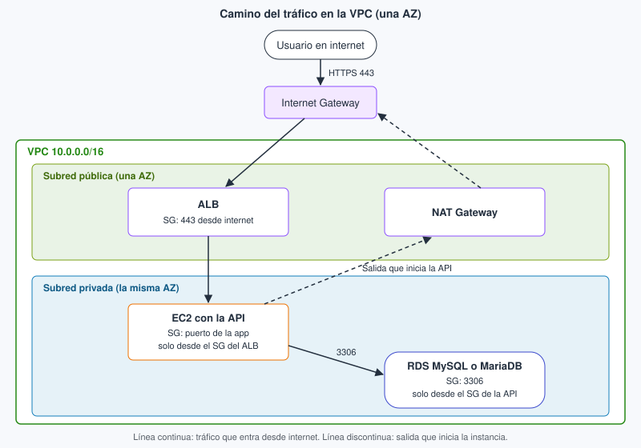
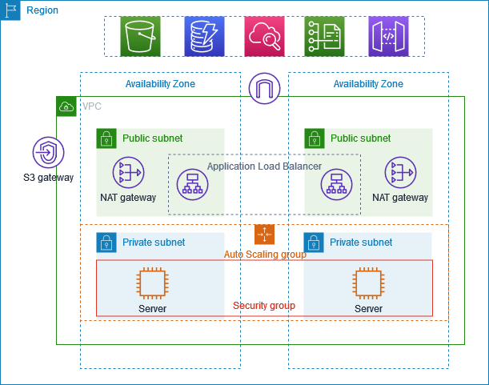
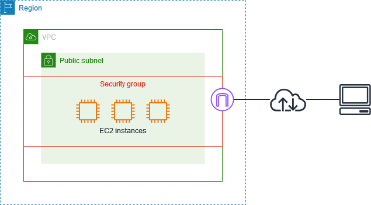
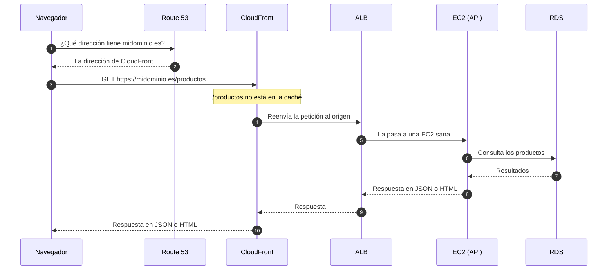

# Tema 3. Redes, VPC y entrega de contenido

Cuando despliegas el front y la API (*Application Programming Interface*, interfaz de programación de aplicaciones) de tu proyecto en AWS, no quedan expuestos a internet por el simple hecho de existir allí. Todos esos recursos viven dentro de una [VPC](#vpc) (*Virtual Private Cloud*, nube virtual privada), una red propia que tú diseñas y repartes en [subredes](#subnet), cada una situada en una sola [zona de disponibilidad](../01-fundamentos-nube-aws/tema1.md#zona-de-disponibilidad) (AZ, *Availability Zone*). Sobre esa red, las tablas de rutas y los cortafuegos deciden qué tráfico puede entrar desde fuera y por dónde sale una instancia cuando es ella la que necesita conectarse a internet, por ejemplo para instalar paquetes o llamar a un servicio externo.

Esa es la decisión de fondo de todo el tema, que corresponde al Módulo 5 de AWS Academy Cloud Foundations: qué publicas hacia internet y qué dejas protegido dentro. Al terminarlo sabrás publicar un servidor web accesible para cualquier usuario sin dejar abierto el puerto 22 de SSH (*Secure Shell*, el protocolo con el que administras en remoto un sistema Linux), que es una de las puertas de entrada más atacadas. Los términos clave del tema están recogidos en el [glosario](#glosario).

!!! tip "Al empezar"
    Empieza por el [cuestionario inicial](#cuestionario-inicial). Trae claro el mapa de [región](../01-fundamentos-nube-aws/tema1.md#region) y AZ del Tema 1. En este tema decides en qué subred colocas el balanceador, la API y la base de datos, y qué tráfico entra o sale.

## Propuesta didáctica

> **RA3.** *Diseña y configura redes virtuales y servicios de cómputo en la nube, aplicando buenas prácticas de seguridad, estrategias de balanceo de carga, escalado automático y aprovechando tecnologías serverless, contenedores y máquinas virtuales según casos de uso específicos.*

### Criterios de evaluación (RA3)

* **a)** Se ha realizado el diseño y configuración de redes virtuales privadas.
* **b)** Se ha aplicado buenas prácticas de seguridad en redes y arquitecturas.
* **c)** Se ha participado activamente en la creación y configuración de una red funcional.

Los tipos de instancia y Lambda se estudian en el Tema 4. El balanceo con más detalle y el autoescalado, en el Tema 8. Aquí dejas preparada la red en la que esos servicios se apoyan.

### Contenidos

* La VPC, el bloque **CIDR** (*Classless Inter-Domain Routing*, enrutamiento entre dominios sin clases) y las subredes, cada una en una sola AZ, con sus tablas de rutas, el Internet Gateway y el **NAT Gateway** (*Network Address Translation*, traducción de direcciones de red).
* El **security group** (**SG**, grupo de seguridad) frente a la **NACL** (*network access control list*, lista de control de acceso de red); qué hace pública o privada a una subred.
* Route 53 y CloudFront: el **DNS** (*Domain Name System*, sistema de nombres de dominio) y la **CDN** (*content delivery network*, red de entrega de contenido).
* La **VPN** (*virtual private network*, red privada virtual) frente a Direct Connect, y cuándo el escenario pide un enlace dedicado.

### Programación de aula (orientativa)

| Quincena | En tutoría | Trabajo autónomo / evidencias |
| --- | --- | --- |
| **Q4** | VPC pública/privada + SG | **PR301**; Autocheck del tema |

---

## Cuestionario inicial

!!! question "Responde con lo que sepas"
    1. ¿Qué es una **VPC** en una frase, sin elegir todavía un bloque **CIDR** (*Classless Inter-Domain Routing*, el rango de direcciones)?
    2. ¿En qué se diferencia una subred **pública** de una **privada** si miras la ruta hacia internet?
    3. En el lab de una API web, ¿usas casi siempre el **security group** o la **NACL**, y por qué?
    4. ¿Por qué es una mala práctica abrir el puerto **3306** (MySQL o MariaDB) o el **22** (SSH, administración remota) a `0.0.0.0/0`, aunque así pudieras abrir la sesión desde tu portátil?
    5. ¿CloudFront acerca el **contenido** al usuario o replica tu base de datos en el borde?

Este cuestionario es solo para ti: te ayuda a ver qué dominas ya y qué te falta antes o mientras lees el tema. No se entrega en Aules; respóndelo con lo que sepas y, cuando quieras contrastar, abre el bloque **Soluciones (autoevaluación)** debajo o el índice en [Soluciones](../90-soluciones/soluciones.md).

Soluciones (autoevaluación)

1. Una **VPC** es tu red virtual, aislada de forma lógica, dentro de **una** región de AWS. Es el espacio donde colocas el balanceador, la API y la base de datos. El bloque de direcciones se elige después: la definición no depende de un CIDR concreto.

2. La subred **pública** tiene, en su tabla de rutas, una ruta cuyo objetivo es el Internet Gateway. Con esa ruta, un recurso con IP pública puede enviar y recibir tráfico de internet, siempre que el cortafuegos lo permita. La subred **privada** no tiene esa ruta directa. Si la instancia necesita salir, la tabla envía `0.0.0.0/0` a un NAT Gateway. Ese camino vale para conexiones que inicia la propia instancia. No sirve para que alguien en internet abra una conexión nueva hacia la instancia.

3. Casi siempre el **security group**. Es un cortafuegos con estado, asociado a la interfaz de red del recurso: si permites la entrada de una conexión, la respuesta de esa misma conexión vuelve sin otra regla. La **NACL** filtra en la subred entera, no recuerda la conexión y te obliga a permitir también el tráfico de vuelta. En un lab es fácil dejar la aplicación incomunicada si editas la NACL sin un plan.

4. `0.0.0.0/0` significa cualquier dirección IPv4 de internet. El puerto 22 es la administración remota por SSH y el 3306 es el motor MySQL o MariaDB. Abrirlos así deja esos servicios expuestos a escaneos y a intentos de adivinar contraseñas. El tráfico de la aplicación debe entrar por el balanceador. Para administrar, usas un bastión, una VPN o Session Manager, y el security group de la base acepta solo el security group de la API.

5. CloudFront acerca **contenido** que se puede cachear (ficheros estáticos y respuestas cacheables). No copia tu base de datos a las ubicaciones de borde.

---

## Bloque Foundations (Módulo 5)

### VPC: tu red virtual en una región

Antes de lanzar una sola instancia tienes que decidir qué parte de tu proyecto se publica hacia internet y cómo sale la instancia cuando es ella la que necesita internet. Esa decisión se toma en la **[VPC](#vpc)**, que es una red virtual aislada de forma lógica dentro de **una** región de AWS. Conviene no imaginarla como un edificio físico con cables y armarios: es el espacio de direcciones y de rutas en el que AWS coloca las interfaces de red de tus recursos, de modo que todo lo que lanzas dentro recibe una dirección de ese espacio y sigue sus reglas de encaminamiento.

El mapa de la VPC se dibuja en tres pasos, uno detrás de otro:

1. **Eliges el rango IP de toda la VPC**, escrito como un bloque **[CIDR](#cidr)**: la dirección de inicio y, tras la barra, el prefijo que fija cuántas direcciones caben. `10.0.0.0/16` deja 16 bits libres, es decir, 65 536 direcciones (de `10.0.0.0` a `10.0.255.255`), margen de sobra para varias subredes.
2. **Lo partes en [subredes](#subnet)**, cada una un trozo más pequeño de ese rango y situada entera en una sola AZ. `10.0.1.0/24` tiene 256 direcciones dentro del `/16`; el tamaño permitido va de `/28` a `/16`, y las subredes no pueden solaparse.
3. **Asocias cada subred a una [tabla de rutas](#tabla-de-rutas)**, que elige el siguiente salto de cada destino y decide si esa subred llega a internet y por dónde.

Al dimensionar, recuerda que AWS reserva cinco direcciones en cada subred: de las 16 de un `/28` solo quedan 11 asignables, y un `/24` no ofrece 256 instancias, sino 251.

!!! note "Direcciones que AWS reserva en cada subred"
    En el CIDR de cada subred, AWS reserva cinco direcciones y no puedes asignarlas a un recurso. En `10.0.0.0/24` son las siguientes.

    * La dirección `10.0.0.0` es la dirección de red.
    * La dirección `10.0.0.1` es el router de la VPC.
    * La dirección `10.0.0.2` queda reservada por AWS.
    * La dirección `10.0.0.3` queda reservada para un uso futuro.
    * La dirección `10.0.0.255` es la dirección de *broadcast*. La VPC no hace broadcast, pero la dirección se reserva igual.

    El servidor DNS de la VPC está en la base del CIDR principal más dos. En una VPC `10.0.0.0/16`, esa dirección es `10.0.0.2`. Por eso un `/24` no ofrece 256 instancias: ofrece 251 direcciones asignables. Cuéntalas al planificar.

Además del tamaño, tienes que decidir en qué zona queda cada subred, porque cada una vive en **una** AZ y no puede cruzar dos zonas. Por eso la alta disponibilidad no se consigue con un único `/24` más grande, sino con al menos dos subredes situadas en dos AZ: la subred, tenga el prefijo que tenga, sigue entera en una sola zona. Si toda la API está en una sola subred y esa AZ falla, no queda otra copia sirviendo tráfico dentro de la región.

**Ejemplo del proyecto DAW.** El front estático está en [S3](../01-fundamentos-nube-aws/tema1.md#s3) (*Simple Storage Service*, almacenamiento de objetos). La API, en Node o PHP, corre sobre [EC2](../01-fundamentos-nube-aws/tema1.md#ec2) (*Elastic Compute Cloud*, máquinas virtuales), y la base de datos está en [RDS](../01-fundamentos-nube-aws/tema1.md#rds) (*Relational Database Service*, servicio de bases de datos relacionales). Dentro de la VPC viven el balanceador, las instancias de la API y la base. Si no dibujas antes el mapa de esa red, suele pasar una de dos cosas: o se publican puertos que no deberían verse desde internet, o la aplicación no consigue salir cuando tiene que descargar paquetes o llamar a un servicio externo.

!!! warning "Errores frecuentes"
    - Se deja la red sin diseñar y se acaban publicando puertos que no deberían verse desde internet, o la aplicación se queda sin salida para descargar paquetes.
    - Se elige un `/28`, que se queda corto en cuanto coinciden en la subred el NAT Gateway, las interfaces del balanceador y una instancia.
    - Se mete toda la API en una sola subred y se da por resuelta la alta disponibilidad ampliando el `/24`.

#### Subred pública

Una subred es pública cuando su tabla de rutas tiene una ruta directa hacia un **[Internet Gateway](#igw)** (**IGW**, puerta de enlace a internet). Se comprueba en la tabla y no en el nombre de la consola: abres la subred, miras **Route table** y buscas la fila `0.0.0.0/0` cuyo objetivo es un `igw-…`. Ese destino significa «cualquier dirección que no encaje en una ruta más específica», así que el tráfico de internet sale por esa puerta.

La ruta, sin embargo, solo abre el camino. Los recursos que deban ser alcanzables necesitan además una [IP pública](#ip-publica) o una [IP elástica](#ip-elastica), y aun así el security group y la NACL deciden qué puertos se aceptan.

<figure markdown="span">
{ width="560" }
<figcaption>Solo la subred pública tiene ruta al Internet Gateway y se comunica con internet; la privada no. Fuente: Amazon VPC User Guide (AWS).</figcaption>
</figure>

En una aplicación web, el usuario llega por **HTTPS** (*Hypertext Transfer Protocol Secure*) al balanceador, normalmente al puerto 443. El 80, el de **HTTP** en claro, solo se deja abierto si el balanceador redirige ese tráfico hacia HTTPS.

El balanceador orientado a internet exige subredes en al menos dos AZ y una VPC que ya tenga Internet Gateway; por eso el diseño usa dos subredes públicas, una en cada zona.

**Ejemplo del proyecto DAW.** Aquí colocas el **[ALB](#alb)** (*Application Load Balancer*, balanceador de carga de aplicación), de la familia **ELB** (*Elastic Load Balancing*, balanceo de carga elástico). El usuario habla con el balanceador y no llega directo al puerto en el que escucha la API (en muchos proyectos, el 3000 de Node o el 8080 de otro servidor de aplicaciones) ni al puerto del motor de base de datos.

!!! warning "Errores frecuentes"
    - Se llama pública a una subred por el nombre que tiene en la consola, aunque su tabla no apunte al IGW.
    - Se deja que el usuario llegue directamente al puerto de la API o al de la base de datos.
    - Se trata una sola subred pública como si bastara para un ALB orientado a internet.

#### Subred privada

La subred privada es el lugar de lo que no debe recibir conexiones desde internet, como la API y la base de datos. Una subred es privada cuando su tabla de rutas **no** tiene una ruta directa al Internet Gateway y, igual que antes, el nombre de la consola no basta: la prueba está en dos filas de la tabla.

La primera fila es la ruta local, que AWS crea sola y no te deja borrar. Su destino es el CIDR de la VPC, en el ejemplo `10.0.0.0/16`, y su objetivo es `local`. Gracias a ella, la API y la base se hablan por IP privada sin salir de la VPC.

La segunda fila es la ruta de internet, y lo que convierte la subred en privada es que `0.0.0.0/0` **no** apunta a un `igw-…`. Si la instancia necesita salir, esa fila apunta a un NAT Gateway (`nat-…`). Si no aparece ni el IGW ni el NAT, la subred está aislada de internet: puede hablar con el resto de la VPC y con nada más.

Esta configuración distingue dos tipos de tráfico. La conexión **no solicitada**, la que abre un equipo de internet hacia tu instancia (un escáner que prueba el puerto 22, por ejemplo), no tiene camino de entrada: AWS no anuncia a internet el rango de la subred, no hay ruta desde el Internet Gateway hasta ella y la instancia no tiene IP pública, así que una dirección como `10.0.2.25` no es alcanzable desde fuera.

La salida que inicia la instancia es el caso contrario: la EC2 de la API envía el primer paquete para aplicar parches del **SO** (sistema operativo), lanzar `npm install` o llamar a una API externa de pagos. Como el destino no está en `10.0.0.0/16`, coincide con `0.0.0.0/0` y la tabla lo entrega al NAT Gateway. El equipo de internet solo **responde** a esa conexión y no puede aprovecharla para abrir una sesión nueva hacia el 22 o el 3306.

**Ejemplo del proyecto DAW.** La API en EC2 y la base en RDS van en subredes privadas, repetidas en dos AZ si el servicio tiene que sobrevivir al fallo de una zona. El ALB, en las subredes públicas, es quien recibe a los usuarios. Cómo se encadenan los security groups de ese camino se detalla en [seguridad por capas](#seguridad-por-capas).

!!! warning "Errores frecuentes"
    - Se confía en el nombre de la subred aunque su tabla apunte `0.0.0.0/0` al IGW; en ese caso deja de ser privada, por muy restrictivo que siga el security group.
    - Se confunde la salida que inicia la instancia con una entrada desde internet.
    - Se da por resuelta la seguridad porque la API está en una subred llamada «privada».

#### Tabla de rutas, Internet Gateway y NAT Gateway

Las dos subredes anteriores solo se distinguen por su [tabla de rutas](#tabla-de-rutas), la lista de reglas que decide el siguiente salto de cada destino: la propia VPC, el IGW o el NAT Gateway. Cada subred está asociada a una tabla y, si no eliges otra, usa la tabla principal de la VPC.

Cada ruta tiene un destino, escrito en CIDR, y un objetivo, que puede ser `local`, un Internet Gateway, un NAT Gateway u otra puerta que ya hayas creado. Cuando un paquete encaja en varias rutas, gana la más específica. Así, un destino dentro de `10.0.0.0/16` usa `local` y no la ruta `0.0.0.0/0`: el tráfico entre IP de la VPC usa la ruta local, y el tráfico hacia internet usa `0.0.0.0/0`.

En el proyecto, con una VPC `10.0.0.0/16`, la subred pública queda así.

| Destino | Objetivo | Qué hace con el paquete |
| --- | --- | --- |
| `10.0.0.0/16` | `local` | Lo entrega a otra IP privada de la VPC. El ALB llega así a la API. |
| `0.0.0.0/0` | `igw-…` | El resto sale o entra por el Internet Gateway. |

La subred privada, cuando la API necesita salir a internet, queda así.

| Destino | Objetivo | Qué hace con el paquete |
| --- | --- | --- |
| `10.0.0.0/16` | `local` | Mantiene dentro de la VPC el tráfico entre ALB, API y RDS. |
| `0.0.0.0/0` | `nat-…` | Envía el resto al NAT Gateway. No hay ningún objetivo `igw-…`. |

Estas tablas se comprueban siempre en **Subnet → Route table**, dentro de la subred concreta, y no en el dibujo del asistente, porque lo que cuenta es la tabla que la subred tiene asociada de verdad.

El [IGW](#igw) es la puerta de la VPC hacia internet para los recursos que tienen ruta hasta él e IP pública. Es redundante y de alta disponibilidad dentro de la región, y cada VPC puede tener uno solo. Para usarlo lo adjuntas a la VPC y apuntas a él la ruta por defecto de las subredes públicas; por ahí entra el usuario hasta el ALB, que de hecho solo se puede crear en una VPC que ya tenga esta puerta.

La API, que está en la subred privada, también necesita salir a internet de vez en cuando, y para eso existe el **[NAT Gateway](#nat-gateway)**: permite que las instancias de una subred privada inicien conexiones salientes. No publica la API, no es un balanceador y no admite security group, así que el filtrado sigue en los security groups del ALB, de la EC2 y de RDS.

El NAT para salir a internet es un NAT público y se crea en una subred pública, porque él mismo necesita llegar al Internet Gateway; además se le asocia una IP elástica para que internet vea un origen estable. Si lo pusieras en la subred privada, su propio tráfico no tendría salida.

La traducción sigue un orden fijo: la EC2 abre la conexión, el NAT la reenvía con su IP elástica como origen y recuerda la conexión, y cuando llega la respuesta se la devuelve a la IP privada de la instancia. Quien está fuera responde, pero no inicia.

Cada NAT Gateway vive en **una** AZ y no cubre el fallo de esa zona entera: si instancias de otra AZ comparten ese NAT y su zona cae, pierden la salida a internet. Por eso se crea un NAT en la subred pública de cada AZ y la tabla privada de cada zona apunta a su propio NAT.

El NAT se factura por cada hora que existe (una hora empezada cuenta entera) y por cada GB que procesa, además de la transferencia de datos habitual. El precio depende de la región y está en la página de precios de Amazon VPC; por eso, al terminar el lab, se borra junto con el resto de recursos.

Parte de ese gasto se puede evitar: si el grueso del tráfico va a S3 en la misma región, un [VPC endpoint](#vpc-endpoint) de tipo *gateway* evita pasar esos bytes por el NAT y no tiene coste por hora ni por GB. Si el lab no crea ningún NAT, anótalo en el entregable, porque significa que la instancia privada no tiene salida o que el servidor está en una subred pública para simplificar.

**Ejemplo del proyecto DAW.** La base de datos no lleva IP pública ni ruta al IGW: solo recibe el tráfico que la API le envía por la ruta local. En cambio, las salidas que inicia la EC2 de la API (parches del SO, `npm install` y llamadas a una API externa) pasan por el NAT.

!!! warning "Errores frecuentes"
    - Se llama privada a una subred que todavía tiene `0.0.0.0/0` hacia el IGW.
    - Se crea el Internet Gateway, pero se olvida asociar la tabla a la subred correcta: el recurso existe y la subred sigue usando otra tabla.
    - Se da IP pública a la base de datos para administrarla desde el portátil.
    - Se usa el NAT como si publicara la API, igual que un balanceador.
    - Se deja un solo NAT compartido por todas las AZ.

#### Caso DAW: ALB en pública, API y RDS en privada

**Ejemplo del proyecto DAW.** Todas las piezas anteriores encajan en un diseño sólido, aunque el lab del módulo lo simplifique, que reparte la VPC en dos pares de subredes. Hay dos subredes públicas, una en cada AZ, y en ellas viven el ALB orientado a internet y, si hace falta salida, un NAT Gateway por zona. En esas mismas AZ hay dos subredes privadas, donde viven las EC2 de la API (Node o PHP) y RDS con MySQL, MariaDB o PostgreSQL.

La clave del patrón es que cada pieza solo acepta tráfico de la anterior. El usuario solo habla con el ALB, la API solo acepta tráfico que viene del balanceador y RDS solo acepta tráfico que viene de la API. Así, la base y el proceso de la aplicación no quedan publicados por el hecho de existir dentro de la VPC.

El esquema siguiente recoge ese camino, reducido a una AZ.

<figure markdown="span">
{ width="800" }
<figcaption>Cada pieza solo acepta tráfico de la anterior; la salida que inicia la API pasa por el NAT.</figcaption>
</figure>

El esquema muestra una sola AZ para que el camino se lea con claridad. En el proyecto repites el par de subredes en una segunda AZ, con su propio NAT y su propia ruta `0.0.0.0/0` en la tabla privada de esa zona. Si el lab usa una sola AZ o un único servidor HTTP público, sirve para aprender rutas y security groups, pero no sustituye a este patrón.

<figure markdown="span">
{ width="800" }
<figcaption>VPC con subredes privadas (patrón de la guía). Fuente: Amazon VPC User Guide (AWS).</figcaption>
</figure>

#### Seguridad por capas: del ALB a RDS

La subred privada evita un camino de entrada desde internet, pero no decide quién puede hablar con cada pieza dentro de la VPC. Eso lo deciden los security groups: cada regla de entrada nombra el puerto y el origen, de modo que abrir un puerto no lo abre para cualquier dirección. En el proyecto, el usuario entra por el balanceador, la API solo acepta a ese balanceador y la base solo acepta a la API.

El security group del ALB acepta el tráfico de los usuarios: TCP en el puerto 443 desde `0.0.0.0/0`, y el 80 solo si redirige a HTTPS. Es el único grupo que necesita un origen tan amplio, y solo en los puertos de la web.

El de la API permite el puerto de la aplicación, y su origen no es una IP sino el security group del ALB. Cuando el origen es otro grupo, la regla afecta a las interfaces que lo llevan y se aplica sobre sus IP privadas, que son las que usa el ALB para enviar las peticiones; así la EC2 no necesita IP pública y, si el balanceador cambia un nodo y su IP, la regla sigue valiendo. Esa misma regla cubre el *health check*, la comprobación con la que el ALB decide si el destino está sano.

El security group de RDS cierra la cadena: permite el puerto del motor (3306 en MySQL y MariaDB, 5432 en PostgreSQL) solo desde el grupo de la API. Si sustituyes la EC2, la base acepta a la nueva instancia porque lleva el mismo grupo.

Con todo cerrado así, la EC2 o la base se administran por uno de estos tres caminos, ninguno de los cuales publica el 22 ni el 3306 a internet.

- El **servidor bastión** es una EC2 pequeña en la subred pública que sirve de salto: abres SSH (22) o **RDP** (*Remote Desktop Protocol*, 3389 en Windows) contra él y desde ahí saltas a la IP privada de la API. Su security group admite el 22 solo desde tu IP, el de la API solo desde el grupo del bastión, y hay que parchearlo como cualquier EC2. Conviene para accesos puntuales.
- La **VPN de cliente** abre un túnel cifrado desde el portátil hasta la VPC para llegar a las IP privadas. Cuesta más montarla que un bastión y conviene cuando varias personas administran durante semanas. La VPN de sitio a sitio, que une redes enteras, se ve en el [enlace híbrido](#enlace-hibrido); el lab no pide ninguna de las dos.
- **Session Manager**, de AWS Systems Manager, abre un shell en la EC2 desde la consola o la AWS CLI sin puerto de entrada, sin bastión y sin claves SSH. La instancia necesita el agente de Systems Manager, salida HTTPS (443) por el NAT o por un VPC endpoint y un [rol](../02-seguridad-iam/tema2.md#rol) de IAM que lo autorice, como se vio en el [Tema 2](../02-seguridad-iam/tema2.md).

Ten en cuenta que en el Learner Lab de AWS Academy los permisos del rol que ya trae el entorno, y el catálogo de servicios, pueden no coincidir con los de una cuenta propia. Por eso no des por hecho que Session Manager, una VPN de cliente o un bastión adicional estén disponibles.

!!! warning "Errores frecuentes"
    - Se abren el puerto 22 y el 3306 a `0.0.0.0/0`.
    - Se suple la falta de bastión, VPN o Session Manager publicando la administración a internet.
    - Se pega la IP de un nodo del ALB en el security group de la API en lugar del identificador del grupo.

### Security groups frente a NACL

En el [Tema 2](../02-seguridad-iam/tema2.md#security-group) el security group apareció como la capa de red, distinta de IAM: IAM decide quién puede llamar a la API de AWS, y el security group decide qué tráfico de red llega a la interfaz. Aquí se configura esa capa.

El **[security group](#security-group)** es un cortafuegos **con estado** asociado a la interfaz de red (**ENI**, *elastic network interface*) de la instancia, del ALB o de RDS. Solo tiene reglas de permiso: un grupo recién creado no deja entrar nada hasta que añades una regla y, en cambio, permite toda la salida (si quitas esa regla, tendrás que permitir la salida que necesites, por ejemplo hacia el NAT). Como recuerda la conexión, la respuesta a una entrada permitida vuelve sola, sin abrir puertos de vuelta. Y su origen puede ser otro security group, que es lo que encadena el ALB, la API y RDS.

La **[NACL](#nacl)** es un cortafuegos **sin estado** asociado a la **subred** entera. Sus reglas están numeradas, se evalúan de menor a mayor hasta la primera que coincide y pueden permitir o denegar. Como no recuerda la conexión, permitir el 443 de entrada no basta: también hay que permitir la vuelta por los puertos efímeros (1024-65535), y si falta, el ALB devuelve un HTTP 504. La NACL por defecto lo permite todo y una creada por ti empieza cerrada; si el enunciado no pide tocarla, deja la de por defecto y trabaja con security groups.

**Ejemplo del proyecto DAW.** En el lab del servidor web abres el 80 o el 443 a internet si el servidor es el punto público del ejercicio, o al grupo del ALB si ya lo hay, y la administración (22 en Linux, 3389 en Windows) solo a tu IP o al grupo del bastión.

| | Security group | NACL |
| --- | --- | --- |
| Dónde actúa | En la interfaz de red de la instancia, del ALB o de RDS. | En la subred entera. |
| Estado | Con estado: la respuesta de una conexión permitida vuelve sola. | Sin estado: la ida y la vuelta van en reglas distintas. |
| Reglas | Solo permisos. Lo que no escribes, no entra. | Permisos y denegaciones, evaluados por número de regla. |
| Uso habitual en el módulo | El control de 80, 443, SSH y el puerto del motor. | Solo cuando el enunciado pide tocarla. |
| Error típico | Dejar `0.0.0.0/0` en el puerto de administración. | Olvidar el puerto de vuelta. |

<figure markdown="span">
{ width="800" }
<figcaption>Security group en la interfaz de red: se permite lo que dice la regla y el resto queda denegado. Fuente: Amazon EC2 User Guide (AWS).</figcaption>
</figure>

En el módulo casi todo el filtrado se hace con security groups, y no hace falta añadir reglas de NACL que el enunciado no pide. Una sola EC2 pública con Node en el 3000 y MySQL en el mismo host responde en el aula, pero queda expuesta en cuanto alguien recorre rangos de direcciones; el patrón de este tema aplica a puertos y orígenes el mínimo privilegio del Tema 2.

!!! warning "Errores frecuentes"
    Dejar `0.0.0.0/0` en el puerto 22, aunque sea el tiempo de una tutoría. Editar la NACL, permitir solo el 443 de entrada y olvidar la regla de vuelta, de modo que la web deja de cargar con un timeout. Añadir reglas simétricas en la NACL para rellenar el entregable cuando el enunciado no las pide.

### DNS y entrega de contenido

Cuando alguien escribe `midominio.es`, hay que traducir ese nombre a un destino. **[Route 53](#route-53)** es el DNS de AWS: aloja la zona autoritativa del dominio, puede comprobar la salud de un destino y aplica políticas sencillas de enrutamiento. No sustituye al ALB ni a CloudFront, sino que resuelve el nombre **hacia** ellos con un registro de alias o un CNAME (*canonical name*). Nunca se apunta a la IP pública de una EC2, porque cambia al parar y relanzar la instancia; en el lab basta con el nombre DNS del propio ALB.

**[CloudFront](#cloudfront)** es la CDN de AWS: guarda copias del contenido que se puede cachear (**HTML**, JavaScript, **CSS** e imágenes) en **[ubicaciones de borde](#edge-location)** cercanas al usuario. Su origen suele ser un bucket S3 con el front o un ALB, y el TTL (*time to live*) de la política de caché marca cuánto dura cada copia. No replica la base de datos: el checkout o cualquier respuesta que depende de la sesión sigue yendo al origen.

*Global Accelerator*, que publica IP anycast (la misma IP anunciada desde varios puntos para entrar por el más cercano), solo aparece como nombre de examen. El recorrido de una petición concreta está en [Flujo de una petición HTTP](#flujo-de-una-peticion-http).

**Ejemplo del proyecto DAW.** Route 53 hace que `api.midominio.es` llegue al ALB, o que `midominio.es` llegue a CloudFront delante del front. La hoja de estilo se sirve desde el borde; la consulta de pedidos sigue yendo al origen. CloudFront no sustituye a la API ni traslada RDS al borde.

!!! warning "Errores frecuentes"
    Apuntar el dominio a la IP pública de la EC2 del lab, que cambia al relanzar la instancia. Pensar que CloudFront replica la base de datos en el borde.

### Flujo de una petición HTTP

**Ejemplo del proyecto DAW.** Un usuario abre `https://midominio.es/productos`. El front está en S3 detrás de CloudFront, la API en EC2 detrás de un ALB y los datos en RDS. Estos son los pasos cuando `/productos` no está en la caché y la aplicación tiene que leer la base de datos.

1. **Resolución DNS (Route 53).** El navegador pregunta qué destino tiene `midominio.es`, y Route 53 responde con la distribución de CloudFront o, si no hay CDN, con el ALB. Route 53 no recibe `/productos` ni consulta datos: solo traduce el nombre.

2. **CloudFront (CDN).** La petición llega a una ubicación de borde. Si hay copia en caché vigente, se entrega desde ahí; si no, CloudFront la pide al origen: los estáticos a S3 y `/productos`, que depende de la base de datos, al ALB.

3. **Balanceador de aplicaciones (ALB).** El ALB, en las subredes públicas, no ejecuta código: elige una EC2 sana de su grupo de destinos, según las comprobaciones de estado (*health checks*), y le reenvía la petición a su IP privada.

4. **Servidor de aplicaciones (EC2).** La EC2, en la subred privada, ejecuta la lógica de la ruta en Node.js, PHP u otro lenguaje. El navegador nunca se conecta a ella directamente.

5. **Base de datos (RDS).** La aplicación consulta RDS y obtiene los datos. RDS no atiende al navegador ni es origen de CloudFront.

6. **Respuesta HTTP.** La EC2 compone la respuesta en **JSON** (*JavaScript Object Notation*) o HTML y la devuelve por el ALB y CloudFront hasta el navegador, sin volver a consultar a Route 53.

En el diagrama, las flechas continuas son peticiones y las discontinuas, respuestas. S3 no aparece porque solo sirve los estáticos y queda fuera de la cadena de `/productos`.

Que la EC2 esté en marcha no demuestra que la petición pueda completarse. Si su security group no admite el tráfico del ALB, fallan las comprobaciones de estado, el destino queda *unhealthy* y el balanceador lo saca del reparto. El navegador verá un **502 Bad Gateway** si el destino rechaza la conexión o responde mal, o un **504 Gateway Timeout** si no responde a tiempo.

!!! warning "Errores frecuentes"
    Dar por resuelta la petición porque la instancia está en marcha. Abrir RDS a `0.0.0.0/0`. Tomar el lab de una EC2 pública con el puerto 80 como el patrón del proyecto.

### Enlace híbrido: VPN y Direct Connect { #enlace-hibrido }

Si el backend del cliente sigue en su CPD (centro de proceso de datos) y la API nueva está en AWS, hace falta un enlace entre los dos sitios. Una **[VPN](#vpn)** de sitio a sitio crea un túnel cifrado con IPsec (*Internet Protocol Security*) que viaja por internet, de modo que una aplicación del CPD puede llamar a una IP privada de la VPC sin publicarla. Encaja en pruebas y caudales moderados; en Foundations no se configura, solo se reconoce en el examen. La VPN de cliente de la [seguridad por capas](#seguridad-por-capas) conecta a una persona; esta une redes.

**[Direct Connect](#direct-connect)** es una conexión física dedicada entre tu CPD y AWS que no pasa por internet público. La VPN aporta cifrado sobre la red pública; Direct Connect, un camino dedicado con caudal estable, útil para sincronizaciones grandes o cuando el contrato lo exige. Un [VPC endpoint](#vpc-endpoint) no sustituye a ninguno de los dos: da acceso a un servicio de AWS como S3 sin salir a internet, pero no une la VPC con el CPD.

**Ejemplo del proyecto DAW.** Casi nunca montarás Direct Connect. Sí tienes que nombrarlo cuando el enunciado del CLF-C02 lo describa: mucho tráfico estable hacia el CPD apunta a Direct Connect; una prueba rápida y cifrada apunta a la VPN.

!!! warning "Errores frecuentes"
    Confundir la VPN (cifrado por internet) con Direct Connect (circuito dedicado). Tratar un VPC endpoint hacia S3 como si uniera la VPC con el CPD del cliente.

### Relación con cómputo y balanceo

La VPC fija el mapa de red de los demás temas. Cuando en el Tema 4 lances una instancia, tendrás que decidir en qué subred cae y con qué security group; cuando en el Tema 8 montes un ALB, en qué subredes públicas viven sus nodos y hacia qué destinos privados reenvía.

### El lab del Módulo 5: creación de una VPC y lanzamiento de un servidor web

En *Cloud Foundations* el ejercicio se llama **Ejercicio de laboratorio 2 — Creación de una VPC y lanzamiento de un servidor web**, y se hace en la región y el orden que marque el enunciado del LMS (*learning management system*).

Primero creas la VPC con el asistente **VPC and more**: el CIDR y, en una AZ, una subred pública, otra privada y un NAT Gateway en la pública.

Después amplías a dos AZ con otra subred pública y otra privada, y asocias cada una a su tabla: las públicas con `0.0.0.0/0` hacia el IGW y las privadas hacia el NAT. En el entregable anotas el CIDR, la AZ y la tabla de cada subred.

Luego creas un security group que permite HTTP (80) desde el origen que indique el lab, normalmente internet, y dejas la administración (22 o 3389) restringida a tu IP.

Por último lanzas el servidor web en una subred pública, le asocias el security group y compruebas que responde por HTTP. Con eso el lab cierra lo que pide.

El lab **practica** la VPC completa (CIDR, dos AZ, IGW, NAT, tablas de rutas y security group), pero **simplifica** el resto: no hay ALB ni separación entre API y base de datos, y el servidor queda en la subred pública en el puerto 80. En PR301 deja escrito qué parte del patrón has configurado y cuál ha quedado fuera.

---

## Bloque Ampliación Practitioner (CLF-C02)

El examen **CLF-C02** (*AWS Certified Cloud Practitioner*, Cloud Practitioner) insiste en **dónde** publicas —el ALB o CloudFront, frente a una base que se queda en subred privada—, en qué hace una CDN y en la diferencia de estado entre el security group y la NACL. La VPN y Direct Connect solo hay que reconocerlos. Si el escenario describe un enlace dedicado hacia el CPD, la respuesta es Direct Connect. Si describe un túnel cifrado que une dos redes a través de internet, la respuesta es la VPN.

!!! tip "Para el CLF"
    Publica el tráfico de los usuarios en el borde o en el balanceador, y deja la base en una subred privada. CloudFront acerca contenido que se puede cachear: no traslada RDS al borde. El security group tiene estado; la NACL, no. La ampliación y el **autocheck de certificación** están en [Certificación § Tema 3](../99-certificacion/certificacion.md#tema-3).

**Videotutorial (CDN / DNS).** [CloudFront - S3 - Route 53 (Static Web)](https://www.youtube.com/watch?v=DgQroj70CJ0) (~19 min). Vídeo: Profe Santos Cloud (YouTube).

---

## Videotutorial

**Principal (Foundations).** [VPC](https://www.youtube.com/watch?v=u0Kh0JRK4zk) (~16 min).

<iframe src="https://www.youtube.com/embed/u0Kh0JRK4zk" title="VPC — Profe Santos Cloud" style="width:100%;max-width:840px;aspect-ratio:16/9;border:0;display:block;margin:0.8em auto" allow="accelerometer;clipboard-write;encrypted-media;gyroscope;picture-in-picture" allowfullscreen loading="lazy"></iframe>

Vídeo: Profe Santos Cloud (YouTube). Conviene seguir el CIDR, las subredes y la salida a internet, y anotar qué recurso queda en la subred pública y cuál en la privada.

**Extra (opcional).** [VPC EC2 RDS](https://www.youtube.com/watch?v=I0nL0NX4qZc) (~40 min). Es una demostración de red con cómputo y base de datos, útil antes del lab del Módulo 5. Vídeo: Profe Santos Cloud (YouTube).

En la clase de *Cloud Foundations* de Academy, abre el **Módulo 5** (redes y VPC) y sigue el lab que indique el LMS. Usa la región que ese lab permita.

---

## Actividad / práctica

### PR301 — VPC y servidor web

* :simple-neutralinojs: **PR301**. (RA3 // a, b, c // **PR 0–10**). Montas (o completas) el lab Academy del **Módulo 5** de VPC y servidor web: subredes, rutas y security group coherentes con una API publicada sin abrir administración al mundo.

  **Tareas:** anota el CIDR de la VPC y el de cada subred con su AZ; verifica la ruta al IGW solo en la subred pública; captura el security group (puertos 80/443 y administración restringida si el lab lo permite); termina los recursos en el orden que indique el lab (suele ser instancia → volúmenes o ENI → IGW → subredes → VPC).

  **Entrega:** según [Cómo entregar las prácticas](../index.md#entrega) — fichero `PR301.md` (o ZIP + `img/` si hay capturas).

  Guía de apoyo: [Soluciones · PR301](../90-soluciones/pr/PR301.md).

| Criterio | Descripción | Puntos |
| --- | --- | --- |
| VPC / subredes | CIDR y AZ documentados | 0–3 |
| Rutas e IGW | Pública frente a privada coherente | 0–2 |
| Security group | Puertos justificados; sin `0.0.0.0/0` innecesario | 0–3 |
| Limpieza | Recursos de lab terminados | 0–2 |
| **Total** | | **/10** |

---

## Autocheck del tema

Comprueba VPC y entrega de este tema. CLF: [Certificación § Tema 3](../99-certificacion/certificacion.md#tema-3).

1. **V/F.** Una subred puede cruzar dos AZ «para tener alta disponibilidad gratis».
2. El **security group**…  
   a) no tiene estado · b) recuerda conexiones establecidas · c) sustituye al IGW
3. ¿Para qué sirve un **NAT Gateway** si ya hay IGW?
4. Empareja: **IGW** · **NACL** · **CloudFront** con: (a) puerta a internet de la VPC · (b) filtro a nivel de subred (sin estado) · (c) CDN en el borde
5. **V/F.** CloudFront «mueve» RDS a la ubicación de borde más cercana al alumno.

Soluciones

1. **Falso** — una subred = una AZ.

2. **b**.

3. Salida a internet desde subredes **privadas** sin aceptar entradas no solicitadas (parches del SO, `npm`…).

4. El **IGW** es (a) la puerta a internet de la VPC; la **NACL**, (b) el filtro a nivel de subred sin estado; **CloudFront**, (c) la CDN en el borde.

5. **Falso** — cachea contenido; no traslada la base de datos.

---

## Glosario

**VPC**{: #vpc}
*Virtual Private Cloud* (nube virtual privada): red virtual aislada de forma lógica en una región de AWS. Dentro defines el CIDR, las subredes, las tablas de rutas y las puertas hacia internet. Es el espacio donde, en el proyecto de DAW, colocas el ALB, la API en EC2 y la base en RDS.

**subnet**{: #subnet}
Subred: un trozo del CIDR de la VPC asociado a una sola zona de disponibilidad. No cruza dos AZ. Por eso la alta disponibilidad pide al menos dos subredes. Si su tabla de rutas apunta a un Internet Gateway, es pública; si no tiene esa ruta, es privada.

**CIDR**{: #cidr}
*Classless Inter-Domain Routing* (enrutamiento entre dominios sin clases): notación que expresa un rango de direcciones IP. `10.0.0.0/16` es un bloque de VPC con 65 536 direcciones. `10.0.1.0/24` es una subred de 256 direcciones, de las cuales AWS reserva cinco.

**IGW**{: #igw}
*Internet Gateway* (puerta de enlace a internet): componente que une la VPC con internet. Solo da servicio a los recursos que tienen una ruta hacia él y una IP pública. Sin esa ruta, la subred no es pública aunque el diagrama la llame así.

**NAT Gateway**{: #nat-gateway}
*Network Address Translation Gateway*: recurso que permite a una subred privada iniciar conexiones salientes a internet, por ejemplo para parches del SO, `npm install` o una API externa. Se coloca en una subred pública, ocupa una AZ y la tabla privada le envía `0.0.0.0/0`. No publica la API y no acepta conexiones que internet intente abrir hacia la instancia.

**security group**{: #security-group}
Cortafuegos con estado en la interfaz de red. Escribes permisos de entrada y de salida; lo que no permites en entrada queda denegado. Si una conexión está permitida, su respuesta vuelve sin otra regla. El origen de una regla puede ser un CIDR o el identificador de otro security group, que es como se encadenan el ALB, la API y RDS.

**NACL**{: #nacl}
*Network ACL* (*network access control list*, lista de control de acceso de red): cortafuegos sin estado en la subred. Las reglas se evalúan por número y pueden permitir o denegar. Hay que escribir la ida y la vuelta, incluidos los puertos efímeros. La NACL por defecto de la VPC lo permite todo; una que crees tú empieza cerrada.

**CloudFront**{: #cloudfront}
CDN de AWS. Cachea en ubicaciones de borde el contenido que se puede repetir, con origen habitual en S3 o en un balanceador. Acerca el front estático del proyecto. No copia la base de datos transaccional al borde.

**tabla de rutas**{: #tabla-de-rutas}
Lista de destinos y de siguientes saltos asociada a una subred. La ruta `local` cubre el CIDR de la VPC. La ruta `0.0.0.0/0` dice si el tráfico de internet va al Internet Gateway (subred pública) o al NAT Gateway (subred privada con salida). Es la comprobación que decide de qué tipo es la subred.

**IP pública**{: #ip-publica}
Dirección alcanzable desde internet, tomada del conjunto de direcciones de AWS y asociada a un recurso cuya subred tiene ruta al Internet Gateway. No es la IP privada del CIDR de la VPC. Si detienes la instancia, AWS puede devolver esa dirección al conjunto y darte otra al arrancarla. Para una dirección pública fija se usa una IP elástica.

**IP elástica**{: #ip-elastica}
*Elastic IP*: dirección pública fija que queda asignada a tu cuenta y que puedes asociar o mover entre recursos, dentro de las cuotas. Un NAT Gateway público la usa como origen estable hacia internet. En el proyecto, el ALB evita tener que pegar una IP elástica a cada EC2 de la API.

**VPC endpoint**{: #vpc-endpoint}
Punto de enlace que permite usar un servicio de AWS, por ejemplo S3, desde la VPC sin salir por internet público. Un endpoint de tipo *gateway* hacia S3 no sustituye a Direct Connect hacia el CPD del cliente, y evita pasar ese tráfico por el NAT Gateway. En políticas de IAM puede aparecer como condición de origen (`aws:SourceVpce`); el detalle de las políticas está en el Tema 2.

**Route 53**{: #route-53}
Servicio DNS de AWS. Traduce el nombre del dominio a un destino: el ALB, CloudFront u otro registro. No reparte la carga ni cachea el contenido; señala hacia quien sí lo hace.

**edge location**{: #edge-location}
Ubicación de borde de la red de AWS, donde CloudFront cachea o termina tráfico cerca del usuario. No es una AZ de la VPC y no es un sitio donde colocar RDS.

**VPN**{: #vpn}
*Virtual private network* (red privada virtual): enlace cifrado. En sitio a sitio une la red del cliente con la VPC a través de internet, con IPsec. En la variante de cliente, une el portátil de quien administra con la VPC para llegar a IP privadas sin publicar el 22 ni el 3306.

**Direct Connect**{: #direct-connect}
Conexión de red dedicada entre una ubicación tuya y AWS, por un circuito que no es internet público. En el examen se reconoce cuando el escenario pide caudal estable hacia el CPD. No se configura en el lab típico de Foundations, y no es lo mismo que el cifrado de una VPN.

**ALB**{: #alb}
*Application Load Balancer*: balanceador de la familia ELB que trabaja en HTTP y HTTPS. Reparte las peticiones entre destinos de la VPC, por ejemplo las EC2 de la API, usando sus IP privadas. El orientado a internet se coloca en subredes públicas de al menos dos AZ.
