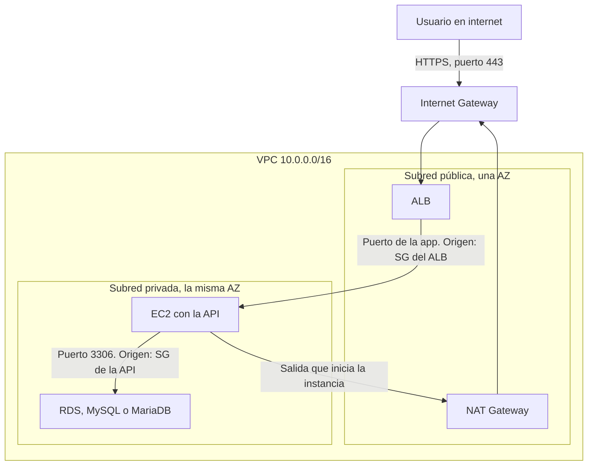
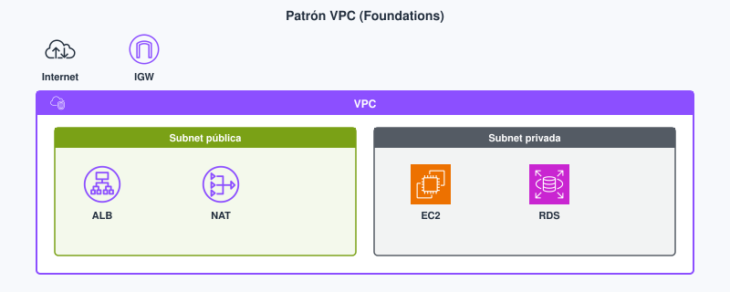
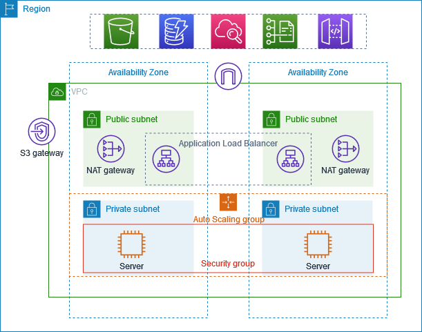
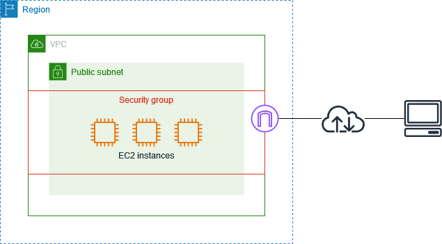

# Tema 3. Redes, VPC y entrega de contenido

Tu front y tu API (interfaz de programación de aplicaciones) no aparecen en internet por el mero hecho de existir en AWS. Viven dentro de una **[VPC](#vpc)** (*Virtual Private Cloud*, nube virtual privada), repartidos en **[subredes](#subnet)**. Cada subred pertenece a una sola [zona de disponibilidad](../01-fundamentos-nube-aws/tema1.md#zona-de-disponibilidad) (**AZ**, *Availability Zone*). Las tablas de rutas y los cortafuegos deciden qué tráfico puede entrar y qué tráfico puede salir. Este tema corresponde al **Módulo 5** de *AWS Academy Cloud Foundations*. Con él publicas un servidor web sin dejar abierto a internet el puerto 22, que es **SSH** (*Secure Shell*, el protocolo con el que administras en remoto un sistema Linux). No sustituye a un módulo de redes locales: aquí el rango de direcciones cabe en un esquema pequeño, y la decisión de fondo es qué publicas hacia internet y cómo sale la instancia cuando es ella quien necesita internet. Los términos clave están en el [glosario](#glosario).

!!! tip "Al empezar"
    Empieza por el [cuestionario inicial](#cuestionario-inicial). Trae claro el mapa de [región](../01-fundamentos-nube-aws/tema1.md#region) y AZ del Tema 1. En este tema decides en qué subred colocas el balanceador, la API y la base de datos, y qué tráfico entra o sale.

## Propuesta didáctica

> **RA3.** *Diseña y configura redes virtuales y servicios de cómputo en la nube, aplicando buenas prácticas de seguridad, estrategias de balanceo de carga, escalado automático y aprovechando tecnologías serverless, contenedores y máquinas virtuales según casos de uso específicos.*

### Criterios de evaluación (RA3)

* **a)** Se ha realizado el diseño y configuración de redes virtuales privadas.
* **b)** Se ha aplicado buenas prácticas de seguridad en redes y arquitecturas.
* **c)** Se ha participado activamente en la creación y configuración de una red funcional.

Los tipos de instancia y Lambda se estudian en el Tema 4. El balanceo con más detalle y el autoescalado, en el Tema 8. Aquí dejas preparada la red en la que esos servicios se apoyan.

### Contenidos

* La VPC, el bloque **CIDR** (*Classless Inter-Domain Routing*, enrutamiento entre dominios sin clases) y las subredes, cada una en una sola AZ, con sus tablas de rutas, el Internet Gateway y el **NAT Gateway** (*Network Address Translation*, traducción de direcciones de red).
* El **security group** (**SG**, grupo de seguridad) frente a la **NACL** (*network access control list*, lista de control de acceso de red); qué hace pública o privada a una subred.
* Route 53 y CloudFront: el **DNS** (*Domain Name System*, sistema de nombres de dominio) y la **CDN** (*content delivery network*, red de entrega de contenido).
* La **VPN** (*virtual private network*, red privada virtual) frente a Direct Connect, y cuándo el escenario pide un enlace dedicado.

### Programación de aula (orientativa)

| Quincena | En tutoría | Trabajo autónomo / evidencias |
| --- | --- | --- |
| **Q4** | VPC pública/privada + SG | **PR301**; Autocheck del tema |

---

## Cuestionario inicial

!!! question "Responde con lo que sepas"
    1. ¿Qué es una **VPC** en una frase, sin elegir todavía un bloque **CIDR** (*Classless Inter-Domain Routing*, el rango de direcciones)?
    2. ¿En qué se diferencia una subred **pública** de una **privada** si miras la ruta hacia internet?
    3. En el lab de una API web, ¿usas casi siempre el **security group** o la **NACL**, y por qué?
    4. ¿Por qué es una mala práctica abrir el puerto **3306** (MySQL o MariaDB) o el **22** (SSH, administración remota) a `0.0.0.0/0`, aunque así pudieras abrir la sesión desde tu portátil?
    5. ¿CloudFront acerca el **contenido** al usuario o replica tu base de datos en el borde?

Este cuestionario es solo para ti: te ayuda a ver qué dominas ya y qué te falta antes o mientras lees el tema. No se entrega en Aules; respóndelo con lo que sepas y, cuando quieras contrastar, abre el bloque **Soluciones (autoevaluación)** debajo o el índice en [Soluciones](../90-soluciones/soluciones.md).

Soluciones (autoevaluación)

1. Una **VPC** es tu red virtual, aislada de forma lógica, dentro de **una** región de AWS. Es el espacio donde colocas el balanceador, la API y la base de datos. El bloque de direcciones se elige después: la definición no depende de un CIDR concreto.

2. La subred **pública** tiene, en su tabla de rutas, una ruta cuyo objetivo es el Internet Gateway. Con esa ruta, un recurso con IP pública puede enviar y recibir tráfico de internet, siempre que el cortafuegos lo permita. La subred **privada** no tiene esa ruta directa. Si la instancia necesita salir, la tabla envía `0.0.0.0/0` a un NAT Gateway. Ese camino vale para conexiones que inicia la propia instancia. No sirve para que alguien en internet abra una conexión nueva hacia la instancia.

3. Casi siempre el **security group**. Es un cortafuegos con estado, asociado a la interfaz de red del recurso: si permites la entrada de una conexión, la respuesta de esa misma conexión vuelve sin otra regla. La **NACL** filtra en la subred entera, no recuerda la conexión y te obliga a permitir también el tráfico de vuelta. En un lab es fácil dejar la aplicación incomunicada si editas la NACL sin un plan.

4. `0.0.0.0/0` significa cualquier dirección IPv4 de internet. El puerto 22 es la administración remota por SSH y el 3306 es el motor MySQL o MariaDB. Abrirlos así deja esos servicios expuestos a escaneos y a intentos de adivinar contraseñas. El tráfico de la aplicación debe entrar por el balanceador. Para administrar, usas un bastión, una VPN o Session Manager, y el security group de la base acepta solo el security group de la API.

5. CloudFront acerca **contenido** que se puede cachear (ficheros estáticos y respuestas cacheables). No copia tu base de datos a las ubicaciones de borde.

---

## Bloque Foundations (Módulo 5)

### VPC: tu red virtual en una región

Una **[VPC](#vpc)** es una red virtual aislada de forma lógica dentro de **una** región de AWS. Tú defines el rango de direcciones **IP** (*Internet Protocol*, protocolo de internet), lo partes en [subredes](#subnet), decides las **[tablas de rutas](#tabla-de-rutas)** y eliges si esa red se conecta a internet. No es un edificio: es el espacio de direcciones y de rutas donde AWS coloca las interfaces de red de tus recursos. En el proyecto de DAW —front estático en [S3](../01-fundamentos-nube-aws/tema1.md#s3) (*Simple Storage Service*, almacenamiento de objetos), API en Node o PHP sobre [EC2](../01-fundamentos-nube-aws/tema1.md#ec2) (*Elastic Compute Cloud*, máquinas virtuales) y base de datos en [RDS](../01-fundamentos-nube-aws/tema1.md#rds) (*Relational Database Service*, servicio de bases de datos relacionales)— la VPC es el sitio donde viven el balanceador, las instancias de la API y la base. Si no la diseñas, o publicas puertos que no deberían verse desde internet, o la aplicación no llega a salir cuando tiene que descargar paquetes o llamar a un servicio externo.

El tamaño de ese espacio se escribe como un bloque **[CIDR](#cidr)**. La notación dice desde qué dirección empieza el bloque y cuántas direcciones contiene. Un ejemplo habitual en labs es `10.0.0.0/16`. El prefijo `/16` deja 16 bits para identificar direcciones dentro de la red, así que el bloque contiene 65 536 direcciones (de `10.0.0.0` a `10.0.255.255`). Ese margen te permite crear varias subredes sin quedarte sin sitio a mitad del proyecto. Dentro de ese bloque, una subred `10.0.1.0/24` contiene 256 direcciones. El `/24` cabe en una sola AZ y deja claro el límite de esa pieza; el `/16` de la VPC agrupa todos esos `/24`. El tamaño permitido para una subred IPv4 va de `/28` a `/16`, y los CIDR de las subredes no pueden solaparse. Un `/28` solo deja 11 direcciones asignables (16 menos las cinco que AWS reserva). Se queda corto en cuanto colocas el NAT Gateway, las interfaces del balanceador y una instancia.

!!! note "Direcciones que AWS reserva en cada subred"
    En el CIDR de cada subred, AWS reserva cinco direcciones y no puedes asignarlas a un recurso. En `10.0.0.0/24` son estas: `10.0.0.0` (dirección de red), `10.0.0.1` (router de la VPC), `10.0.0.2` (reservada por AWS), `10.0.0.3` (reservada para uso futuro) y `10.0.0.255` (dirección de *broadcast*; la VPC no hace broadcast, pero la dirección se reserva igual). El servidor DNS de la VPC está en la base del CIDR principal más dos: en una VPC `10.0.0.0/16`, esa dirección es `10.0.0.2`. Por eso un `/24` no ofrece 256 instancias: ofrece 251 direcciones asignables. Cuéntalas al planificar.

Cada subred vive en **una** AZ y no puede cruzar dos zonas. La alta disponibilidad se consigue con al menos dos subredes, en dos AZ, no con un único `/24` más grande. Si toda la API está en una sola subred y esa AZ falla, no queda otra copia sirviendo tráfico dentro de la región.

#### Subred pública

**Qué es en este caso.** Una subred es pública cuando su tabla de rutas tiene una ruta directa hacia un **[Internet Gateway](#igw)** (**IGW**, puerta de enlace a internet). En la práctica abres la subred, miras **Route table** y ves una fila `0.0.0.0/0` cuyo objetivo es un identificador `igw-…`. `0.0.0.0/0` significa cualquier destino que no encaje en una ruta más específica: para el tráfico de internet, el siguiente salto es esa puerta. Los recursos que deban ser alcanzables desde internet se colocan aquí y necesitan, además, una [IP pública](#ip-publica) o una [IP elástica](#ip-elastica). Llamarla pública no significa que esté sin cortafuegos: significa que la ruta hacia internet existe. El security group y la NACL siguen decidiendo qué puertos se aceptan.

**En la práctica.** En el proyecto de DAW colocas aquí el **[ALB](#alb)** (*Application Load Balancer*, balanceador de carga de aplicación). El ALB pertenece a la familia **ELB** (*Elastic Load Balancing*, balanceo de carga elástico). El usuario llega por **HTTPS** (*Hypertext Transfer Protocol Secure*, HTTP seguro) al balanceador, normalmente al puerto 443. **HTTP** (*Hypertext Transfer Protocol*) es el protocolo de la web en claro, puerto 80, y solo lo dejas si el balanceador redirige ese puerto hacia HTTPS. El usuario no debería llegar directo al puerto en el que escucha tu API (en muchos proyectos, 3000 en Node u 8080 en otro servidor de aplicaciones) ni al puerto del motor de base de datos. En el caso habitual, dentro de una región y sin Local Zones ni Outposts, la consola te pide subredes en al menos dos AZ, y la VPC tiene que tener ya un Internet Gateway. Por eso el diseño del proyecto usa dos subredes públicas, una en cada zona, y no una sola.

#### Subred privada

**Qué es en este caso.** Una subred es privada cuando su tabla de rutas **no** tiene una ruta directa al Internet Gateway. No basta con el nombre que le pongas en la consola: la prueba está en la tabla. Abres la subred, entras en su tabla de rutas y compruebas dos cosas. La primera es la ruta local, que AWS crea sola y no te deja borrar: el destino es el CIDR de la VPC (en el ejemplo, `10.0.0.0/16`) y el objetivo es `local`. Gracias a ella, la API y la base se hablan por IP privada sin salir de la VPC. La segunda es la ruta de internet. En una subred privada, `0.0.0.0/0` **no** apunta a un `igw-…`. Si la instancia necesita salir, esa fila apunta a un NAT Gateway (`nat-…`). Si no aparece ni el IGW ni el NAT, la subred está aislada de internet: puede hablar con el resto de la VPC y con nada más.

Esa ausencia de ruta hacia el IGW cambia qué conexiones son posibles. AWS no anuncia a internet el rango de direcciones de la subred, así que la IP privada de la instancia (una dirección del CIDR, por ejemplo `10.0.2.25`) no es un destino al que alguien de fuera pueda encaminar un paquete. Una conexión **no solicitada** es la que abre un equipo de internet hacia tu instancia: un escáner que prueba el puerto 22, o un cliente que intenta el puerto 3306. Ese paquete no tiene un camino de entrada, porque no hay ruta desde el Internet Gateway hasta esta subred y la instancia no ofrece una IP pública alcanzable.

La **salida que inicia la instancia** es el caso contrario. La EC2 de la API ejecuta ella el primer paquete: aplica parches del **SO** (sistema operativo), lanza `npm install` contra el registro de paquetes, o llama a una API externa de pagos. El destino de ese paquete no está dentro de `10.0.0.0/16`, así que coincide con `0.0.0.0/0` y la tabla lo entrega al NAT Gateway. El equipo de internet solo **responde** a una conexión que tu instancia ya abrió. No puede aprovechar esa respuesta para abrir, por su cuenta, una sesión nueva hacia el 22 o el 3306.

**En la práctica.** En el proyecto de DAW, la API en EC2 y la base en RDS van en subredes privadas, repetidas en dos AZ si buscas que el servicio sobreviva al fallo de una zona. El ALB, en las subredes públicas, es quien recibe a los usuarios. Cómo se encadenan los security groups de ese camino se detalla en [seguridad por capas](#seguridad-por-capas). La subred privada no sustituye al cortafuegos: si un día la tabla apuntara `0.0.0.0/0` al IGW, la subred dejaría de ser privada aunque el security group siguiera restrictivo. Por eso el criterio de comprobación es siempre la tabla de rutas, no el nombre de la subred.

#### Tabla de rutas, Internet Gateway y NAT Gateway

**Qué es en este caso — tabla de rutas.** La [tabla de rutas](#tabla-de-rutas) es la lista de reglas que decide el siguiente salto de cada destino. Cada subred está asociada a una tabla (si no eliges otra, usa la tabla principal de la VPC). Una ruta tiene un destino, escrito en CIDR, y un objetivo: `local`, un Internet Gateway, un NAT Gateway u otra puerta que ya hayas creado. La ruta más específica gana. El tráfico entre IPs de la VPC usa la ruta local; el tráfico hacia internet usa `0.0.0.0/0`.

**En la práctica — tabla de rutas.** Estas dos tablas son el diseño del proyecto, con una VPC `10.0.0.0/16`. La subred pública queda así:

| Destino | Objetivo | Qué hace con el paquete |
| --- | --- | --- |
| `10.0.0.0/16` | `local` | Lo entrega a otra IP privada de la VPC. El ALB llega así a la API. |
| `0.0.0.0/0` | `igw-…` | El resto sale o entra por el Internet Gateway. |

La subred privada, cuando la API necesita salir a internet, queda así:

| Destino | Objetivo | Qué hace con el paquete |
| --- | --- | --- |
| `10.0.0.0/16` | `local` | Mantiene dentro de la VPC el tráfico entre ALB, API y RDS. |
| `0.0.0.0/0` | `nat-…` | Envía el resto al NAT Gateway. No hay ningún objetivo `igw-…`. |

El error habitual es llamar privada a una subred que todavía tiene `0.0.0.0/0` hacia el IGW. Otro es crear el Internet Gateway y olvidar asociar la tabla a la subred correcta: el recurso existe, pero la subred sigue usando otra tabla. La comprobación es siempre **Subnet → Route table**, en la subred concreta, no en el dibujo del asistente.

**Qué es en este caso — Internet Gateway.** El [IGW](#igw) es la puerta de la VPC hacia internet para los recursos que tienen ruta hasta él e IP pública. Es un componente redundante y de alta disponibilidad dentro de la región. Cada VPC puede tener un solo IGW asociado. Sin IGW, y sin la ruta que apunta a él, una subred no es pública aunque el diagrama de la práctica la pinte de otro color.

**En la práctica — IGW.** Adjuntas el IGW a la VPC y pones la ruta por defecto de las subredes públicas con objetivo en ese IGW. Por ahí entra el usuario hasta el ALB y por ahí sale el propio balanceador cuando tiene que responder. La base de datos no lleva IP pública ni ruta al IGW: el motor no se administra abriéndolo a internet. El ALB orientado a internet solo se puede crear en una VPC que ya tenga esta puerta.

**Qué es en este caso — NAT Gateway.** Un **[NAT Gateway](#nat-gateway)** (*Network Address Translation*, traducción de direcciones de red) permite que las instancias de una subred **privada** inicien conexiones **salientes** hacia internet. Sirve para tres tareas concretas del proyecto de DAW: aplicar parches del SO de la EC2, ejecutar `npm install` (o el equivalente de tu lenguaje) y llamar a una API externa. No publica tu API. No es un balanceador, no tiene un nombre DNS al que apunte el usuario y no puedes asociarle un security group: el filtrado de la aplicación sigue estando en los security groups del ALB, de la EC2 y de RDS.

El NAT que usas para salir a internet es un NAT **público**. Lo creas en una subred pública porque necesita llegar él mismo al Internet Gateway: su subred tiene `0.0.0.0/0` hacia el `igw-…`, y al NAT se le asocia una IP elástica para que internet vea un origen público estable. Si lo colocaras en la subred privada, su propio tráfico hacia internet no tendría puerta de salida y no podría traducir las conexiones de las instancias. La traducción funciona así: la EC2 abre la conexión, el NAT la reenvía hacia internet usando su IP elástica como origen, recuerda esa conexión y, cuando llega la respuesta, se la devuelve a la IP privada de la instancia. Quien está fuera responde; no inicia.

**En la práctica — NAT.** En la tabla de la subred privada, la ruta por defecto queda literalmente así: destino `0.0.0.0/0`, objetivo el identificador del NAT (`nat-…`). Con eso la API puede actualizar paquetes y llamar a servicios externos sin tener una ruta al IGW y sin exponer el puerto 22. Cada NAT Gateway se crea en **una** AZ, la de la subred pública donde lo colocas, y dentro de esa zona AWS lo implementa con redundancia. No cubre el fallo de toda la AZ. Si las instancias de otra zona comparten ese único NAT y la zona del NAT cae, esas instancias pierden la salida a internet, aunque su propia AZ siga en pie. Para evitarlo creas un NAT en la subred pública de cada AZ y haces que la tabla privada de esa misma AZ apunte a su NAT, no al de la otra zona.

El NAT Gateway se factura por cada hora en la que está disponible y por cada gigabyte (GB) que procesa, con independencia de si el tráfico va a internet o a otro servicio. Una hora empezada se cobra como hora completa, y además se aplican los cargos habituales de transferencia de datos de AWS por el tráfico que sale a través de él. El precio por hora y por GB depende de la región; la cifra concreta está en la página de precios de Amazon VPC, no en una tarifa fija de estos apuntes. Mientras el NAT exista, esa hora sigue contando, así que al terminar el lab lo borras junto con el resto de recursos. Si el grueso del tráfico de la API va a S3 en la misma región (por ejemplo, al subir las imágenes del proyecto), un [VPC endpoint](#vpc-endpoint) de tipo *gateway* hacia S3 evita pasar esos bytes por el NAT: ese tipo de punto de enlace no tiene cargo por hora ni por GB procesado.

Si el enunciado del lab no crea un NAT, anótalo en el entregable. O la instancia privada no tiene salida a internet, o el servidor está en una subred pública para simplificar el ejercicio. Las dos lecturas son distintas y las dos se pueden explicar.

#### Caso DAW: ALB en pública, API y RDS en privada

Un diseño sólido para el proyecto, aunque el lab del módulo lo simplifique, queda así. Hay dos subredes públicas, una en cada AZ, y en ellas viven el ALB orientado a internet y, si hace falta salida, un NAT Gateway por zona. Hay dos subredes privadas en esas mismas AZ, y en ellas viven las EC2 de la API (Node o PHP) y RDS con MySQL, MariaDB o PostgreSQL. El usuario solo habla con el ALB. La API solo acepta tráfico que viene del balanceador. RDS solo acepta tráfico que viene de la API. El primer lab de Academy a menudo deja un único servidor HTTP en una subred pública: sirve para aprender rutas y security groups. En el entregable debes poder decir qué pieza de este patrón has practicado y cuál has dejado fuera. Si el lab usa una sola AZ, es una simplificación del ejercicio, no el diseño de un proyecto que tenga que sobrevivir al fallo de una zona.

El esquema muestra una sola AZ para que se lea el camino. En el proyecto repites el par de subredes en una segunda AZ. El NAT de la segunda zona es otro recurso, con su propia ruta `0.0.0.0/0` en la tabla privada de esa AZ.

<figure markdown="span">
{ width="800" }
<figcaption>Patrón didáctico Foundations: exposición controlada en la subred pública; API y datos en la privada.</figcaption>
</figure>

<figure markdown="span">
{ width="800" }
<figcaption>VPC con subredes privadas (patrón de la guía). Fuente: Amazon VPC User Guide (AWS).</figcaption>
</figure>

| Pieza | Para qué sirve | Error típico |
| --- | --- | --- |
| **Subred** | Parte el CIDR de la VPC y queda entera en una sola AZ. | Tratar una subred como si cruzara dos AZ. |
| **Tabla de rutas** | Elige el siguiente salto: local, IGW o NAT. | Dar por privada una subred que aún apunta al IGW. |
| **Internet Gateway** | Da a la VPC una puerta a internet para quien tenga ruta e IP pública. | Poner la base de datos con IP pública para administrarla desde el portátil. |
| **NAT Gateway** | Deja salir a internet a la subred privada sin aceptar conexiones nuevas desde fuera. | Usarlo como si publicara la API, igual que un balanceador. |
| **Security group** | Filtra en la interfaz de red y recuerda la conexión. | Abrir el puerto 22 a `0.0.0.0/0`. |
| **NACL** | Filtra en la subred entera y no recuerda la conexión. | Permitir la ida y olvidar la regla de vuelta. |

| Examen CLF-C02 | Clase DAW / proyecto |
| --- | --- |
| Una subred ocupa una AZ. La pública tiene ruta al IGW. La privada sale con NAT. | Dibujar el ALB en subredes públicas y la API con RDS en privadas antes de abrir el lab. |
| Distinguir el IGW del NAT Gateway. | Justificar en el entregable por qué la base de datos no tiene IP pública. |
| Elegir un CIDR de VPC y otro de subred que quepan uno dentro del otro. | Explicar por qué `10.0.0.0/16` deja sitio y `10.0.1.0/24` acota una AZ. |

#### Seguridad por capas: del ALB a RDS

La subred privada evita un camino de entrada desde internet. Los security groups deciden, además, **quién** puede hablar con cada pieza dentro de la VPC. En el proyecto de DAW la cadena tiene tres grupos, y cada regla de entrada nombra el puerto y el origen.

El security group del ALB acepta el tráfico de los usuarios. La regla de entrada habitual es TCP (*Transmission Control Protocol*, protocolo de control de transmisión) en el puerto 443 desde `0.0.0.0/0`, porque cualquier cliente de internet debe poder abrir la web. El puerto 80 se añade solo si el balanceador redirige HTTP a HTTPS. Este grupo es el único que necesita un origen tan amplio, y solo en los puertos de la web.

El security group de la API no repite esa apertura. Su regla de entrada permite el puerto de la aplicación, y el origen de la regla es **el security group del ALB**, no una dirección IP. AWS lo permite: en el campo de origen puedes escribir un CIDR (una IP o un rango) o el identificador de otro security group. Cuando el origen es otro grupo, la regla afecta a las interfaces de red que lo tienen asociado, y el tráfico se autoriza hacia sus **IP privadas**, no hacia una IP pública que pudiera cambiar. Encaja con el modo en que trabaja el ALB: envía las peticiones a los destinos usando direcciones privadas, así que la EC2 de la API no necesita IP pública para recibirlas. También encaja con el día a día del proyecto. Si el balanceador sustituye un nodo, la IP de ese nodo puede cambiar y el identificador del security group sigue siendo válido. Pegar en la regla la IP concreta de un nodo te obligaría a editarla en cada cambio. La misma regla tiene que cubrir el puerto del *health check* (la comprobación con la que el ALB decide si el destino está sano), que en este diseño coincide con el puerto de la aplicación.

El security group de RDS cierra la cadena. La regla de entrada permite el puerto del motor **solo** desde el security group de la API. En MySQL y MariaDB ese puerto es el **3306**. En PostgreSQL es el **5432**. El origen, otra vez, es un security group y no una IP: si sustituyes la EC2 de la API, la base sigue aceptando a quien lleve el grupo de la API y deja de aceptar a la instancia que ya no existe. RDS permanece en la subred privada, sin IP pública.

El puerto **22** y el puerto **3306** no se abren a `0.0.0.0/0`. El 22 es SSH, la administración remota del SO. El 3306 es el motor MySQL o MariaDB, donde están los datos del proyecto. `0.0.0.0/0` significa cualquier origen IPv4 de internet. Quien deje esos puertos así publica la consola de administración y la base de datos a escáneres que recorren internet y prueban contraseñas. La aplicación ya tiene su puerta pública, que es el 443 del ALB. SSH y el motor no forman parte de esa puerta. Si los publicas igual, dejas de tener una cadena y pasas a tener dos servicios alcanzables desde cualquier origen de internet.

Cuando necesites administrar la EC2 o consultar la base, hay tres alternativas. Eliges según cuánto dura el acceso y qué te deja crear el entorno.

El **servidor bastión** es una EC2 pequeña en la subred pública que solo sirve de salto. Tu portátil abre SSH (22), o **RDP** (*Remote Desktop Protocol*, protocolo de escritorio remoto, puerto 3389) si la instancia es Windows, contra el bastión. Desde ahí abres otra sesión hacia la IP privada de la API. Conviene cuando el acceso es puntual y el lab te deja crear esa instancia de salto. El security group del bastión admite el 22 solo desde tu IP. El de la API admite el 22 solo desde el security group del bastión. El bastión es una EC2 más: hay que parchear su SO, igual que el de la API.

La **VPN de cliente** abre un túnel cifrado desde tu portátil hasta la VPC, de modo que llegas a las IP privadas sin publicar el 22 ni el 3306. El portátil no recibe una dirección del CIDR de la VPC: entra por el túnel y, desde ahí, el enrutado le deja alcanzar esas IP. Conviene cuando varias personas tienen que administrar la API o usar un cliente SQL durante un proyecto que dura semanas, no durante una sola sesión de lab. Montarla es más trabajo que un bastión. La VPN de sitio a sitio, la que une una red entera (el centro del cliente) con la VPC, es otro caso y se retoma en el [enlace híbrido](#enlace-hibrido). El lab del Módulo 5 no te pide crear ninguna de las dos.

**Session Manager** es una capacidad de AWS Systems Manager. Abre un shell en la EC2 desde la consola o desde la AWS CLI (*Command Line Interface*, la herramienta de terminal) sin puerto de entrada, sin bastión y sin repartir claves SSH. Conviene cuando quieres administrar sin exponer el 22. La instancia tiene que llevar el agente de Systems Manager y poder iniciar ella una conexión HTTPS (puerto 443) hacia los puntos de enlace de ese servicio, ya sea por el NAT Gateway o por un VPC endpoint. También necesita un [rol](../02-seguridad-iam/tema2.md#rol) de IAM (*Identity and Access Management*, gestión de identidades y accesos) que autorice a Systems Manager. Cómo se escribe un rol y qué es el [mínimo privilegio](../02-seguridad-iam/tema2.md#minimo-privilegio) está explicado en el Tema 2; aquí solo se usa esa pieza, no se vuelve a desarrollar. En el Learner Lab de AWS Academy los permisos del rol que ya trae el entorno, y el catálogo de servicios, pueden no coincidir con una cuenta propia. No des por hecho que Session Manager, una VPN de cliente o un bastión adicional estén disponibles: si el enunciado no los abre, no cubras el hueco abriendo el 22 o el 3306 a `0.0.0.0/0`.

### Security groups frente a NACL

En el [Tema 2](../02-seguridad-iam/tema2.md#security-group) el security group apareció como la capa de red, distinta de IAM: IAM decide quién puede llamar a la API de AWS, y el security group decide qué tráfico de red llega a la interfaz. Aquí se configura esa capa.

El **[security group](#security-group)** es un cortafuegos **con estado** asociado a la interfaz de red (**ENI**, *elastic network interface*, interfaz de red elástica) de la instancia, del ALB o de RDS. Tú escribes reglas de permiso. Lo que no permites en entrada queda denegado: un grupo que acabas de crear no trae reglas de entrada, así que no entra nada hasta que añades una. La salida, en ese grupo recién creado, incluye una regla que permite todo el tráfico de salida; si la quitas, tendrás que permitir explícitamente la salida que la instancia necesite, por ejemplo hacia el NAT. Si permites una conexión de entrada, el tráfico de vuelta de **esa** conexión se permite solo, sin una segunda regla. Por eso no tienes que abrir a mano los puertos de respuesta. Es la herramienta habitual del módulo. El grupo del ALB permite el 443 desde internet; el de la API permite el puerto de la aplicación desde el grupo del ALB; el de RDS permite el 3306 o el 5432 desde el grupo de la API.

La **[NACL](#nacl)** es un cortafuegos **sin estado** asociado a la **subred** entera, no a una interfaz. Cada regla lleva un número, y se evalúa de menor a mayor hasta la primera que coincide. Puede permitir o denegar. Como no recuerda la conexión, permitir el 443 de entrada no abre la respuesta: tienes que permitir también el tráfico de vuelta por los puertos efímeros, el rango alto que elige el cliente al abrir la conexión. La guía de resolución de problemas del ALB cita el rango 1024-65535 en ese camino de vuelta entre los nodos del balanceador y los destinos, y documenta un HTTP 504 cuando la NACL lo bloquea. Cada subred tiene una NACL. La que viene por defecto con la VPC permite todo el tráfico de entrada y de salida. Una NACL que creas tú empieza cerrada, sin permisos, hasta que escribes reglas.

**Qué es en este caso — security group.** Es la lista de permisos sobre quién puede hablar con esa ENI. Puedes poner como origen otro security group, que es lo que hace estable la cadena ALB → API → RDS descrita arriba. El grupo recuerda la conexión, así que la respuesta no necesita una regla gemela.

**En la práctica — security group.** En el lab del servidor web abres el 80 o el 443 hacia quien deba llegar: internet, si el servidor es el punto público del ejercicio, o el security group del balanceador, si ya hay ALB. La administración queda restringida. En Linux es el puerto 22 (SSH). En Windows es el 3389 (RDP). El origen de esa regla es tu IP o el security group del bastión, si el lab te deja usarlo. Dejar `0.0.0.0/0` en el 22, aunque sea el tiempo de una tutoría, publica la administración a internet durante ese intervalo, y el intervalo suele alargarse porque nadie vuelve a cerrar la regla.

**Qué es en este caso — NACL.** Es el filtro de toda la subred. No recuerda que la respuesta pertenece a la conexión que acabas de permitir. Si la editas y solo dejas pasar el 443 de entrada, la web deja de cargar aunque la instancia esté en marcha y el security group sea correcto, porque la vuelta no tiene regla.

**En la práctica — NACL.** Si el enunciado del Módulo 5 no pide modificar la NACL, deja la que viene por defecto y trabaja con security groups. Tocarla sin anotar la regla de ida y la de vuelta es la forma habitual de perder el laboratorio en un timeout. En el examen CLF-C02 sí tienes que reconocer la diferencia: el security group tiene estado y la NACL no.

| | Security group | NACL |
| --- | --- | --- |
| Dónde actúa | En la interfaz de red de la instancia, del ALB o de RDS. | En la subred entera. |
| Estado | Con estado: la respuesta de una conexión permitida vuelve sola. | Sin estado: la ida y la vuelta van en reglas distintas. |
| Reglas | Solo permisos. Lo que no escribes, no entra. | Permisos y denegaciones, evaluados por número de regla. |
| Uso habitual en el módulo | El control de 80, 443, SSH y el puerto del motor. | Solo cuando el enunciado pide tocarla. |
| Error típico | Dejar `0.0.0.0/0` en el puerto de administración. | Olvidar el puerto de vuelta. |

<figure markdown="span">
{ width="800" }
<figcaption>Security group en la interfaz de red: se permite lo que dice la regla y el resto queda denegado. Fuente: Amazon EC2 User Guide (AWS).</figcaption>
</figure>

En la práctica del módulo, casi todas las decisiones de filtrado se toman con security groups. Si el enunciado no pide una NACL, no añadas reglas simétricas para rellenar el entregable.

Una sola EC2 con IP pública, Node escuchando en el puerto 3000 a todo internet y MySQL en el mismo host suele responder en el aula, y queda expuesta en cuanto alguien recorre rangos de direcciones. Con el ALB en la subred pública y la API junto a RDS en la privada, el usuario sigue llegando por HTTPS y tú dejas de publicar SSH y el puerto del motor. Es el mismo criterio de mínimo privilegio del Tema 2, aplicado a puertos y a orígenes en lugar de a acciones de IAM.

### DNS y entrega de contenido

Cuando alguien escribe `midominio.es` en el navegador, hay que traducir ese nombre a un destino. **[Route 53](#route-53)** es el servicio de DNS de AWS. Aloja la zona autoritativa del dominio, puede hacer comprobaciones de salud de un destino y aplica políticas sencillas de enrutamiento. No sustituye al ALB ni a CloudFront: resuelve el nombre **hacia** ellos. Un registro de alias o un CNAME (*canonical name*, un nombre que apunta a otro nombre) debe señalar al balanceador o a la distribución, no a la IP pública de la EC2 de esta semana, porque esa IP cambia si paras y vuelves a lanzar la instancia.

**[CloudFront](#cloudfront)** es la CDN de AWS. Guarda copias del contenido que se puede cachear en **[ubicaciones de borde](#edge-location)** (*edge locations*), cerca del usuario. Acerca **HTML** (*HyperText Markup Language*, el marcado de la página), JavaScript, **CSS** (*Cascading Style Sheets*, hojas de estilo) e imágenes. No replica la base de datos transaccional a otra región ni a una ubicación de borde. El origen suele ser un bucket S3, el front estático del proyecto, o un ALB cuando la respuesta sale de la API. El tiempo que una copia permanece en el borde lo marca el TTL (*time to live*, tiempo de vida) de la política de caché.

En Foundations el flujo habitual es este: el dominio, en Route 53, apunta a CloudFront o al ALB; CloudFront toma el origen en S3 o en el balanceador y reduce la latencia de lo que puede servir muchas veces igual. *Global Accelerator*, que publica direcciones IP anycast (la misma IP se anuncia desde varios puntos de la red de AWS y la conexión entra por el más cercano), aparece como nombre de examen. No hace falta para el lab del Módulo 5.

**Qué es en este caso — Route 53.** Es el registro que hace que `api.midominio.es` llegue al ALB, o que `midominio.es` llegue a CloudFront delante del front.

**En la práctica — Route 53.** En el lab a menudo compruebas la aplicación con el nombre DNS que te da el propio ALB o la instancia, sin comprar un dominio. En un proyecto intermodular sí hay dominio, y el registro tiene que seguir al recurso estable (el ALB o CloudFront), no a una IP que el lab te cambia al relanzar la EC2.

**Qué es en este caso — CloudFront.** Es la capa que termina la conexión cerca del usuario y guarda lo que se puede repetir. El checkout, o cualquier respuesta que depende de la sesión y de la base de datos, sigue yendo al origen.

**En la práctica — CloudFront.** Encaja con el front estático en S3 y con los estáticos: hojas de estilo, imágenes y librerías. No sustituye a la API ni traslada RDS al borde. La hoja de estilo del proyecto se sirve desde el borde; la consulta de pedidos sigue yendo al origen.

### Flujo de una petición HTTP

El camino completo, en el proyecto de DAW, es el de un usuario que abre `https://midominio.es/productos`. El front está en S3 detrás de CloudFront, la API está en EC2 detrás de un ALB y los datos están en RDS. El lab del Módulo 5 a veces lo reduce a un solo servidor web. Aun así tienes que poder contar el camino entero, porque es el que justifica dónde va cada pieza.

El navegador pregunta al DNS, Route 53 u otro resolutor, qué destino tiene ese nombre. La respuesta puede ser la distribución de CloudFront o, si no hay CDN, el nombre del ALB. Con eso el cliente ya sabe con quién hablar por HTTPS.

Si hay CloudFront, la petición llega a una ubicación de borde. Si el objeto está en caché y el TTL no ha vencido, CloudFront responde desde ahí y el origen no interviene. Si no hay copia, o la petición no se puede cachear, CloudFront pide el contenido al origen y, si la política lo permite, lo guarda para la siguiente.

Cuando el origen es el ALB, o cuando no hay CDN, el balanceador está en las subredes públicas. Su security group acepta el 443 desde internet, o desde CloudFront si has restringido el origen a los rangos de la CDN. El ALB elige un destino sano del grupo de destinos —las instancias de la API, en la subred privada— y reenvía la petición a su IP privada. Eso solo funciona si el security group de la API permite el puerto de la aplicación **desde el security group del ALB**, incluido el puerto del *health check*. Si ese grupo solo acepta la IP de tu portátil, el balanceador no puede comprobar el destino ni enviarle tráfico, y el destino queda fuera de servicio. La guía de resolución de problemas del ALB pide revisar el security group del destino en ese caso. El código que acaba viendo el usuario depende del fallo: la misma guía asocia un HTTP 502 a una respuesta inesperada del destino al intentar conectar, y un HTTP 504 a una conexión que no llega a establecerse antes del tiempo de espera.

La API, en Node o en PHP, ejecuta la lógica. Si necesita datos, abre una conexión TCP hacia el puerto del motor en RDS: el 3306 si el motor es MySQL o MariaDB, el 5432 si es PostgreSQL. El security group de RDS acepta ese puerto solo desde el security group de la API. Abrir el 3306 a `0.0.0.0/0` para probar con un cliente SQL desde el aula rompe el patrón: cualquier origen de internet puede intentar entrar al motor.

La respuesta, en **JSON** (*JavaScript Object Notation*, el formato habitual de la API) o en HTML, vuelve por el mismo camino: RDS, API, ALB, CloudFront si está en medio, y el navegador. Si en algún tramo una NACL bloquea la vuelta por los puertos efímeros, el fallo se ve como un timeout o como el HTTP 504 que documenta la guía del ALB, aunque la instancia figure en marcha. El security group no te pide esa regla de vuelta, porque tiene estado; la NACL sí.

En un lab corto, el enunciado a veces se queda en una EC2 pública con el puerto 80 abierto. En el entregable tienes que poder escribir qué has simplificado y por qué el enunciado lo hace: la diferencia entre ese laboratorio y el patrón del proyecto es parte de lo que se evalúa.

| Examen CLF-C02 | Clase DAW / proyecto |
| --- | --- |
| CloudFront acerca contenido cacheable y no mueve RDS. | Front en S3 con CloudFront; la API queda detrás del ALB. |
| Route 53 resuelve nombres y no sustituye al balanceador. | Apuntar el dominio al ALB o a CloudFront, según quién reciba al usuario. |
| El security group tiene estado y la NACL no. | Usar security groups, y justificar una NACL solo si el enunciado la pide. |

### Enlace híbrido: VPN y Direct Connect { #enlace-hibrido }

Si el backend del instituto o del cliente sigue en un CPD (centro de proceso de datos) y la API nueva está en AWS, hace falta un enlace entre los dos sitios. No todo el sistema nace ya dentro de la VPC.

**Qué es en este caso — VPN.** Una **[VPN](#vpn)** de sitio a sitio cifra el tráfico entre la red del cliente y la VPC. El túnel usa IPsec (*Internet Protocol Security*, el conjunto de protocolos que cifra el tráfico IP) y los paquetes viajan por internet entre los dos extremos. Las dos redes se ven a través de ese túnel: una aplicación del CPD puede llamar a una IP privada de la VPC sin que publiques esa IP en internet.

**En la práctica — VPN.** Encaja para una prueba, para un caudal moderado y para un escenario en el que importa cifrar sin esperar a un circuito contratado. En Foundations no configuras la VPN del lab típico del Módulo 5. Sí la reconoces en el CLF-C02 cuando el enunciado describe un enlace cifrado que va por internet. La VPN de cliente, la del portátil de quien administra, es la variante que se citó en la [seguridad por capas](#seguridad-por-capas); la de sitio a sitio une redes, no una sola persona.

**Qué es en este caso — Direct Connect.** **[Direct Connect](#direct-connect)** es una conexión física dedicada entre tu ubicación (el CPD, la oficina o el centro de datos del cliente) y AWS. El tráfico de ese circuito no pasa por internet público: va por el enlace acordado con el operador. La VPN, en cambio, cifra y sí viaja por internet. Son criterios distintos. Uno aporta cifrado sobre la red pública y el otro aporta un camino dedicado. El precio y la latencia dependen del contrato con el operador y de dónde esté el punto de presencia, así que no hay una tabla fija que memorizar en el apunte.

**En la práctica — Direct Connect.** Tiene sentido cuando el caudal estable importa más que un laboratorio de aula: sincronizaciones grandes, aplicaciones sensibles a la variación del camino público, o un contrato en el que el enlace dedicado es un requisito. En Foundations solo tienes que reconocer el escenario del examen. Mucho tráfico estable hacia el CPD apunta a Direct Connect. Una prueba rápida y cifrada apunta a la VPN.

En un proyecto de DAW casi nunca montarás Direct Connect. Sí tienes que nombrarlo cuando el enunciado del CLF-C02 lo describa. Un [VPC endpoint](#vpc-endpoint) es otra pieza, y no los sustituye: permite alcanzar un servicio de AWS, por ejemplo S3, desde la VPC sin salir por internet público. No une la VPC con el CPD del cliente.

### Relación con cómputo y balanceo

La VPC fija el mapa de red. EC2 y Lambda, en el Tema 4, son los recursos que ejecutan el código. El ALB y Auto Scaling, en el Tema 8, reparten y escalan **dentro** de esa red. Sin un CIDR y unas subredes claras, el resto de labs falla con timeouts, sin ruta al IGW o con un security group que no coincide con el origen real del tráfico. Cuando en el Tema 4 lances una instancia, la pregunta no es solo qué AMI (*Amazon Machine Image*, imagen de máquina de Amazon) eliges, sino en qué subred cae y con qué security group. Cuando en el Tema 8 montes un ALB, la pregunta es en qué subredes públicas viven sus nodos y hacia qué destinos privados reenvían.

### El lab del Módulo 5: creación de una VPC y lanzamiento de un servidor web

En la clase de *Cloud Foundations*, el ejercicio se llama **Ejercicio de laboratorio 2 — Creación de una VPC y lanzamiento de un servidor web**. Trabajas en la región que indique el lab y sigues el enunciado del LMS (*learning management system*, el sistema de gestión del aprendizaje) en el orden en que lo presenta. Lo que sigue es el hilo para que ese ejercicio encaje con el patrón de ALB, API y RDS de este tema.

Primero creas la VPC con el asistente **VPC and more**. Defines el CIDR de la VPC y, en una sola AZ, dejas creadas una subred pública, una subred privada y un NAT Gateway en la pública. Ahí practicas la diferencia de rutas: la pública llega al Internet Gateway y la privada, cuando necesita salir, lo hace por el NAT, sin quedar expuesta a conexiones que internet abra hacia la instancia.

Después amplías el diseño a dos AZ. Añades una segunda subred pública y una segunda subred privada en otra zona, y asocias cada una a su tabla de rutas: las públicas, con `0.0.0.0/0` hacia el IGW; las privadas, con `0.0.0.0/0` hacia el NAT. En el entregable anotas el CIDR y la AZ de cada subred, y qué tabla lleva cada una.

Luego creas un security group que permite HTTP en el puerto 80 desde el origen que indique el lab. A menudo ese origen es internet, porque el ejercicio te pide comprobar el servidor desde el navegador. La administración por SSH (22) o por RDP (3389) no debe quedar abierta a `0.0.0.0/0` si puedes evitarlo: la restringes a tu IP o al método que marque el enunciado.

Por último lanzas el servidor web en una subred pública, le asocias el security group y compruebas que responde por HTTP. Con eso el lab cierra lo que pide.

Respecto al patrón de este tema, el lab **practica** la VPC de verdad: el CIDR, dos AZ, el IGW, el NAT, las tablas de rutas, el security group y una instancia alcanzable desde internet. **Simplifica** el resto. No montas un ALB y no separas la API de la base de datos. El servidor web queda directamente en la subred pública, en el puerto 80, que no es el diseño completo de un proyecto intermodular. En el entregable de PR301 dejas escrito qué parte del patrón has configurado y qué has dejado fuera porque el enunciado se limita a una EC2 con un servidor web en la subred pública.

---

## Bloque Ampliación Practitioner (CLF-C02)

El examen **CLF-C02** (*AWS Certified Cloud Practitioner*, Cloud Practitioner) insiste en **dónde** publicas —el ALB o CloudFront, frente a una base que se queda en subred privada—, en qué hace una CDN y en la diferencia de estado entre el security group y la NACL. La VPN y Direct Connect solo hay que reconocerlos. Si el escenario describe un enlace dedicado hacia el CPD, la respuesta es Direct Connect. Si describe un túnel cifrado que une dos redes a través de internet, la respuesta es la VPN.

!!! tip "Para el CLF"
    Publica el tráfico de los usuarios en el borde o en el balanceador, y deja la base en una subred privada. CloudFront acerca contenido que se puede cachear: no traslada RDS al borde. El security group tiene estado; la NACL, no. La ampliación y el **autocheck de certificación** están en [Certificación § Tema 3](../99-certificacion/certificacion.md#tema-3).

**Videotutorial (CDN / DNS).** [CloudFront - S3 - Route 53 (Static Web)](https://www.youtube.com/watch?v=DgQroj70CJ0) (~19 min). Vídeo: Profe Santos Cloud (YouTube).

---

## Videotutorial

**Principal (Foundations).** [VPC](https://www.youtube.com/watch?v=u0Kh0JRK4zk) (~16 min).

<iframe src="https://www.youtube.com/embed/u0Kh0JRK4zk" title="VPC — Profe Santos Cloud" style="width:100%;max-width:840px;aspect-ratio:16/9;border:0;display:block;margin:0.8em auto" allow="accelerometer;clipboard-write;encrypted-media;gyroscope;picture-in-picture" allowfullscreen loading="lazy"></iframe>

Vídeo: Profe Santos Cloud (YouTube). Conviene seguir el CIDR, las subredes y la salida a internet, y anotar qué recurso queda en la subred pública y cuál en la privada.

**Extra (opcional).** [VPC EC2 RDS](https://www.youtube.com/watch?v=I0nL0NX4qZc) (~40 min). Es una demostración de red con cómputo y base de datos, útil antes del lab del Módulo 5. Vídeo: Profe Santos Cloud (YouTube).

En la clase de *Cloud Foundations* de Academy, abre el **Módulo 5** (redes y VPC) y sigue el lab que indique el LMS. Usa la región que ese lab permita.

---

## Actividad / práctica

### PR301 — VPC y servidor web

* :simple-neutralinojs: **PR301**. (RA3 // a, b, c // **PR 0–10**). Montas (o completas) el lab Academy del **Módulo 5** de VPC y servidor web: subredes, rutas y security group coherentes con una API publicada sin abrir administración al mundo.

  **Tareas:** anota el CIDR de la VPC y el de cada subred con su AZ; verifica la ruta al IGW solo en la subred pública; captura el security group (puertos 80/443 y administración restringida si el lab lo permite); termina los recursos en el orden que indique el lab (suele ser instancia → volúmenes o ENI → IGW → subredes → VPC).

  **Entrega:** según [Cómo entregar las prácticas](../index.md#entrega) — fichero `PR301.md` (o ZIP + `img/` si hay capturas).

  Guía de apoyo: [Soluciones · PR301](../90-soluciones/pr/PR301.md).

| Criterio | Descripción | Puntos |
| --- | --- | --- |
| VPC / subredes | CIDR y AZ documentados | 0–3 |
| Rutas e IGW | Pública frente a privada coherente | 0–2 |
| Security group | Puertos justificados; sin `0.0.0.0/0` innecesario | 0–3 |
| Limpieza | Recursos de lab terminados | 0–2 |
| **Total** | | **/10** |

---

## Autocheck del tema

Comprueba VPC y entrega de este tema. CLF: [Certificación § Tema 3](../99-certificacion/certificacion.md#tema-3).

1. **V/F.** Una subred puede cruzar dos AZ «para tener alta disponibilidad gratis».
2. El **security group**…  
   a) no tiene estado · b) recuerda conexiones establecidas · c) sustituye al IGW
3. ¿Para qué sirve un **NAT Gateway** si ya hay IGW?
4. Empareja: **IGW** · **NACL** · **CloudFront** con: (a) puerta a internet de la VPC · (b) filtro a nivel de subred (sin estado) · (c) CDN en el borde
5. **V/F.** CloudFront «mueve» RDS a la ubicación de borde más cercana al alumno.

Soluciones

1. **Falso** — una subred = una AZ.

2. **b**.

3. Salida a internet desde subredes **privadas** sin aceptar entradas no solicitadas (parches del SO, `npm`…).

4. El **IGW** es (a) la puerta a internet de la VPC; la **NACL**, (b) el filtro a nivel de subred sin estado; **CloudFront**, (c) la CDN en el borde.

5. **Falso** — cachea contenido; no traslada la base de datos.

---

## Glosario

**VPC**{: #vpc}
*Virtual Private Cloud* (nube virtual privada): red virtual aislada de forma lógica en una región de AWS. Dentro defines el CIDR, las subredes, las tablas de rutas y las puertas hacia internet. Es el espacio donde, en el proyecto de DAW, colocas el ALB, la API en EC2 y la base en RDS.

**subnet**{: #subnet}
Subred: un trozo del CIDR de la VPC asociado a una sola zona de disponibilidad. No cruza dos AZ. Por eso la alta disponibilidad pide al menos dos subredes. Si su tabla de rutas apunta a un Internet Gateway, es pública; si no tiene esa ruta, es privada.

**CIDR**{: #cidr}
*Classless Inter-Domain Routing* (enrutamiento entre dominios sin clases): notación que expresa un rango de direcciones IP. `10.0.0.0/16` es un bloque de VPC con 65 536 direcciones. `10.0.1.0/24` es una subred de 256 direcciones, de las cuales AWS reserva cinco.

**IGW**{: #igw}
*Internet Gateway* (puerta de enlace a internet): componente que une la VPC con internet. Solo da servicio a los recursos que tienen una ruta hacia él y una IP pública. Sin esa ruta, la subred no es pública aunque el diagrama la llame así.

**NAT Gateway**{: #nat-gateway}
*Network Address Translation Gateway*: recurso que permite a una subred privada iniciar conexiones salientes a internet, por ejemplo para parches del SO, `npm install` o una API externa. Se coloca en una subred pública, ocupa una AZ y la tabla privada le envía `0.0.0.0/0`. No publica la API y no acepta conexiones que internet intente abrir hacia la instancia.

**security group**{: #security-group}
Cortafuegos con estado en la interfaz de red. Escribes permisos de entrada y de salida; lo que no permites en entrada queda denegado. Si una conexión está permitida, su respuesta vuelve sin otra regla. El origen de una regla puede ser un CIDR o el identificador de otro security group, que es como se encadenan el ALB, la API y RDS.

**NACL**{: #nacl}
*Network ACL* (*network access control list*, lista de control de acceso de red): cortafuegos sin estado en la subred. Las reglas se evalúan por número y pueden permitir o denegar. Hay que escribir la ida y la vuelta, incluidos los puertos efímeros. La NACL por defecto de la VPC lo permite todo; una que crees tú empieza cerrada.

**CloudFront**{: #cloudfront}
CDN de AWS. Cachea en ubicaciones de borde el contenido que se puede repetir, con origen habitual en S3 o en un balanceador. Acerca el front estático del proyecto. No copia la base de datos transaccional al borde.

**tabla de rutas**{: #tabla-de-rutas}
Lista de destinos y de siguientes saltos asociada a una subred. La ruta `local` cubre el CIDR de la VPC. La ruta `0.0.0.0/0` dice si el tráfico de internet va al Internet Gateway (subred pública) o al NAT Gateway (subred privada con salida). Es la comprobación que decide de qué tipo es la subred.

**IP pública**{: #ip-publica}
Dirección alcanzable desde internet, tomada del conjunto de direcciones de AWS y asociada a un recurso cuya subred tiene ruta al Internet Gateway. No es la IP privada del CIDR de la VPC. Si detienes la instancia, AWS puede devolver esa dirección al conjunto y darte otra al arrancarla. Para una dirección pública fija se usa una IP elástica.

**IP elástica**{: #ip-elastica}
*Elastic IP*: dirección pública fija que queda asignada a tu cuenta y que puedes asociar o mover entre recursos, dentro de las cuotas. Un NAT Gateway público la usa como origen estable hacia internet. En el proyecto, el ALB evita tener que pegar una IP elástica a cada EC2 de la API.

**VPC endpoint**{: #vpc-endpoint}
Punto de enlace que permite usar un servicio de AWS, por ejemplo S3, desde la VPC sin salir por internet público. Un endpoint de tipo *gateway* hacia S3 no sustituye a Direct Connect hacia el CPD del cliente, y evita pasar ese tráfico por el NAT Gateway. En políticas de IAM puede aparecer como condición de origen (`aws:SourceVpce`); el detalle de las políticas está en el Tema 2.

**Route 53**{: #route-53}
Servicio DNS de AWS. Traduce el nombre del dominio a un destino: el ALB, CloudFront u otro registro. No reparte la carga ni cachea el contenido; señala hacia quien sí lo hace.

**edge location**{: #edge-location}
Ubicación de borde de la red de AWS, donde CloudFront cachea o termina tráfico cerca del usuario. No es una AZ de la VPC y no es un sitio donde colocar RDS.

**VPN**{: #vpn}
*Virtual private network* (red privada virtual): enlace cifrado. En sitio a sitio une la red del cliente con la VPC a través de internet, con IPsec. En la variante de cliente, une el portátil de quien administra con la VPC para llegar a IP privadas sin publicar el 22 ni el 3306.

**Direct Connect**{: #direct-connect}
Conexión de red dedicada entre una ubicación tuya y AWS, por un circuito que no es internet público. En el examen se reconoce cuando el escenario pide caudal estable hacia el CPD. No se configura en el lab típico de Foundations, y no es lo mismo que el cifrado de una VPN.

**ALB**{: #alb}
*Application Load Balancer*: balanceador de la familia ELB que trabaja en HTTP y HTTPS. Reparte las peticiones entre destinos de la VPC, por ejemplo las EC2 de la API, usando sus IP privadas. El orientado a internet se coloca en subredes públicas de al menos dos AZ.
