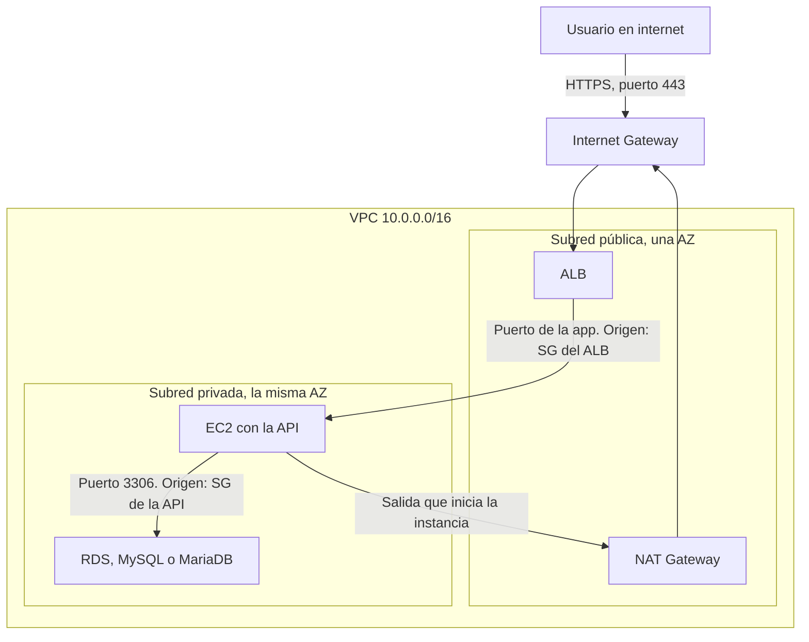
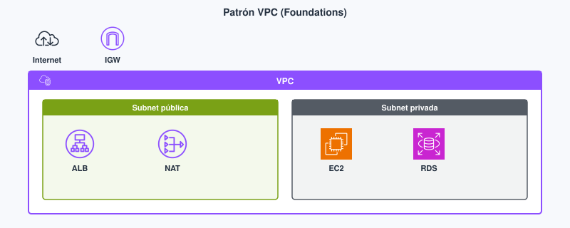
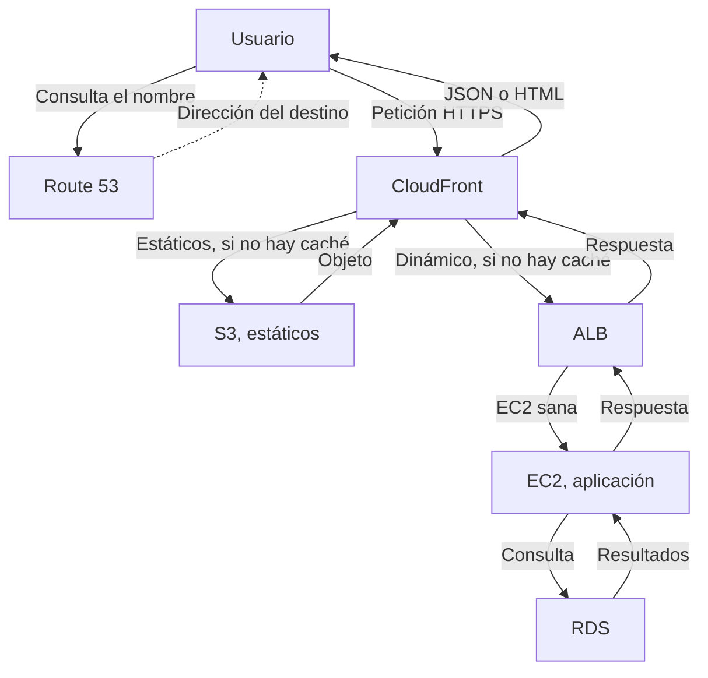

# Tema 3. Redes, VPC y entrega de contenido

Cuando despliegas el front y la API (*Application Programming Interface*, interfaz de programación de aplicaciones) de tu proyecto en AWS, no quedan expuestos a internet por el simple hecho de existir allí. Todos esos recursos viven dentro de una [VPC](#vpc) (*Virtual Private Cloud*, nube virtual privada), una red propia que tú diseñas y repartes en [subredes](#subnet), cada una situada en una sola [zona de disponibilidad](../01-fundamentos-nube-aws/tema1.md#zona-de-disponibilidad) (AZ, *Availability Zone*). Sobre esa red, las tablas de rutas y los cortafuegos deciden qué tráfico puede entrar desde fuera y por dónde sale una instancia cuando es ella la que necesita conectarse a internet, por ejemplo para instalar paquetes o llamar a un servicio externo.

Esa es la decisión de fondo de todo el tema, que corresponde al Módulo 5 de AWS Academy Cloud Foundations: qué publicas hacia internet y qué dejas protegido dentro. Al terminarlo sabrás publicar un servidor web accesible para cualquier usuario sin dejar abierto el puerto 22 de SSH (*Secure Shell*, el protocolo con el que administras en remoto un sistema Linux), que es una de las puertas de entrada más atacadas. Los términos clave del tema están recogidos en el [glosario](#glosario).

!!! tip "Al empezar"
    Empieza por el [cuestionario inicial](#cuestionario-inicial). Trae claro el mapa de [región](../01-fundamentos-nube-aws/tema1.md#region) y AZ del Tema 1. En este tema decides en qué subred colocas el balanceador, la API y la base de datos, y qué tráfico entra o sale.

## Propuesta didáctica

> **RA3.** *Diseña y configura redes virtuales y servicios de cómputo en la nube, aplicando buenas prácticas de seguridad, estrategias de balanceo de carga, escalado automático y aprovechando tecnologías serverless, contenedores y máquinas virtuales según casos de uso específicos.*

### Criterios de evaluación (RA3)

* **a)** Se ha realizado el diseño y configuración de redes virtuales privadas.
* **b)** Se ha aplicado buenas prácticas de seguridad en redes y arquitecturas.
* **c)** Se ha participado activamente en la creación y configuración de una red funcional.

Los tipos de instancia y Lambda se estudian en el Tema 4. El balanceo con más detalle y el autoescalado, en el Tema 8. Aquí dejas preparada la red en la que esos servicios se apoyan.

### Contenidos

* La VPC, el bloque **CIDR** (*Classless Inter-Domain Routing*, enrutamiento entre dominios sin clases) y las subredes, cada una en una sola AZ, con sus tablas de rutas, el Internet Gateway y el **NAT Gateway** (*Network Address Translation*, traducción de direcciones de red).
* El **security group** (**SG**, grupo de seguridad) frente a la **NACL** (*network access control list*, lista de control de acceso de red); qué hace pública o privada a una subred.
* Route 53 y CloudFront: el **DNS** (*Domain Name System*, sistema de nombres de dominio) y la **CDN** (*content delivery network*, red de entrega de contenido).
* La **VPN** (*virtual private network*, red privada virtual) frente a Direct Connect, y cuándo el escenario pide un enlace dedicado.

### Programación de aula (orientativa)

| Quincena | En tutoría | Trabajo autónomo / evidencias |
| --- | --- | --- |
| **Q4** | VPC pública/privada + SG | **PR301**; Autocheck del tema |

---

## Cuestionario inicial

!!! question "Responde con lo que sepas"
    1. ¿Qué es una **VPC** en una frase, sin elegir todavía un bloque **CIDR** (*Classless Inter-Domain Routing*, el rango de direcciones)?
    2. ¿En qué se diferencia una subred **pública** de una **privada** si miras la ruta hacia internet?
    3. En el lab de una API web, ¿usas casi siempre el **security group** o la **NACL**, y por qué?
    4. ¿Por qué es una mala práctica abrir el puerto **3306** (MySQL o MariaDB) o el **22** (SSH, administración remota) a `0.0.0.0/0`, aunque así pudieras abrir la sesión desde tu portátil?
    5. ¿CloudFront acerca el **contenido** al usuario o replica tu base de datos en el borde?

Este cuestionario es solo para ti: te ayuda a ver qué dominas ya y qué te falta antes o mientras lees el tema. No se entrega en Aules; respóndelo con lo que sepas y, cuando quieras contrastar, abre el bloque **Soluciones (autoevaluación)** debajo o el índice en [Soluciones](../90-soluciones/soluciones.md).

Soluciones (autoevaluación)

1. Una **VPC** es tu red virtual, aislada de forma lógica, dentro de **una** región de AWS. Es el espacio donde colocas el balanceador, la API y la base de datos. El bloque de direcciones se elige después: la definición no depende de un CIDR concreto.

2. La subred **pública** tiene, en su tabla de rutas, una ruta cuyo objetivo es el Internet Gateway. Con esa ruta, un recurso con IP pública puede enviar y recibir tráfico de internet, siempre que el cortafuegos lo permita. La subred **privada** no tiene esa ruta directa. Si la instancia necesita salir, la tabla envía `0.0.0.0/0` a un NAT Gateway. Ese camino vale para conexiones que inicia la propia instancia. No sirve para que alguien en internet abra una conexión nueva hacia la instancia.

3. Casi siempre el **security group**. Es un cortafuegos con estado, asociado a la interfaz de red del recurso: si permites la entrada de una conexión, la respuesta de esa misma conexión vuelve sin otra regla. La **NACL** filtra en la subred entera, no recuerda la conexión y te obliga a permitir también el tráfico de vuelta. En un lab es fácil dejar la aplicación incomunicada si editas la NACL sin un plan.

4. `0.0.0.0/0` significa cualquier dirección IPv4 de internet. El puerto 22 es la administración remota por SSH y el 3306 es el motor MySQL o MariaDB. Abrirlos así deja esos servicios expuestos a escaneos y a intentos de adivinar contraseñas. El tráfico de la aplicación debe entrar por el balanceador. Para administrar, usas un bastión, una VPN o Session Manager, y el security group de la base acepta solo el security group de la API.

5. CloudFront acerca **contenido** que se puede cachear (ficheros estáticos y respuestas cacheables). No copia tu base de datos a las ubicaciones de borde.

---

## Bloque Foundations (Módulo 5)

### VPC: tu red virtual en una región

Antes de lanzar una sola instancia tienes que decidir qué parte de tu proyecto se publica hacia internet y cómo sale la instancia cuando es ella la que necesita internet. Esa decisión se toma en la **[VPC](#vpc)**, que es una red virtual aislada de forma lógica dentro de **una** región de AWS. Conviene no imaginarla como un edificio físico con cables y armarios: es el espacio de direcciones y de rutas en el que AWS coloca las interfaces de red de tus recursos, de modo que todo lo que lanzas dentro recibe una dirección de ese espacio y sigue sus reglas de encaminamiento.

Ese mapa se dibuja con tres decisiones que van una detrás de otra. Primero eliges un rango de direcciones **IP** (*Internet Protocol*, protocolo de internet) para toda la VPC. Después lo partes en [subredes](#subnet), que son los trozos donde colocarás cada tipo de recurso. Por último, asocias cada subred a una **[tabla de rutas](#tabla-de-rutas)**, que elige el siguiente salto de cada destino. Con el rango, las subredes y las rutas queda fijado si la red se conecta a internet y por dónde lo hace.

El rango de la VPC tiene que ser lo bastante grande para que quepan todas las subredes que vas a necesitar, y su tamaño se escribe como un bloque **[CIDR](#cidr)**. Esta notación indica dos cosas: la dirección en la que empieza el bloque y, con el prefijo que va detrás de la barra, cuántas direcciones contiene. Un ejemplo habitual en los labs es `10.0.0.0/16`. El prefijo `/16` deja 16 bits para identificar direcciones dentro de la red, de modo que el bloque contiene 65 536 direcciones, desde `10.0.0.0` hasta `10.0.255.255`. Ese margen es precisamente el motivo de elegirlo, porque permite crear varias subredes sin agotar el espacio a mitad del proyecto.

Con el bloque de la VPC ya reservado, cada subred toma una parte más pequeña de él. Una subred `10.0.1.0/24`, por ejemplo, contiene 256 direcciones dentro del mismo `10.0.0.0/16`. La relación entre los dos prefijos es la de un contenedor y su contenido: el `/24` cabe en una sola AZ y marca el límite de esa pieza, mientras que el `/16` de la VPC agrupa todos esos `/24`. Al elegir tamaños te encuentras con dos límites. El tamaño permitido para una subred IPv4 va de `/28` a `/16`, y los CIDR de las subredes no pueden solaparse, así que cada dirección pertenece a una única subred.

Tampoco puedes contar con todas las direcciones de cada subred, porque AWS reserva cinco en cada una. En una subred pequeña se nota mucho: de las 16 direcciones de un `/28`, solo 11 quedan asignables. La nota siguiente detalla cuáles son esas cinco y por qué un `/24` tampoco ofrece 256 instancias.

!!! note "Direcciones que AWS reserva en cada subred"
    En el CIDR de cada subred, AWS reserva cinco direcciones y no puedes asignarlas a un recurso. En `10.0.0.0/24` son las siguientes.

    * La dirección `10.0.0.0` es la dirección de red.
    * La dirección `10.0.0.1` es el router de la VPC.
    * La dirección `10.0.0.2` queda reservada por AWS.
    * La dirección `10.0.0.3` queda reservada para un uso futuro.
    * La dirección `10.0.0.255` es la dirección de *broadcast*. La VPC no hace broadcast, pero la dirección se reserva igual.

    El servidor DNS de la VPC está en la base del CIDR principal más dos. En una VPC `10.0.0.0/16`, esa dirección es `10.0.0.2`. Por eso un `/24` no ofrece 256 instancias: ofrece 251 direcciones asignables. Cuéntalas al planificar.

Además del tamaño, tienes que decidir en qué zona queda cada subred, porque cada una vive en **una** AZ y no puede cruzar dos zonas. Por eso la alta disponibilidad no se consigue con un único `/24` más grande, sino con al menos dos subredes situadas en dos AZ: la subred, tenga el prefijo que tenga, sigue entera en una sola zona. Si toda la API está en una sola subred y esa AZ falla, no queda otra copia sirviendo tráfico dentro de la región.

**Ejemplo del proyecto DAW.** El front estático está en [S3](../01-fundamentos-nube-aws/tema1.md#s3) (*Simple Storage Service*, almacenamiento de objetos). La API, en Node o PHP, corre sobre [EC2](../01-fundamentos-nube-aws/tema1.md#ec2) (*Elastic Compute Cloud*, máquinas virtuales), y la base de datos está en [RDS](../01-fundamentos-nube-aws/tema1.md#rds) (*Relational Database Service*, servicio de bases de datos relacionales). Dentro de la VPC viven el balanceador, las instancias de la API y la base. Si no dibujas antes el mapa de esa red, suele pasar una de dos cosas: o se publican puertos que no deberían verse desde internet, o la aplicación no consigue salir cuando tiene que descargar paquetes o llamar a un servicio externo.

!!! warning "Errores frecuentes"
    - Se deja la red sin diseñar y se acaban publicando puertos que no deberían verse desde internet, o la aplicación se queda sin salida para descargar paquetes.
    - Se elige un `/28`, que se queda corto en cuanto coinciden en la subred el NAT Gateway, las interfaces del balanceador y una instancia.
    - Se mete toda la API en una sola subred y se da por resuelta la alta disponibilidad ampliando el `/24`.

#### Subred pública

Que una subred sea pública decide si lo que colocas en ella puede recibir tráfico de internet, así que conviene saber comprobarlo y no fiarse de la etiqueta. Una subred es pública cuando su tabla de rutas tiene una ruta directa hacia un **[Internet Gateway](#igw)** (**IGW**, puerta de enlace a internet). Esa condición se lee en la tabla, no en el nombre que tenga la subred en la consola: abres la subred, miras **Route table** y localizas la fila `0.0.0.0/0` cuyo objetivo es un identificador `igw-…`. El destino `0.0.0.0/0` significa cualquier destino que no encaje en una ruta más específica, de modo que el tráfico de internet toma esa puerta como siguiente salto.

La ruta, sin embargo, solo abre el camino. Los recursos que deban ser alcanzables desde internet se colocan en esta subred y necesitan, además, una [IP pública](#ip-publica) o una [IP elástica](#ip-elastica). Y aun con ruta e IP, el security group y la NACL siguen decidiendo qué puertos se aceptan, porque la ruta abre el camino y no los puertos.

En una aplicación web, los puertos que importan en esta subred son los de la propia web. **HTTP** (*Hypertext Transfer Protocol*, protocolo de transferencia de hipertexto) es el protocolo de la web en claro, en el puerto 80. El usuario llega por **HTTPS** (*Hypertext Transfer Protocol Secure*, HTTP seguro) al balanceador, normalmente al puerto 443, y el puerto 80 solo se deja si el balanceador redirige ese tráfico hacia HTTPS.

El balanceador condiciona también cuántas subredes públicas necesitas. En el caso habitual, dentro de una región y sin Local Zones ni Outposts, la consola pide subredes en al menos dos AZ y exige que la VPC tenga ya un Internet Gateway. Por eso el diseño usa dos subredes públicas, una en cada zona, y no una sola.

**Ejemplo del proyecto DAW.** Aquí colocas el **[ALB](#alb)** (*Application Load Balancer*, balanceador de carga de aplicación), de la familia **ELB** (*Elastic Load Balancing*, balanceo de carga elástico). El usuario habla con el balanceador y no llega directo al puerto en el que escucha la API (en muchos proyectos, el 3000 de Node o el 8080 de otro servidor de aplicaciones) ni al puerto del motor de base de datos.

!!! warning "Errores frecuentes"
    - Se llama pública a una subred por el nombre que tiene en la consola, aunque su tabla no apunte al IGW.
    - Se deja que el usuario llegue directamente al puerto de la API o al de la base de datos.
    - Se trata una sola subred pública como si bastara para un ALB orientado a internet.

#### Subred privada

La subred privada es el lugar de lo que no debe recibir conexiones desde internet, como la API y la base de datos. Una subred es privada cuando su tabla de rutas **no** tiene una ruta directa al Internet Gateway y, igual que antes, el nombre de la consola no basta: la prueba está en dos filas de la tabla.

La primera fila es la ruta local, que AWS crea sola y no te deja borrar. Su destino es el CIDR de la VPC, en el ejemplo `10.0.0.0/16`, y su objetivo es `local`. Gracias a ella, la API y la base se hablan por IP privada sin salir de la VPC.

La segunda fila es la ruta de internet, y lo que convierte la subred en privada es que `0.0.0.0/0` **no** apunta a un `igw-…`. Si la instancia necesita salir, esa fila apunta a un NAT Gateway (`nat-…`). Si no aparece ni el IGW ni el NAT, la subred está aislada de internet: puede hablar con el resto de la VPC y con nada más.

Para entender qué protege esta configuración hay que distinguir dos tipos de tráfico. El primero es la conexión **no solicitada**, la que abre un equipo de internet hacia tu instancia, como un escáner que prueba el puerto 22 o un cliente que intenta el 3306. Ese paquete no tiene camino de entrada. AWS no anuncia a internet el rango de direcciones de la subred, así que la IP privada de la instancia, por ejemplo `10.0.2.25`, no es un destino al que alguien de fuera pueda encaminar un paquete. Además, no hay ruta desde el Internet Gateway hasta esta subred y la instancia no ofrece una IP pública alcanzable.

La salida que inicia la instancia es el caso contrario, porque es la EC2 de la API la que envía el primer paquete. Ocurre cuando aplica parches del **SO** (sistema operativo), cuando lanza `npm install` contra el registro de paquetes o cuando llama a una API externa de pagos. El destino no está dentro de `10.0.0.0/16`, así que coincide con `0.0.0.0/0` y la tabla lo entrega al NAT Gateway. El equipo de internet solo **responde** a una conexión que tu instancia ya abrió; no puede aprovechar esa respuesta para abrir, por su cuenta, una sesión nueva hacia el 22 o el 3306.

**Ejemplo del proyecto DAW.** La API en EC2 y la base en RDS van en subredes privadas, repetidas en dos AZ si el servicio tiene que sobrevivir al fallo de una zona. El ALB, en las subredes públicas, es quien recibe a los usuarios. Cómo se encadenan los security groups de ese camino se detalla en [seguridad por capas](#seguridad-por-capas).

!!! warning "Errores frecuentes"
    - Se confía en el nombre de la subred aunque su tabla apunte `0.0.0.0/0` al IGW; en ese caso deja de ser privada, por muy restrictivo que siga el security group.
    - Se confunde la salida que inicia la instancia con una entrada desde internet.
    - Se da por resuelta la seguridad porque la API está en una subred llamada «privada».

#### Tabla de rutas, Internet Gateway y NAT Gateway

Las dos subredes anteriores solo se distinguen por su tabla de rutas, así que merece la pena ver cómo funciona por dentro. La [tabla de rutas](#tabla-de-rutas) es la lista de reglas que decide el siguiente salto de cada destino; sin ella, la subred no sabría si el siguiente salto es la propia VPC, el IGW o el NAT Gateway. Cada subred está asociada a una tabla y, si no eliges otra, usa la tabla principal de la VPC.

Cada ruta tiene un destino, escrito en CIDR, y un objetivo, que puede ser `local`, un Internet Gateway, un NAT Gateway u otra puerta que ya hayas creado. Cuando un paquete encaja en varias rutas, gana la más específica. Así, un destino dentro de `10.0.0.0/16` usa `local` y no la ruta `0.0.0.0/0`: el tráfico entre IP de la VPC usa la ruta local, y el tráfico hacia internet usa `0.0.0.0/0`.

En el proyecto, con una VPC `10.0.0.0/16`, la subred pública queda así.

| Destino | Objetivo | Qué hace con el paquete |
| --- | --- | --- |
| `10.0.0.0/16` | `local` | Lo entrega a otra IP privada de la VPC. El ALB llega así a la API. |
| `0.0.0.0/0` | `igw-…` | El resto sale o entra por el Internet Gateway. |

La subred privada, cuando la API necesita salir a internet, queda así.

| Destino | Objetivo | Qué hace con el paquete |
| --- | --- | --- |
| `10.0.0.0/16` | `local` | Mantiene dentro de la VPC el tráfico entre ALB, API y RDS. |
| `0.0.0.0/0` | `nat-…` | Envía el resto al NAT Gateway. No hay ningún objetivo `igw-…`. |

Estas tablas se comprueban siempre en **Subnet → Route table**, dentro de la subred concreta, y no en el dibujo del asistente, porque lo que cuenta es la tabla que la subred tiene asociada de verdad.

El [IGW](#igw) es la puerta de la VPC hacia internet para los recursos que tienen ruta hasta él e IP pública. Es un componente redundante y de alta disponibilidad dentro de la región, y cada VPC puede tener un solo IGW asociado. Para usarlo, lo adjuntas a la VPC y pones la ruta por defecto de las subredes públicas con objetivo en ese IGW. Por ahí entra el usuario hasta el ALB y por ahí sale el propio balanceador cuando tiene que responder; de hecho, el ALB orientado a internet solo se puede crear en una VPC que ya tenga esta puerta. Sin IGW, y sin la ruta que apunta a él, una subred no es pública aunque el diagrama de la práctica la pinte de otro color.

El IGW resuelve la entrada, pero la API, que está en la subred privada, también necesita salir a internet de vez en cuando. Para eso existe el **[NAT Gateway](#nat-gateway)**, que permite que las instancias de una subred privada inicien conexiones salientes hacia internet. Conviene tener igual de claro lo que no hace: no publica la API, no es un balanceador, no tiene un nombre DNS al que apunte el usuario y no puedes asociarle un security group. El filtrado de la aplicación sigue, por tanto, en los security groups del ALB, de la EC2 y de RDS.

El NAT que usas para salir a internet es un NAT público, y por eso lo creas en una subred pública: necesita llegar él mismo al Internet Gateway. Su subred tiene `0.0.0.0/0` hacia el `igw-…`, y al NAT se le asocia una IP elástica para que internet vea un origen público estable. Si lo colocaras en la subred privada, su propio tráfico hacia internet no tendría puerta de salida y no podría traducir las conexiones de las instancias.

La traducción sigue un orden fijo. La EC2 abre la conexión, el NAT la reenvía hacia internet usando su IP elástica como origen y recuerda esa conexión, y cuando llega la respuesta se la devuelve a la IP privada de la instancia. Quien está fuera responde, pero no inicia. En la tabla de la subred privada, la ruta por defecto queda así: destino `0.0.0.0/0`, objetivo el identificador del NAT (`nat-…`). Con eso la API puede actualizar paquetes y llamar a servicios externos sin tener una ruta al IGW y sin exponer el puerto 22.

Al planificar el NAT también hay que pensar en las zonas. Cada NAT Gateway se crea en **una** AZ, la de la subred pública donde lo colocas, y dentro de esa zona AWS lo implementa con redundancia, pero no cubre el fallo de toda la AZ. Si las instancias de otra zona comparten ese único NAT y la zona del NAT cae, esas instancias pierden la salida a internet, aunque su propia AZ siga en pie. Para evitarlo creas un NAT en la subred pública de cada AZ y haces que la tabla privada de esa misma AZ apunte a su NAT, no al de la otra zona.

El NAT tiene además un coste que corre mientras existe, y eso hay que saberlo antes de dejar un lab abierto. El NAT Gateway se factura por cada hora en la que está disponible y por cada gigabyte (GB) que procesa, con independencia de si el tráfico va a internet o a otro servicio. Una hora empezada se cobra como hora completa, y además se aplican los cargos habituales de transferencia de datos de AWS por el tráfico que sale a través de él. El precio por hora y por GB depende de la región: la cifra concreta está en la página de precios de Amazon VPC, no en una tarifa fija de estos apuntes. Mientras el NAT exista, esa hora sigue contando, así que al terminar el lab lo borras junto con el resto de recursos.

Parte de ese gasto se puede evitar. Si el grueso del tráfico de la API va a S3 en la misma región, por ejemplo al subir las imágenes del proyecto, un [VPC endpoint](#vpc-endpoint) de tipo *gateway* hacia S3 evita pasar esos bytes por el NAT, y ese tipo de punto de enlace no tiene cargo por hora ni por GB procesado. Puede ocurrir también que el enunciado del lab no cree ningún NAT. En ese caso, anótalo en el entregable, porque caben dos lecturas distintas: o la instancia privada no tiene salida a internet, o el servidor está en una subred pública para simplificar el ejercicio. Las dos se pueden explicar.

**Ejemplo del proyecto DAW.** La base de datos no lleva IP pública ni ruta al IGW, porque el motor no se administra abriéndolo a internet. Quien llega desde fuera habla con el ALB, y la base solo recibe el tráfico que la API le envía por la ruta local. En cambio, las tres salidas que inicia la EC2 de la API —parches del SO, `npm install` o el equivalente de tu lenguaje, y una API externa— pasan por el NAT.

!!! warning "Errores frecuentes"
    - Se llama privada a una subred que todavía tiene `0.0.0.0/0` hacia el IGW.
    - Se crea el Internet Gateway, pero se olvida asociar la tabla a la subred correcta: el recurso existe y la subred sigue usando otra tabla.
    - Se da IP pública a la base de datos para administrarla desde el portátil.
    - Se usa el NAT como si publicara la API, igual que un balanceador.
    - Se deja un solo NAT compartido por todas las AZ.

#### Caso DAW: ALB en pública, API y RDS en privada

**Ejemplo del proyecto DAW.** Todas las piezas anteriores encajan en un diseño sólido, aunque el lab del módulo lo simplifique, que reparte la VPC en dos pares de subredes. Hay dos subredes públicas, una en cada AZ, y en ellas viven el ALB orientado a internet y, si hace falta salida, un NAT Gateway por zona. En esas mismas AZ hay dos subredes privadas, donde viven las EC2 de la API (Node o PHP) y RDS con MySQL, MariaDB o PostgreSQL.

La clave del patrón es que cada pieza solo acepta tráfico de la anterior. El usuario solo habla con el ALB, la API solo acepta tráfico que viene del balanceador y RDS solo acepta tráfico que viene de la API. Así, la base y el proceso de la aplicación no quedan publicados por el hecho de existir dentro de la VPC.

El esquema siguiente recoge ese camino, reducido a una AZ.

El esquema muestra una sola AZ para que el camino se lea con claridad. En el proyecto repites el par de subredes en una segunda AZ, y el NAT de esa segunda zona es otro recurso, con su propia ruta `0.0.0.0/0` en la tabla privada de esa AZ.

<figure markdown="span">
{ width="800" }
<figcaption>Patrón didáctico Foundations: exposición controlada en la subred pública; API y datos en la privada.</figcaption>
</figure>

<figure markdown="span">
{ width="800" }
<figcaption>VPC con subredes privadas (patrón de la guía). Fuente: Amazon VPC User Guide (AWS).</figcaption>
</figure>

La tabla siguiente reúne cada pieza, la función que cumple y el error que más se repite al usarla.

| Pieza | Para qué sirve | Error típico |
| --- | --- | --- |
| **Subred** | La subred parte el CIDR de la VPC y queda entera en una sola AZ. | El error típico es tratar una subred como si cruzara dos AZ. |
| **Tabla de rutas** | La tabla elige el siguiente salto, que puede ser local, el IGW o el NAT. | El error típico es dar por privada una subred que aún apunta al IGW. |
| **Internet Gateway** | El IGW da a la VPC una puerta a internet para quien tenga ruta e IP pública. | El error típico es poner la base de datos con IP pública para administrarla desde el portátil. |
| **NAT Gateway** | El NAT deja salir a internet a la subred privada sin aceptar conexiones nuevas desde fuera. | El error típico es usarlo como si publicara la API, igual que un balanceador. |
| **Security group** | El security group filtra en la interfaz de red y recuerda la conexión. | El error típico es abrir el puerto 22 a `0.0.0.0/0`. |
| **NACL** | La NACL filtra en la subred entera y no recuerda la conexión. | El error típico es permitir la ida y olvidar la regla de vuelta. |

El examen **CLF-C02** (*AWS Certified Cloud Practitioner*) pide reconocer ese patrón, mientras que en clase hay que dibujarlo y justificarlo antes de abrir el lab.

| Examen CLF-C02 | Clase DAW / proyecto |
| --- | --- |
| Una subred ocupa una AZ. La pública tiene ruta al IGW. La privada sale con NAT. | En el proyecto se dibuja el ALB en subredes públicas y la API con RDS en privadas antes de abrir el lab. |
| Hay que distinguir el IGW del NAT Gateway. | En el entregable se justifica por qué la base de datos no tiene IP pública. |
| Hay que elegir un CIDR de VPC y otro de subred que quepan uno dentro del otro. | En el proyecto se explica por qué `10.0.0.0/16` deja sitio y `10.0.1.0/24` acota una AZ. |

Si el lab usa una sola AZ, o un único servidor HTTP en una subred pública, eso sirve para aprender rutas y security groups, pero no es el diseño de un servicio que tenga que sobrevivir al fallo de una zona. Por eso, en el entregable hay que decir qué pieza de este patrón se ha practicado y cuál se ha dejado fuera.

!!! warning "Errores frecuentes"
    - Se toma la simplificación del lab por el diseño del proyecto, cuando una sola AZ o un servidor HTTP público no sustituyen al patrón ALB, API y RDS.

#### Seguridad por capas: del ALB a RDS

La subred privada evita un camino de entrada desde internet, pero no decide quién puede hablar con cada pieza dentro de la VPC. Eso lo deciden los security groups: cada regla de entrada nombra el puerto y el origen, de modo que abrir un puerto no lo abre para cualquier dirección. En el proyecto, el usuario entra por el balanceador, la API solo acepta a ese balanceador y la base solo acepta a la API.

El security group del ALB es el que acepta el tráfico de los usuarios. La regla de entrada habitual es TCP (*Transmission Control Protocol*, protocolo de control de transmisión) en el puerto 443 desde `0.0.0.0/0`, porque cualquier cliente de internet debe poder abrir la web, y el puerto 80 se añade solo si el balanceador redirige HTTP a HTTPS. Este grupo es el único que necesita un origen tan amplio, y solo en los puertos de la web.

El de la API no repite esa apertura. Su regla permite el puerto de la aplicación, y el origen es el security group del ALB, no una dirección IP. Esto es posible porque en el campo de origen se puede escribir un CIDR, una IP o un rango, o bien el identificador de otro security group. Cuando el origen es otro grupo, la regla afecta a las interfaces de red que lo tienen asociado y el tráfico se autoriza hacia sus IP privadas, no hacia una IP pública que pudiera cambiar. Encaja con el ALB, que envía las peticiones a los destinos usando direcciones privadas, así que la EC2 de la API no necesita IP pública para recibirlas.

Usar el grupo en lugar de una IP también te ahorra mantenimiento. Si el balanceador sustituye un nodo, la IP de ese nodo puede cambiar, pero el identificador del security group sigue siendo válido; pegar la IP concreta de un nodo, en cambio, obligaría a editarla en cada cambio. La misma regla tiene que cubrir el puerto del *health check* (la comprobación con la que el ALB decide si el destino está sano), que en este diseño coincide con el puerto de la aplicación.

El security group de RDS cierra la cadena con la misma lógica. Su regla de entrada permite el puerto del motor solo desde el security group de la API: en MySQL y MariaDB ese puerto es el 3306, y en PostgreSQL es el 5432. Si sustituyes la EC2 de la API, la base sigue aceptando a quien lleve el grupo de la API y deja de aceptar a la instancia que ya no existe. RDS permanece en la subred privada, sin IP pública.

Con todo cerrado así, queda una pregunta práctica: cómo administras la EC2 o consultas la base si no hay ningún puerto de administración abierto a internet. Hay tres caminos, y se elige según cuánto dura el acceso y qué deja crear el entorno. Ninguno de los tres publica el 22 ni el 3306 a internet.

- El **servidor bastión** es una EC2 pequeña en la subred pública que solo sirve de salto. El portátil abre SSH en el puerto 22, o **RDP** (*Remote Desktop Protocol*, protocolo de escritorio remoto) en el puerto 3389 si la instancia es Windows, contra el bastión, y desde ahí otra sesión hacia la IP privada de la API. Conviene cuando el acceso es puntual y el lab deja crear esa instancia. El security group del bastión admite el 22 solo desde tu IP; el de la API, solo desde el security group del bastión. El bastión es una EC2 más: hay que parchear su SO igual que el de la API.
- La VPN de cliente abre un túnel cifrado desde el portátil hasta la VPC, de modo que llegas a las IP privadas sin publicar el 22 ni el 3306. El portátil no recibe una dirección del CIDR de la VPC: entra por el túnel y, desde ahí, el enrutado le deja alcanzar esas IP. Conviene cuando varias personas tienen que administrar la API o usar un cliente SQL durante semanas, no durante una sola sesión de lab. Montarla es más trabajo que un bastión. La VPN de sitio a sitio, la que une una red entera (el centro del cliente) con la VPC, es otro caso y se retoma en el [enlace híbrido](#enlace-hibrido). El lab del Módulo 5 no te pide crear ninguna de las dos.
- **Session Manager** es una capacidad de AWS Systems Manager. Abre un shell en la EC2 desde la consola o desde la AWS CLI (*Command Line Interface*, la herramienta de terminal) sin puerto de entrada, sin bastión y sin repartir claves SSH. La instancia tiene que llevar el agente de Systems Manager y poder iniciar ella una conexión HTTPS, en el puerto 443, hacia los puntos de enlace de ese servicio, ya sea por el NAT Gateway o por un VPC endpoint. También necesita un [rol](../02-seguridad-iam/tema2.md#rol) de IAM (*Identity and Access Management*, gestión de identidades y accesos) que autorice a Systems Manager. Cómo se escribe un rol y qué es el [mínimo privilegio](../02-seguridad-iam/tema2.md#minimo-privilegio) está explicado en el [Tema 2](../02-seguridad-iam/tema2.md).

**Ejemplo del proyecto DAW.** La cadena queda en tres grupos. El ALB acepta el 443 desde internet (y el 80 solo si hay redirección); la API acepta el puerto de la aplicación desde el grupo del ALB, y RDS acepta el 3306 o el 5432 desde el grupo de la API. La puerta pública de la aplicación es, por tanto, el 443 del ALB; SSH y el motor no forman parte de esa puerta.

Ten en cuenta que en el Learner Lab de AWS Academy los permisos del rol que ya trae el entorno, y el catálogo de servicios, pueden no coincidir con los de una cuenta propia. Por eso no des por hecho que Session Manager, una VPN de cliente o un bastión adicional estén disponibles.

!!! warning "Errores frecuentes"
    - Se abren el puerto 22 y el 3306 a `0.0.0.0/0`.
    - Se suple la falta de bastión, VPN o Session Manager publicando la administración a internet.
    - Se pega la IP de un nodo del ALB en el security group de la API en lugar del identificador del grupo.

### Security groups frente a NACL

En el [Tema 2](../02-seguridad-iam/tema2.md#security-group) el security group apareció como la capa de red, distinta de IAM: IAM decide quién puede llamar a la API de AWS, y el security group decide qué tráfico de red llega a la interfaz. Aquí se configura esa capa.

El **[security group](#security-group)** es un cortafuegos **con estado** asociado a la interfaz de red (**ENI**, *elastic network interface*, interfaz de red elástica) de la instancia, del ALB o de RDS. Tú escribes reglas de permiso. Lo que no permites en entrada queda denegado: un grupo que acabas de crear no trae reglas de entrada, así que no entra nada hasta que añades una. La salida, en ese grupo recién creado, incluye una regla que permite todo el tráfico de salida; si la quitas, tendrás que permitir explícitamente la salida que la instancia necesite, por ejemplo hacia el NAT. Si permites una conexión de entrada, el tráfico de vuelta de **esa** conexión se permite solo, sin una segunda regla, y por eso no tienes que abrir a mano los puertos de respuesta. Puedes poner como origen otro security group, que es lo que hace estable la cadena del ALB a la API y de la API a RDS. Es la herramienta habitual del módulo.

La **[NACL](#nacl)** es un cortafuegos **sin estado** asociado a la **subred** entera, no a una interfaz. Cada regla lleva un número y se evalúa de menor a mayor hasta la primera que coincide; puede permitir o denegar. Como no recuerda la conexión, permitir el 443 de entrada no abre la respuesta: tienes que permitir también el tráfico de vuelta por los puertos efímeros, el rango alto que elige el cliente al abrir la conexión. La guía de resolución de problemas del ALB cita el rango 1024-65535 en ese camino de vuelta entre los nodos del balanceador y los destinos, y documenta un HTTP 504 cuando la NACL lo bloquea. Cada subred tiene una NACL. La que viene por defecto con la VPC permite todo el tráfico de entrada y de salida. Una NACL que creas tú empieza cerrada, sin permisos, hasta que escribes reglas. Si el enunciado del Módulo 5 no pide modificarla, deja la que viene por defecto y trabaja con security groups. En el examen CLF-C02 sí tienes que reconocer la diferencia: el security group tiene estado y la NACL no.

**Ejemplo del proyecto DAW.** En el lab del servidor web abres el 80 o el 443 hacia quien deba llegar: internet, si el servidor es el punto público del ejercicio, o el security group del balanceador, si ya hay ALB. La administración queda restringida al puerto 22 en Linux o al 3389 en Windows, con origen tu IP o el security group del bastión si el lab te deja usarlo. El grupo del ALB permite el 443 desde internet; el de la API, el puerto de la aplicación desde el grupo del ALB; el de RDS, el 3306 o el 5432 desde el grupo de la API.

| | Security group | NACL |
| --- | --- | --- |
| Dónde actúa | En la interfaz de red de la instancia, del ALB o de RDS. | En la subred entera. |
| Estado | Con estado: la respuesta de una conexión permitida vuelve sola. | Sin estado: la ida y la vuelta van en reglas distintas. |
| Reglas | Solo permisos. Lo que no escribes, no entra. | Permisos y denegaciones, evaluados por número de regla. |
| Uso habitual en el módulo | El control de 80, 443, SSH y el puerto del motor. | Solo cuando el enunciado pide tocarla. |
| Error típico | Dejar `0.0.0.0/0` en el puerto de administración. | Olvidar el puerto de vuelta. |

<figure markdown="span">
{ width="800" }
<figcaption>Security group en la interfaz de red: se permite lo que dice la regla y el resto queda denegado. Fuente: Amazon EC2 User Guide (AWS).</figcaption>
</figure>

En el módulo, casi todas las decisiones de filtrado se toman con security groups. Si el enunciado no pide una NACL, no añadas reglas simétricas para rellenar el entregable. Una sola EC2 con IP pública, Node escuchando en el puerto 3000 a todo internet y MySQL en el mismo host suele responder en el aula, y queda expuesta en cuanto alguien recorre rangos de direcciones. Con el ALB en la subred pública y la API junto a RDS en la privada, el usuario sigue llegando por HTTPS y dejas de publicar SSH y el puerto del motor: es el mismo criterio de mínimo privilegio del Tema 2, aplicado a puertos y a orígenes en lugar de a acciones de IAM.

!!! warning "Errores frecuentes"
    Dejar `0.0.0.0/0` en el puerto 22, aunque sea el tiempo de una tutoría. Editar la NACL, permitir solo el 443 de entrada y olvidar la regla de vuelta, de modo que la web deja de cargar con un timeout. Añadir reglas simétricas en la NACL para rellenar el entregable cuando el enunciado no las pide.

### DNS y entrega de contenido

Cuando alguien escribe `midominio.es` en el navegador, hay que traducir ese nombre a un destino. **[Route 53](#route-53)** es el servicio de DNS de AWS: aloja la zona autoritativa del dominio, puede hacer comprobaciones de salud de un destino y aplica políticas sencillas de enrutamiento. No sustituye al ALB ni a CloudFront: resuelve el nombre **hacia** ellos. Un registro de alias o un CNAME (*canonical name*, un nombre que apunta a otro nombre) debe señalar al balanceador o a la distribución, no a la IP pública de la EC2 de esta semana, porque esa IP cambia si paras y vuelves a lanzar la instancia. En el lab a menudo compruebas la aplicación con el nombre DNS que te da el propio ALB o la instancia, sin comprar un dominio; en un proyecto intermodular sí hay dominio, y el registro tiene que seguir al recurso estable.

**[CloudFront](#cloudfront)** es la CDN de AWS. Guarda copias del contenido que se puede cachear en **[ubicaciones de borde](#edge-location)** (*edge locations*), cerca del usuario, y acerca **HTML** (*HyperText Markup Language*, el marcado de la página), JavaScript, **CSS** (*Cascading Style Sheets*, hojas de estilo) e imágenes. No replica la base de datos transaccional a otra región ni a una ubicación de borde. El origen suele ser un bucket S3, el front estático del proyecto, o un ALB cuando la respuesta sale de la API. El tiempo que una copia permanece en el borde lo marca el TTL (*time to live*, tiempo de vida) de la política de caché. El checkout, o cualquier respuesta que depende de la sesión y de la base de datos, sigue yendo al origen.

En Foundations el flujo habitual es este: el dominio, en Route 53, apunta a CloudFront o al ALB; CloudFront toma el origen en S3 o en el balanceador y reduce la latencia de lo que puede servir muchas veces igual. *Global Accelerator*, que publica direcciones IP anycast (la misma IP se anuncia desde varios puntos de la red de AWS y la conexión entra por el más cercano), aparece como nombre de examen y no hace falta para el lab del Módulo 5. El recorrido de una petición concreta, paso a paso, está en [Flujo de una petición HTTP](#flujo-de-una-peticion-http).

**Ejemplo del proyecto DAW.** Route 53 hace que `api.midominio.es` llegue al ALB, o que `midominio.es` llegue a CloudFront delante del front. La hoja de estilo se sirve desde el borde; la consulta de pedidos sigue yendo al origen. CloudFront no sustituye a la API ni traslada RDS al borde.

!!! warning "Errores frecuentes"
    Apuntar el dominio a la IP pública de la EC2 del lab, que cambia al relanzar la instancia. Pensar que CloudFront replica la base de datos en el borde.

### Flujo de una petición HTTP

**Ejemplo del proyecto DAW.** El camino completo es el de un usuario que abre `https://midominio.es/productos`. El front está en S3 detrás de CloudFront, la API está en EC2 detrás de un ALB y los datos están en RDS. El lab del Módulo 5 a veces lo reduce a un solo servidor web; aun así hay que poder contar el camino entero, porque es el que justifica dónde va cada pieza. Los seis pasos siguientes describen esa petición cuando `/productos` no está en la caché y la aplicación tiene que leer la base de datos.

1. **Resolución DNS (Route 53).** El navegador todavía no pide la página. Pregunta al DNS qué destino tiene el nombre `midominio.es`. Si la zona del dominio está en Route 53, la respuesta autoritativa sale de ese servicio: el destino suele ser la distribución de CloudFront o, si el proyecto no usa CDN, el nombre del ALB. Con esa dirección el navegador ya sabe con quién abrir la conexión HTTPS. Route 53 no recibe `/productos` ni consulta los datos. Solo traduce el dominio en un destino. Qué registro usar, y por qué no se apunta a la IP pública de la EC2, está en [DNS y entrega de contenido](#dns-y-entrega-de-contenido).

2. **CloudFront (CDN).** La petición HTTPS llega a una ubicación de borde. Si CloudFront tiene el contenido en caché y el TTL no ha vencido, lo entrega desde ahí y el origen no interviene. Si no hay copia, o la respuesta no se puede cachear, CloudFront pide el contenido al origen. Los estáticos del front salen del bucket de S3. La ruta `/productos`, que depende de la base de datos, sigue hacia el ALB. CloudFront no ejecuta la lógica de la aplicación ni guarda RDS en el borde.

3. **Balanceador de aplicaciones (ALB).** El ALB recibe la petición HTTPS en las subredes públicas. No ejecuta el código de la aplicación: elige una EC2 sana del grupo de destinos, el conjunto de instancias registradas en el balanceador, y le reenvía la petición a su IP privada. La elección la hacen las comprobaciones de estado (*health checks*), que son las peticiones con las que el balanceador decide si el destino está en condiciones de trabajar. Una instancia que no las supera no entra en el reparto.

4. **Servidor de aplicaciones (EC2).** La EC2 ejecuta el código de la aplicación, en Node.js, PHP u otro lenguaje del proyecto, y la lógica de negocio de la ruta. En el diseño del proyecto esa instancia está en la subred privada. El navegador no se conecta a ella: quien le entrega la petición es el ALB.

5. **Base de datos (RDS).** Cuando la lógica necesita datos, la aplicación consulta RDS y obtiene los resultados. RDS almacena esos datos y se los proporciona a la EC2. No atiende al navegador y no es un origen de CloudFront.

6. **Respuesta HTTP.** Los resultados vuelven de RDS a la aplicación. La EC2 compone la respuesta, normalmente en **JSON** (*JavaScript Object Notation*, el formato habitual de una API) o en HTML, y la envía al ALB. El ALB la pasa a CloudFront si la CDN interviene, y CloudFront la entrega al navegador. Si no hay CloudFront, la respuesta va del ALB al navegador. El regreso no consulta otra vez a Route 53: el nombre ya quedó resuelto en el primer paso.

La flecha discontinua es solo la resolución. Route 53 devuelve al navegador la dirección del destino, que será CloudFront o el ALB, y no transporta la página. A partir de esa dirección la petición va a CloudFront y, cuando el contenido no está en caché, al ALB, a la EC2 y a RDS. La respuesta recorre ese tramo hacia el navegador. S3 es el origen de los estáticos de CloudFront y queda fuera de la cadena de `/productos`: la aplicación prepara la respuesta con los datos de RDS y la devuelve por el ALB.

| Componente | Función |
| --- | --- |
| **DNS** (Route 53) | Traduce el nombre del dominio en un destino. |
| **CloudFront** | Distribuye el contenido y lo sirve desde la caché. |
| **ALB** | Reparte las peticiones entre los servidores. |
| **EC2** | Ejecuta la aplicación. |
| **RDS** | Almacena los datos y se los proporciona a la aplicación. |

En ese recorrido solo deben permitirse las comunicaciones necesarias. El security group de la EC2 admite el puerto de la aplicación cuando el origen de la regla es el security group del ALB. El security group de RDS admite el puerto del motor cuando el origen es el security group de la EC2: el **3306** si el motor es MySQL o MariaDB, y el **5432** si es PostgreSQL. RDS no se abre a `0.0.0.0/0`. Cómo se escribe cada regla, y por qué el origen es otro security group y no una IP concreta, está desarrollado en [seguridad por capas](#seguridad-por-capas). El security group tiene estado y la NACL no; esa diferencia, con la entrada, la salida y los puertos efímeros, está en [Security groups frente a NACL](#security-groups-frente-a-nacl).

Que la EC2 figure en marcha no demuestra que la petición pueda completarse. Si su security group no admite el tráfico del ALB, las comprobaciones de estado fallan, el destino queda marcado como *unhealthy* (no sano) y el balanceador lo deja fuera de servicio. La guía de resolución de problemas del ALB pide revisar el security group del destino cuando un destino registrado no entra en servicio. El código que ve el navegador depende de cómo falle la comunicación con ese destino: un **502 Bad Gateway** indica que el destino ha devuelto una respuesta inválida o ha rechazado la conexión, y un **504 Gateway Timeout** indica que el destino no ha respondido a tiempo. En un lab corto, el enunciado a veces se queda en una EC2 pública con el puerto 80 abierto; en el entregable hay que escribir qué se ha simplificado y por qué.

!!! warning "Errores frecuentes"
    Dar por resuelta la petición porque la instancia está en marcha. Abrir RDS a `0.0.0.0/0`. Tomar el lab de una EC2 pública con el puerto 80 como el patrón del proyecto.

| Examen CLF-C02 | Clase DAW / proyecto |
| --- | --- |
| CloudFront acerca contenido cacheable y no mueve RDS. | Front en S3 con CloudFront; la API queda detrás del ALB. |
| Route 53 resuelve nombres y no sustituye al balanceador. | Apuntar el dominio al ALB o a CloudFront, según quién reciba al usuario. |
| El security group tiene estado y la NACL no. | Usar security groups, y justificar una NACL solo si el enunciado la pide. |

### Enlace híbrido: VPN y Direct Connect { #enlace-hibrido }

Si el backend del instituto o del cliente sigue en un CPD (centro de proceso de datos) y la API nueva está en AWS, hace falta un enlace entre los dos sitios: no todo el sistema nace ya dentro de la VPC. Una **[VPN](#vpn)** de sitio a sitio cifra el tráfico entre la red del cliente y la VPC. El túnel usa IPsec (*Internet Protocol Security*, el conjunto de protocolos que cifra el tráfico IP) y los paquetes viajan por internet entre los dos extremos. Las dos redes se ven a través de ese túnel: una aplicación del CPD puede llamar a una IP privada de la VPC sin que publiques esa IP en internet. Encaja para una prueba, para un caudal moderado y para un escenario en el que importa cifrar sin esperar a un circuito contratado. En Foundations no configuras la VPN del lab típico del Módulo 5; sí la reconoces en el CLF-C02 cuando el enunciado describe un enlace cifrado que va por internet. La VPN de cliente, la del portátil de quien administra, es la variante que se citó en la [seguridad por capas](#seguridad-por-capas); la de sitio a sitio une redes, no una sola persona.

**[Direct Connect](#direct-connect)** es una conexión física dedicada entre tu ubicación (el CPD, la oficina o el centro de datos del cliente) y AWS. El tráfico de ese circuito no pasa por internet público: va por el enlace acordado con el operador. La VPN, en cambio, cifra y sí viaja por internet. Son criterios distintos: uno aporta cifrado sobre la red pública y el otro aporta un camino dedicado. El precio y la latencia dependen del contrato con el operador y de dónde esté el punto de presencia, así que no hay una tabla fija que memorizar. Tiene sentido cuando el caudal estable importa más que un laboratorio de aula: sincronizaciones grandes, aplicaciones sensibles a la variación del camino público, o un contrato en el que el enlace dedicado es un requisito. En Foundations solo hay que reconocer el escenario del examen. Un [VPC endpoint](#vpc-endpoint) es otra pieza y no los sustituye: permite alcanzar un servicio de AWS, por ejemplo S3, desde la VPC sin salir por internet público, y no une la VPC con el CPD del cliente.

**Ejemplo del proyecto DAW.** Casi nunca montarás Direct Connect. Sí tienes que nombrarlo cuando el enunciado del CLF-C02 lo describa: mucho tráfico estable hacia el CPD apunta a Direct Connect; una prueba rápida y cifrada apunta a la VPN.

!!! warning "Errores frecuentes"
    Confundir la VPN (cifrado por internet) con Direct Connect (circuito dedicado). Tratar un VPC endpoint hacia S3 como si uniera la VPC con el CPD del cliente.

### Relación con cómputo y balanceo

La VPC fija el mapa de red. EC2 y Lambda, en el Tema 4, son los recursos que ejecutan el código. El ALB y Auto Scaling, en el Tema 8, reparten y escalan **dentro** de esa red. Sin un CIDR y unas subredes claras, el resto de labs falla con timeouts, sin ruta al IGW o con un security group que no coincide con el origen real del tráfico. Cuando en el Tema 4 lances una instancia, la pregunta no es solo qué AMI (*Amazon Machine Image*, imagen de máquina de Amazon) eliges, sino en qué subred cae y con qué security group. Cuando en el Tema 8 montes un ALB, la pregunta es en qué subredes públicas viven sus nodos y hacia qué destinos privados reenvían.

### El lab del Módulo 5: creación de una VPC y lanzamiento de un servidor web

En la clase de *Cloud Foundations*, el ejercicio se llama **Ejercicio de laboratorio 2 — Creación de una VPC y lanzamiento de un servidor web**. Trabajas en la región que indique el lab y sigues el enunciado del LMS (*learning management system*, el sistema de gestión del aprendizaje) en el orden en que lo presenta. Lo que sigue es el hilo para que ese ejercicio encaje con el patrón de ALB, API y RDS de este tema.

Primero creas la VPC con el asistente **VPC and more**. Defines el CIDR de la VPC y, en una sola AZ, dejas creadas una subred pública, una subred privada y un NAT Gateway en la pública. Ahí practicas la diferencia de rutas: la pública llega al Internet Gateway y la privada, cuando necesita salir, lo hace por el NAT, sin quedar expuesta a conexiones que internet abra hacia la instancia.

Después amplías el diseño a dos AZ. Añades una segunda subred pública y una segunda subred privada en otra zona, y asocias cada una a su tabla de rutas: las públicas, con `0.0.0.0/0` hacia el IGW; las privadas, con `0.0.0.0/0` hacia el NAT. En el entregable anotas el CIDR y la AZ de cada subred, y qué tabla lleva cada una.

Luego creas un security group que permite HTTP en el puerto 80 desde el origen que indique el lab. A menudo ese origen es internet, porque el ejercicio te pide comprobar el servidor desde el navegador. La administración por SSH (22) o por RDP (3389) no debe quedar abierta a `0.0.0.0/0` si puedes evitarlo: la restringes a tu IP o al método que marque el enunciado.

Por último lanzas el servidor web en una subred pública, le asocias el security group y compruebas que responde por HTTP. Con eso el lab cierra lo que pide.

Respecto al patrón de este tema, el lab **practica** la VPC de verdad: el CIDR, dos AZ, el IGW, el NAT, las tablas de rutas, el security group y una instancia alcanzable desde internet. **Simplifica** el resto. No montas un ALB y no separas la API de la base de datos. El servidor web queda directamente en la subred pública, en el puerto 80, que no es el diseño completo de un proyecto intermodular. En el entregable de PR301 dejas escrito qué parte del patrón has configurado y qué has dejado fuera porque el enunciado se limita a una EC2 con un servidor web en la subred pública.

---

## Bloque Ampliación Practitioner (CLF-C02)

El examen **CLF-C02** (*AWS Certified Cloud Practitioner*, Cloud Practitioner) insiste en **dónde** publicas —el ALB o CloudFront, frente a una base que se queda en subred privada—, en qué hace una CDN y en la diferencia de estado entre el security group y la NACL. La VPN y Direct Connect solo hay que reconocerlos. Si el escenario describe un enlace dedicado hacia el CPD, la respuesta es Direct Connect. Si describe un túnel cifrado que une dos redes a través de internet, la respuesta es la VPN.

!!! tip "Para el CLF"
    Publica el tráfico de los usuarios en el borde o en el balanceador, y deja la base en una subred privada. CloudFront acerca contenido que se puede cachear: no traslada RDS al borde. El security group tiene estado; la NACL, no. La ampliación y el **autocheck de certificación** están en [Certificación § Tema 3](../99-certificacion/certificacion.md#tema-3).

**Videotutorial (CDN / DNS).** [CloudFront - S3 - Route 53 (Static Web)](https://www.youtube.com/watch?v=DgQroj70CJ0) (~19 min). Vídeo: Profe Santos Cloud (YouTube).

---

## Videotutorial

**Principal (Foundations).** [VPC](https://www.youtube.com/watch?v=u0Kh0JRK4zk) (~16 min).

<iframe src="https://www.youtube.com/embed/u0Kh0JRK4zk" title="VPC — Profe Santos Cloud" style="width:100%;max-width:840px;aspect-ratio:16/9;border:0;display:block;margin:0.8em auto" allow="accelerometer;clipboard-write;encrypted-media;gyroscope;picture-in-picture" allowfullscreen loading="lazy"></iframe>

Vídeo: Profe Santos Cloud (YouTube). Conviene seguir el CIDR, las subredes y la salida a internet, y anotar qué recurso queda en la subred pública y cuál en la privada.

**Extra (opcional).** [VPC EC2 RDS](https://www.youtube.com/watch?v=I0nL0NX4qZc) (~40 min). Es una demostración de red con cómputo y base de datos, útil antes del lab del Módulo 5. Vídeo: Profe Santos Cloud (YouTube).

En la clase de *Cloud Foundations* de Academy, abre el **Módulo 5** (redes y VPC) y sigue el lab que indique el LMS. Usa la región que ese lab permita.

---

## Actividad / práctica

### PR301 — VPC y servidor web

* :simple-neutralinojs: **PR301**. (RA3 // a, b, c // **PR 0–10**). Montas (o completas) el lab Academy del **Módulo 5** de VPC y servidor web: subredes, rutas y security group coherentes con una API publicada sin abrir administración al mundo.

  **Tareas:** anota el CIDR de la VPC y el de cada subred con su AZ; verifica la ruta al IGW solo en la subred pública; captura el security group (puertos 80/443 y administración restringida si el lab lo permite); termina los recursos en el orden que indique el lab (suele ser instancia → volúmenes o ENI → IGW → subredes → VPC).

  **Entrega:** según [Cómo entregar las prácticas](../index.md#entrega) — fichero `PR301.md` (o ZIP + `img/` si hay capturas).

  Guía de apoyo: [Soluciones · PR301](../90-soluciones/pr/PR301.md).

| Criterio | Descripción | Puntos |
| --- | --- | --- |
| VPC / subredes | CIDR y AZ documentados | 0–3 |
| Rutas e IGW | Pública frente a privada coherente | 0–2 |
| Security group | Puertos justificados; sin `0.0.0.0/0` innecesario | 0–3 |
| Limpieza | Recursos de lab terminados | 0–2 |
| **Total** | | **/10** |

---

## Autocheck del tema

Comprueba VPC y entrega de este tema. CLF: [Certificación § Tema 3](../99-certificacion/certificacion.md#tema-3).

1. **V/F.** Una subred puede cruzar dos AZ «para tener alta disponibilidad gratis».
2. El **security group**…  
   a) no tiene estado · b) recuerda conexiones establecidas · c) sustituye al IGW
3. ¿Para qué sirve un **NAT Gateway** si ya hay IGW?
4. Empareja: **IGW** · **NACL** · **CloudFront** con: (a) puerta a internet de la VPC · (b) filtro a nivel de subred (sin estado) · (c) CDN en el borde
5. **V/F.** CloudFront «mueve» RDS a la ubicación de borde más cercana al alumno.

Soluciones

1. **Falso** — una subred = una AZ.

2. **b**.

3. Salida a internet desde subredes **privadas** sin aceptar entradas no solicitadas (parches del SO, `npm`…).

4. El **IGW** es (a) la puerta a internet de la VPC; la **NACL**, (b) el filtro a nivel de subred sin estado; **CloudFront**, (c) la CDN en el borde.

5. **Falso** — cachea contenido; no traslada la base de datos.

---

## Glosario

**VPC**{: #vpc}
*Virtual Private Cloud* (nube virtual privada): red virtual aislada de forma lógica en una región de AWS. Dentro defines el CIDR, las subredes, las tablas de rutas y las puertas hacia internet. Es el espacio donde, en el proyecto de DAW, colocas el ALB, la API en EC2 y la base en RDS.

**subnet**{: #subnet}
Subred: un trozo del CIDR de la VPC asociado a una sola zona de disponibilidad. No cruza dos AZ. Por eso la alta disponibilidad pide al menos dos subredes. Si su tabla de rutas apunta a un Internet Gateway, es pública; si no tiene esa ruta, es privada.

**CIDR**{: #cidr}
*Classless Inter-Domain Routing* (enrutamiento entre dominios sin clases): notación que expresa un rango de direcciones IP. `10.0.0.0/16` es un bloque de VPC con 65 536 direcciones. `10.0.1.0/24` es una subred de 256 direcciones, de las cuales AWS reserva cinco.

**IGW**{: #igw}
*Internet Gateway* (puerta de enlace a internet): componente que une la VPC con internet. Solo da servicio a los recursos que tienen una ruta hacia él y una IP pública. Sin esa ruta, la subred no es pública aunque el diagrama la llame así.

**NAT Gateway**{: #nat-gateway}
*Network Address Translation Gateway*: recurso que permite a una subred privada iniciar conexiones salientes a internet, por ejemplo para parches del SO, `npm install` o una API externa. Se coloca en una subred pública, ocupa una AZ y la tabla privada le envía `0.0.0.0/0`. No publica la API y no acepta conexiones que internet intente abrir hacia la instancia.

**security group**{: #security-group}
Cortafuegos con estado en la interfaz de red. Escribes permisos de entrada y de salida; lo que no permites en entrada queda denegado. Si una conexión está permitida, su respuesta vuelve sin otra regla. El origen de una regla puede ser un CIDR o el identificador de otro security group, que es como se encadenan el ALB, la API y RDS.

**NACL**{: #nacl}
*Network ACL* (*network access control list*, lista de control de acceso de red): cortafuegos sin estado en la subred. Las reglas se evalúan por número y pueden permitir o denegar. Hay que escribir la ida y la vuelta, incluidos los puertos efímeros. La NACL por defecto de la VPC lo permite todo; una que crees tú empieza cerrada.

**CloudFront**{: #cloudfront}
CDN de AWS. Cachea en ubicaciones de borde el contenido que se puede repetir, con origen habitual en S3 o en un balanceador. Acerca el front estático del proyecto. No copia la base de datos transaccional al borde.

**tabla de rutas**{: #tabla-de-rutas}
Lista de destinos y de siguientes saltos asociada a una subred. La ruta `local` cubre el CIDR de la VPC. La ruta `0.0.0.0/0` dice si el tráfico de internet va al Internet Gateway (subred pública) o al NAT Gateway (subred privada con salida). Es la comprobación que decide de qué tipo es la subred.

**IP pública**{: #ip-publica}
Dirección alcanzable desde internet, tomada del conjunto de direcciones de AWS y asociada a un recurso cuya subred tiene ruta al Internet Gateway. No es la IP privada del CIDR de la VPC. Si detienes la instancia, AWS puede devolver esa dirección al conjunto y darte otra al arrancarla. Para una dirección pública fija se usa una IP elástica.

**IP elástica**{: #ip-elastica}
*Elastic IP*: dirección pública fija que queda asignada a tu cuenta y que puedes asociar o mover entre recursos, dentro de las cuotas. Un NAT Gateway público la usa como origen estable hacia internet. En el proyecto, el ALB evita tener que pegar una IP elástica a cada EC2 de la API.

**VPC endpoint**{: #vpc-endpoint}
Punto de enlace que permite usar un servicio de AWS, por ejemplo S3, desde la VPC sin salir por internet público. Un endpoint de tipo *gateway* hacia S3 no sustituye a Direct Connect hacia el CPD del cliente, y evita pasar ese tráfico por el NAT Gateway. En políticas de IAM puede aparecer como condición de origen (`aws:SourceVpce`); el detalle de las políticas está en el Tema 2.

**Route 53**{: #route-53}
Servicio DNS de AWS. Traduce el nombre del dominio a un destino: el ALB, CloudFront u otro registro. No reparte la carga ni cachea el contenido; señala hacia quien sí lo hace.

**edge location**{: #edge-location}
Ubicación de borde de la red de AWS, donde CloudFront cachea o termina tráfico cerca del usuario. No es una AZ de la VPC y no es un sitio donde colocar RDS.

**VPN**{: #vpn}
*Virtual private network* (red privada virtual): enlace cifrado. En sitio a sitio une la red del cliente con la VPC a través de internet, con IPsec. En la variante de cliente, une el portátil de quien administra con la VPC para llegar a IP privadas sin publicar el 22 ni el 3306.

**Direct Connect**{: #direct-connect}
Conexión de red dedicada entre una ubicación tuya y AWS, por un circuito que no es internet público. En el examen se reconoce cuando el escenario pide caudal estable hacia el CPD. No se configura en el lab típico de Foundations, y no es lo mismo que el cifrado de una VPN.

**ALB**{: #alb}
*Application Load Balancer*: balanceador de la familia ELB que trabaja en HTTP y HTTPS. Reparte las peticiones entre destinos de la VPC, por ejemplo las EC2 de la API, usando sus IP privadas. El orientado a internet se coloca en subredes públicas de al menos dos AZ.
