# Tema 4. Cómputo: EC2, Lambda y contenedores

En AWS puedes ejecutar el código de una aplicación de tres maneras: en una **máquina virtual** ([EC2](#ec2), *Elastic Compute Cloud*, nube elástica de cómputo), en un **contenedor** ([ECS](#ecs) o [Fargate](#fargate)) o como una **función** ([Lambda](#lambda)). Las tres sirven para desplegar la API de un proyecto de DAW, pero se diferencian en quién instala y actualiza el sistema operativo, en cómo se paga y en si el programa puede quedarse encendido todo el día esperando peticiones en un puerto, como hace un servidor web. Una máquina virtual o un contenedor pueden hacerlo; una función Lambda no, porque arranca cuando llega una petición, la atiende y se apaga.

Por eso el error típico en un proyecto no es confundir el nombre de los servicios, sino escoger el que no encaja. Un ejemplo es llevar a Lambda, solo porque es *serverless*, un servidor de chat que tiene que mantener abiertas las conexiones de los usuarios, cuando una función se apaga al terminar cada petición y no puede sostenerlas. El error contrario es pagar una máquina `t3.large` encendida las veinticuatro horas para una tarea programada que dura treinta segundos, cuando una función la haría cobrando solo esos segundos. Este tema corresponde al **Módulo 6** de *AWS Academy Cloud Foundations*, y los términos clave están en el [glosario](#glosario).

!!! tip "Al empezar"
    Empieza por el [cuestionario inicial](#cuestionario-inicial). En el Tema 3 diseñaste la red en la que vive la instancia; en este tema decides **dónde se ejecuta** el programa y cuánto cuesta mantenerlo encendido.

## Propuesta didáctica

> **RA3.** *Diseña y configura redes virtuales y servicios de cómputo en la nube, aplicando buenas prácticas de seguridad, estrategias de balanceo de carga, escalado automático y aprovechando tecnologías serverless, contenedores y máquinas virtuales según casos de uso específicos.*

### Criterios de evaluación (RA3)

* **d)** Se ha realizado la selección de servicios de computación adecuados según casos de uso.
* **f)** Se han desarrollado prácticas relacionadas con la optimización de recursos computacionales.

El balanceo de carga y el Auto Scaling se desarrollan en el [Tema 8](../08-escalado-monitoreo-cierre/tema8.md). Aquí solo aparece el **ASG** (*Auto Scaling group*, grupo de autoescalado) porque trabaja junto a EC2: añade o quita instancias según la carga, pero no decide por ti si tu aplicación debería ir en una máquina virtual o en Lambda.

### Contenidos

* [EC2](#ec2): [AMI](#ami), familia de instancia, red, compra (On-Demand, Spot, Savings Plans).
* Lambda: evento, duración, coste por invocación.
* ECS, EKS, Fargate: contenedores con o sin nodos cuyo sistema operativo (SO) tú parcheas.
* Elastic Beanstalk, Lightsail: nombres; cuándo simplifican.

### Programación de aula (orientativa)

| Quincena | En tutoría | Trabajo autónomo / evidencias |
| --- | --- | --- |
| **Q5** | EC2 + AMI + elección VM/Lambda | **PR401**; Autocheck del tema |

---

## Cuestionario inicial

!!! question "Responde con lo que sepas"
    1. Nombra un caso en el que **EC2** encaje mejor que **Lambda** (pista: estado o conexión larga).
    2. ¿Qué es una **AMI** y para qué la usarías al clonar un lab?
    3. ¿**Spot** es un tamaño de instancia (`t3.micro`) o un **modelo de compra**?
    4. ¿Por qué conviene **terminate** (o min=0) al acabar el lab aunque «la dejes para mañana»?
    5. En una frase: ¿qué diferencia hay entre una **VM** y un **contenedor** en quién mantiene el SO?

Este cuestionario es solo para ti: te ayuda a ver qué dominas ya y qué te falta antes o mientras lees el tema. No se entrega en Aules; respóndelo con lo que sepas y, cuando quieras contrastar, abre el bloque **Soluciones (autoevaluación)** debajo o el índice en [Soluciones](../90-soluciones/soluciones.md).

Soluciones (autoevaluación)

1. Una API que mantiene conexiones abiertas con los usuarios (por ejemplo, un chat con **WebSocket**) o un proceso largo que guarda datos en memoria y escucha siempre en un puerto encaja mejor en **EC2** (o en un contenedor), porque una función Lambda se apaga al terminar cada petición.

2. Una **AMI** es la **plantilla** (SO + software) para lanzar instancias iguales; sirve para clonar el lab sin reinstalar a mano.

3. **Spot** es un **modelo de compra** (capacidad interrumpible más barata), no un tamaño `t3.micro`.

4. Si no **terminate** (o min=0), el lab **sigue facturando** horas, discos y balanceadores olvidados.

5. En una **VM** gestionas (más) el SO y el proceso; en un **contenedor** empaquetas la app y, con Fargate, dejas de parchear nodos EC2 del clúster.

---

## Bloque Foundations (Módulo 6)

Piensa en la API de tu proyecto, hecha en Node o PHP, con el front aparte y la base de datos en [RDS](../01-fundamentos-nube-aws/tema1.md#rds) (*Relational Database Service*, servicio de bases de datos relacionales). Esa misma API se puede instalar en una **instancia EC2**, adaptarse para que se ejecute como **función Lambda** o empaquetarse con **Docker** y ejecutarse en **ECS con Fargate**. En los tres casos el código se ejecuta, pero cambia quién mantiene y actualiza cada parte, cómo se paga, cuánto puede durar cada ejecución y si el programa puede quedarse encendido escuchando en un puerto y guardando datos en memoria entre una petición y otra.

### Amazon EC2

**[Amazon EC2](#ec2)** es el servicio de **instancias** (máquinas virtuales) en AWS. Eliges una plantilla (**[AMI](#ami)**, *Amazon Machine Image*, imagen de máquina de Amazon), un **[tipo de instancia](#tipo-de-instancia)** (combinación de **vCPU** —*virtual CPU*, procesador virtual—, RAM y red), la **[VPC](../03-redes-entrega-contenido/tema3.md#vpc)** (*Virtual Private Cloud*, nube virtual privada) y la subred, el disco (**[EBS](#ebs)**, *Elastic Block Store*, almacenamiento en bloques elástico, [Tema 5](../05-almacenamiento/tema5.md)) y el [security group](../03-redes-entrega-contenido/tema3.md#security-group). La instancia es un servidor Linux o Windows donde instalas Node, PHP, nginx o Apache y dejas un proceso escuchando un puerto.

Es la opción más directa para una API clásica: un programa que hace `listen(3000)` y se queda esperando peticiones en ese puerto, que guarda las sesiones de los usuarios en memoria o que mantiene conexiones abiertas con ellos, como un chat. A cambio, tú aplicas los **parches del sistema operativo**, tú mantienes y actualizas Node o PHP y sus dependencias, y pagas todo el tiempo que la instancia está en estado *running*, más el disco EBS asociado. En el lab del **Módulo 6** sueles lanzar una instancia pequeña a partir de una AMI. En el **Learner Lab**, si la EC2 tiene que acceder a S3 u otros servicios, le asignas el rol **LabRole** mediante **LabInstanceProfile**; ese rol da permisos a la instancia, no a tu sesión en la consola.

La AMI no es la instancia encendida, sino la receta con la que se crea: el sistema operativo y el software que trae instalado. Si en cada despliegue instalas Node a mano, pierdes tiempo y además pagas las horas que la máquina pasa encendida mientras tanto. Por eso, cuando una instancia ya está bien configurada, conviene crear a partir de ella una AMI propia y lanzar copias idénticas.

<figure markdown="span">
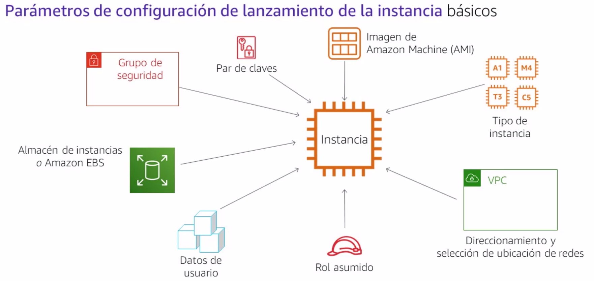{ width="720" }
<figcaption>AMI Quick Start al lanzar una instancia.</figcaption>
</figure>

!!! tip "Crear tu propia AMI"
    Cuando la instancia ya tiene el SO y el software listos, puedes crear la imagen desde **Actions → Image and templates → Create image**. Así lanzas clones iguales sin reinstalar a mano. En el formulario conviene dejar activado el reinicio (*reboot*), porque así el *snapshot* del disco se toma en un estado coherente.

<figure markdown="span">
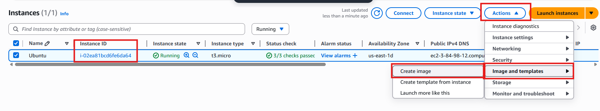{ width="720" }
<figcaption>Crear AMI desde una EC2 que ya está lista.</figcaption>
</figure>

<figure markdown="span">
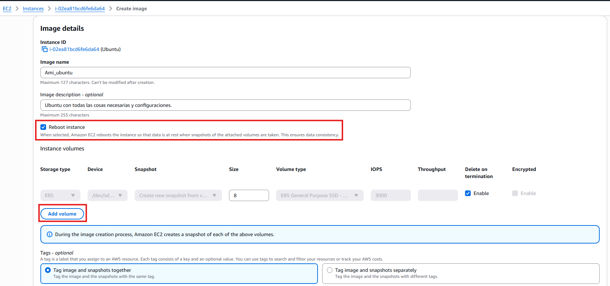{ width="720" }
<figcaption>Nombre de la AMI, reboot para consistencia y volúmenes incluidos.</figcaption>
</figure>

!!! note "Características EC2 (Foundations)"
    - Genera **máquinas virtuales** en la nube (web, correo, ficheros…).
    - El coste depende de RAM, vCPU, disco e [IP elástica](../03-redes-entrega-contenido/tema3.md#ip-elastica) si la usas.
    - Es escalable: puedes cambiar el tipo de instancia (con límites) según lo que necesites y **apagarla** cuando no hace falta.

#### Tipo de instancia y familia

Un **[tipo de instancia](#tipo-de-instancia)**, como `t3.micro`, fija cuántas vCPU, cuánta memoria y qué rendimiento de red tiene la máquina. Los tipos se agrupan en **[familias](#familia-de-instancia)** según el uso para el que están pensados: propósito general (`t`, `m`), cómputo intensivo (`c`), mucha memoria (`r`, `x`), mucho almacenamiento (`i`, `d`) o aceleradores como GPU (`p`, `g`). Ajustar el tamaño a la carga real se llama **rightsizing**: para una API de prácticas con poco tráfico no hace falta un `2xlarge` porque lo usara un tutorial, y un tipo pequeño suele bastar.

Otra cosa distinta es el **modelo de compra** (On-Demand, Reserved, Savings Plans o Spot), que **no** es una familia. El tipo indica qué hardware tiene la máquina; el modelo indica cómo la pagas y si AWS puede retirártela. Por ejemplo, puedes comprar un `t3.micro` como Spot: es la misma máquina pequeña, pero más barata y con la condición de que AWS puede interrumpirla.

<figure markdown="span">
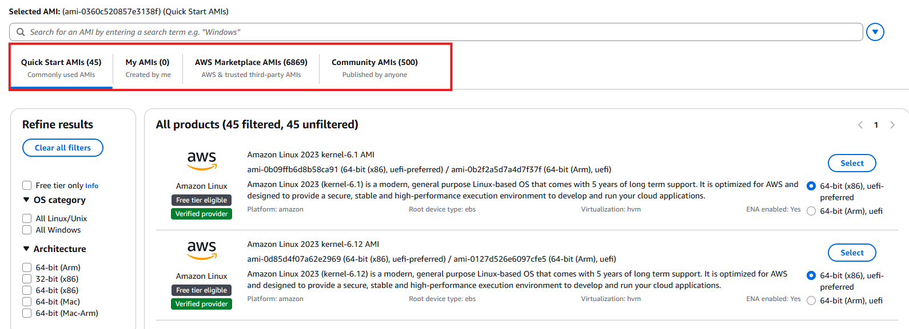{ width="720" }
<figcaption>Familia / tipo: plantilla de hardware, no el modelo de precio.</figcaption>
</figure>

#### Disco: EBS frente a instance store

**[EBS](#ebs)** es un disco en red que no depende del servidor físico: si detienes la instancia (*stop*), el volumen raíz conserva sus datos y vuelve a estar disponible cuando la inicias. Lo que se configura es qué ocurre al **terminar** la instancia (*terminate*): el atributo *DeleteOnTermination* decide si el volumen se borra con ella, que es lo que viene activado por defecto en el volumen raíz, o si se conserva. El **[instance store](#instance-store)**, en cambio, es un disco local del servidor físico donde corre la instancia. Es más rápido en algunos casos, pero sus datos **se pierden** cuando la instancia se detiene, hiberna o termina, y también si falla ese hardware. Para la API del proyecto y sus registros casi siempre eliges EBS; el instance store solo tiene sentido en cargas muy concretas y como pregunta de examen.

#### Par de claves y user data

El **[par de claves](#par-de-claves)** (*key pair*) es la credencial con la que entras por **[SSH](#ssh)** (*Secure Shell*, acceso remoto cifrado) a una instancia Linux, si no te conectas desde la consola con Instance Connect. Si generas tu propia clave, **descarga el fichero `.pem` en ese momento**, porque AWS no te lo vuelve a dar. En Academy sueles usar la clave que trae el lab, `vockey` o `labsuser.pem` según el caso.

<figure markdown="span">
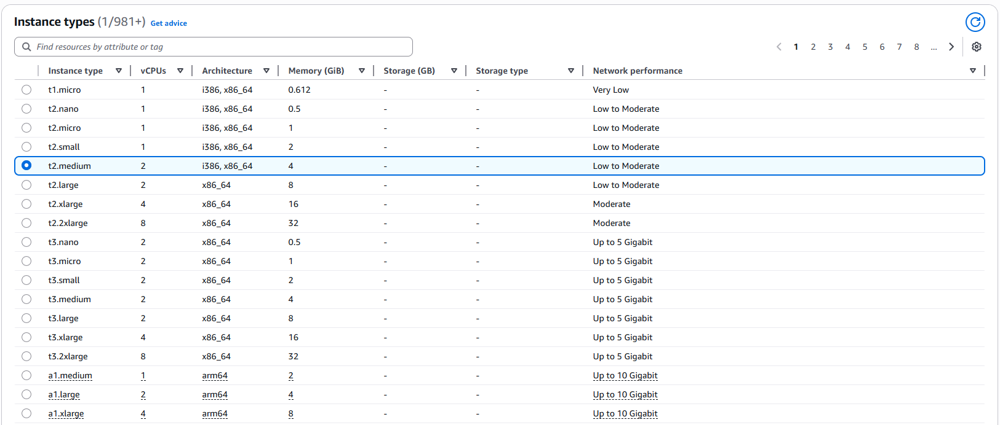{ width="640" }
<figcaption>Par de claves: sin `.pem` no entras por SSH.</figcaption>
</figure>

**[User data](#user-data)** es un script (*cloud-init*) que la instancia ejecuta solo la **primera vez que arranca**, por ejemplo para instalar paquetes, clonar el repositorio o poner en marcha un servicio. No sustituye a una AMI bien preparada, pero en el lab te ahorra hacer a mano esos primeros pasos.

#### Cómo pagas EC2: On-Demand, Reserved, Savings Plans y Spot

| Modelo | Idea | Cuándo tiene sentido |
| --- | --- | --- |
| **On-Demand** | Pagas por hora/segundo sin compromiso | Labs, picos imprevisibles, primer despliegue |
| **Reserved Instances** / compromiso | Descuento a cambio de plazo (1 o 3 años) | Carga estable 24/7 en producción |
| **Savings Plans** | Compromiso de gasto ($/h) flexible entre familias/regiones | Empresa con mix de tipos pero uso predecible |
| **Spot** | Capacidad sobrante, **puede interrumpirse** con aviso | Batch tolerante a fallos, no checkout en vivo |

En un **lab** y en la mayoría de prácticas de DAW usas **On-Demand** y, al acabar, detienes o terminas la instancia. **Spot** es más barato, pero AWS puede recuperar la máquina con un breve aviso, así que no sirve para una demo de evaluación que no puede cortarse. **Reserved** y **Savings Plans** son decisiones de empresa que se toman después de medir el uso durante meses, no para un ejercicio de fin de semana.

La tabla siguiente separa lo que pregunta el examen CLF-C02 (*AWS Certified Cloud Practitioner*, la certificación de entrada de AWS) de lo que importa en clase y en la empresa.

| Examen CLF | Clase DAW / empresa |
| --- | --- |
| Spot = modelo de precio, no `t3.micro` | No usar Spot para la demo que no puede caerse |
| Distinguir tipo/familia de modelo de compra | Rightsizing antes de Reserved |
| EC2 = tú parcheas el SO | En el `.md`, justificar On-Demand + terminate en labs |

Detener y terminar no son lo mismo. Al **detener** (*stop*) una instancia dejas de pagar la máquina, pero el volumen EBS se conserva y se sigue cobrando como almacenamiento mientras exista; lo que hubiera en *instance store* se pierde. Al **terminar** (*terminate*) eliminas la instancia, y con ella los volúmenes que tienen activado *DeleteOnTermination*, como el raíz por defecto; los que lo tienen desactivado siguen existiendo y cobrándose hasta que los borres. Por eso, en el lab, terminar al cerrar evita encontrarse cargos el lunes.

Para entrar en la instancia, **EC2 Instance Connect** te conecta desde la propia consola sin tener que manejar el `.pem` en el portátil del aula; el usuario (`ubuntu`, `ec2-user`…) depende de la AMI. Si entras por SSH con par de claves, el security group debe abrir el puerto 22 **solo** a tu IP o a un bastión (una máquina intermedia de acceso), nunca a todo internet.

**Ejemplo del proyecto DAW.** Imagina un `t3.large` encendido las veinticuatro horas «para ir holgado», cuando la API solo tiene tráfico alrededor de las 11:00: el resto del día pagas una máquina que no hace nada. Lo razonable es elegir un tipo más pequeño, apagarla fuera de horario (o usar [Auto Scaling](#auto-scaling) con mínimo cero, que verás en el [Tema 8](../08-escalado-monitoreo-cierre/tema8.md)) y, si el trabajo es una tarea programada corta, pasarla a Lambda. El ahorro viene de dejar de pagar lo que no usas.

!!! warning "Errores frecuentes"
    - Confundir el tipo `t3.micro` con Spot: el primero es un tamaño de hardware y el segundo, una forma de compra interrumpible.
    - Elegir Spot para el checkout o para una demo en directo.
    - Dejar la instancia encendida el fin de semana: el estado *running* sigue facturando horas y disco.
    - Abrir el puerto 22 a todo internet para entrar por SSH.

### AWS Lambda

**[AWS Lambda](#lambda)** ejecuta una **[función](#funcion-lambda)**, es decir, un trozo de código, cada vez que ocurre un **[evento](#evento-lambda)**: una petición HTTP que llega por API Gateway, un fichero que se sube a S3, un mensaje en una cola o una regla programada de EventBridge. No hay ninguna máquina virtual encendida esperando: AWS prepara un entorno temporal, ejecuta tu función principal (el *handler*), lo retira y te cobra por el número de **invocaciones** y por su duración, medida en **GB-segundo** (la memoria asignada multiplicada por los segundos de ejecución).

Por eso Lambda encaja en tareas cortas que responden a algo concreto, como recibir el aviso de otra aplicación (*webhook*), redimensionar una imagen al subirla o lanzar cada hora una tarea que dura segundos. No encaja en un programa que tiene que quedarse escuchando en un puerto todo el día, en trabajos que duran horas ni en una aplicación que guarda datos en memoria para usarlos en la petición siguiente, porque cada invocación puede ejecutarse en un entorno nuevo. Cada invocación tiene un tiempo máximo (**[timeout](#timeout-lambda)**) que tú configuras y que, según la documentación oficial, **no puede pasar de 15 minutos**. Si la tarea dura más, necesitas EC2, un contenedor o Step Functions, un servicio que encadena varias Lambdas.

El **[arranque en frío](#cold-start)** (*cold start*) es el retraso extra de una invocación cuando AWS no tiene ningún entorno preparado y debe crear uno. Importa en una API en la que cada milisegundo cuenta y apenas importa en un proceso que se ejecuta de noche. AWS mantiene y actualiza el entorno de ejecución (*runtime*, por ejemplo Node 20); **tú** te encargas del código, de las dependencias que empaquetas y del rol de ejecución, que fija con IAM (*Identity and Access Management*, gestión de identidades y accesos) a qué servicios puede acceder la función.

**Ejemplo del proyecto DAW.** Lambda no es buena opción para un chat que mantiene conexiones abiertas con los usuarios, para convertir un vídeo durante horas, para depurar entrando por SSH en la máquina ni para una aplicación Express copiada tal cual, que guarda la sesión en memoria y escucha en un puerto fijo. En esos casos suele ir mejor una EC2 o un contenedor.

!!! warning "Errores frecuentes"
    - Meter en Lambda una API Express copiada tal cual, que guarda datos en memoria y escucha en un puerto fijo.
    - Elegir Lambda «porque es serverless» para un proceso que tiene que escuchar todo el día.

### Contenedores: Docker, ECR, ECS, EKS y Fargate

Un **[contenedor](#contenedor)** es la aplicación empaquetada junto con todo lo que necesita para funcionar (librerías, versión de Node, configuración), de modo que se ejecuta igual en tu portátil que en AWS. Ese paquete se construye como una **[imagen](#imagen-contenedor)**, normalmente con **[Docker](#docker)**, y en AWS se guarda en **[ECR](#ecr)** (*Elastic Container Registry*, registro de contenedores elástico). Para ejecutarlo hace falta un orquestador, es decir, un servicio que arranca los contenedores, los vigila y los reinicia si fallan.

Si en clase ya tienes la API en Docker, el paso natural es **ECS** (*Elastic Container Service*, servicio de contenedores elástico) con **[Fargate](#fargate)**: AWS pone y mantiene las máquinas en las que corren los contenedores, y tú solo indicas cuánta CPU y memoria necesita cada tarea (*task*). Por eso con Fargate **no** parcheas el sistema operativo de esas máquinas, aunque sí mantienes y actualizas la imagen de tu aplicación. **EKS** (*Elastic Kubernetes Service*, Kubernetes gestionado) tiene sentido cuando la empresa ya trabaja con Kubernetes; para un único contenedor de prácticas es demasiado.

| Servicio | Qué aporta | Trade-off didáctico |
| --- | --- | --- |
| **ECR** | Repositorio de imágenes privado en AWS | Hay que publicar imagen antes del despliegue |
| **ECS** | Orquestación propia de AWS | Menos portable que K8s puro |
| **EKS** | Kubernetes gestionado | Más control, más piezas |
| **Fargate** | Cómputo serverless para contenedores | Sin SSH al nodo; menos «tocar el hierro» |

Para este módulo no necesitas montar un clúster de producción, pero sí saber razonar qué opción encaja. Si la API ya está en Docker, el siguiente paso es ECS con Fargate; si el trabajo es un script de veinte segundos, basta con Lambda; y si una aplicación antigua exige un sistema operativo con una licencia concreta, su sitio es EC2.

**Ejemplo del proyecto DAW.** Cada opción cambia la forma de desplegar la API. En EC2, que es lo que hace el lab del módulo, lanzas la instancia en una zona de disponibilidad (AZ), le asocias el security group y te conectas a ella. En Lambda no hay ningún `listen`: escribes el *handler* en el editor de la consola, pulsas **Deploy** para publicarlo y **Test** para probarlo con un evento de ejemplo. Con ECS y Fargate subes la imagen nueva a ECR y actualizas el servicio para que arranque tareas con esa versión.

!!! warning "Errores frecuentes"
    - Montar EKS para un único contenedor de prácticas, con un plano de control, nodos y una curva de aprendizaje que no aportan nada si ECS con Fargate basta.

<figure markdown="span">
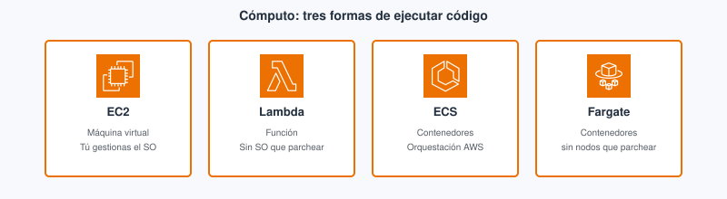{ width="800" }
<figcaption>Misma carga, distinto nivel de gestión: VM, función o contenedor (con o sin nodos).</figcaption>
</figure>

<figure markdown="span">
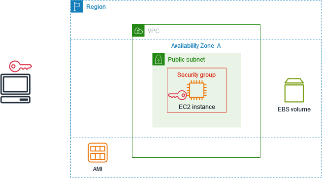{ width="800" }
<figcaption>Flujo Get started de EC2. Fuente: Amazon EC2 User Guide (AWS).</figcaption>
</figure>

<figure markdown="span">
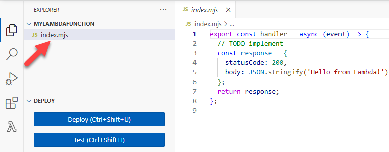{ width="800" }
<figcaption>Editor de la función: Deploy / Test en la propia consola. Fuente: AWS Lambda Developer Guide (AWS).</figcaption>
</figure>

<figure markdown="span">
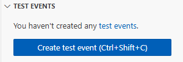{ width="800" }
<figcaption>Evento de prueba: invocas sin montar API Gateway todavía. Fuente: AWS Lambda Developer Guide (AWS).</figcaption>
</figure>

### Elastic Beanstalk y Lightsail

Con **Elastic Beanstalk** subes el código de la aplicación y AWS crea por ti las instancias EC2, el balanceador y el despliegue, con menos pasos manuales; por eso se dice que es un PaaS (*Platform as a Service*, plataforma como servicio) construido sobre EC2. **Lightsail** ofrece servidores privados virtuales (VPS, *Virtual Private Server*) sencillos, con un precio fijo al mes, pensados para sitios pequeños. En un proyecto de DAW en el que diseñas a mano la VPC, el **ALB** (*Application Load Balancer*, balanceador de carga de aplicación) y RDS, lo normal es usar EC2 o contenedores. Beanstalk y Lightsail aparecen en el CLF-C02 como atajos para cuando no necesitas controlar la red con detalle.

**Ejemplo del proyecto DAW.** Si ya diseñaste en el [Tema 3](../03-redes-entrega-contenido/tema3.md) la VPC, las subredes privadas, el ALB y RDS, Lightsail no sustituye ese diseño. Sirve para montar rápido un WordPress o un servidor único, pero no te hace practicar el mapa completo de la red.

!!! warning "Errores frecuentes"
    - Tratar Beanstalk, Rekognition o SageMaker como «un tipo de EC2».
    - Sustituir el diseño de red del módulo por Lightsail y dar por practicada la VPC.

### EC2, Lambda y contenedor: la misma API, tres formas

La tabla siguiente reúne lo visto en los apartados anteriores y compara las tres opciones para desplegar la misma API.

| Dimensión | EC2 | Lambda | ECS + Fargate |
| --- | --- | --- | --- |
| Quién parchea el SO | Tú (instancia) | AWS (entorno gestionado) | AWS (nodo); tú la imagen de app |
| Cómo pagas | Tiempo *running* + EBS | Invocaciones + duración | vCPU/memoria del task + tiempo |
| Estado / puerto | El proceso escucha en un puerto todo el día; disco propio | No escucha en ningún puerto; cada invocación puede empezar de cero | El contenedor escucha en un puerto mientras la tarea está en marcha |
| Límites | Tú eliges disco y tipo y gestionas el escalado (ASG, Tema 8) | Máximo 15 min por invocación; arranque en frío | Hay que definir la tarea; no puedes entrar por SSH a la máquina |
| Cuándo elegir | API siempre encendida, conexiones abiertas (chat), aplicaciones antiguas | Tareas cortas ante un evento, tareas programadas, webhooks | Aplicación ya en Docker, sin administrar máquinas |

| Examen CLF | Clase DAW / empresa |
| --- | --- |
| Lambda no sustituye todo «por moderno» | PR401: comparar estado, duración, coste 24/7 |
| Fargate ≠ gestionar SO del nodo | Docker en clase → ECS/Fargate razonable |
| Beanstalk/Rekognition/SageMaker ≠ «tipo EC2» | Nombrar el servicio correcto en el enunciado |

### Relación con red y almacenamiento

Una EC2 sin una VPC ni un security group bien definidos es un servidor expuesto a internet ([Tema 3](../03-redes-entrega-contenido/tema3.md)). Su disco principal suele ser EBS ([Tema 5](../05-almacenamiento/tema5.md)), pero los ficheros que suben los usuarios no deben guardarse en el disco raíz de una sola instancia: las demás no los ven y, si *DeleteOnTermination* está activado, desaparecen al terminarla. Por último, **[Auto Scaling](#auto-scaling)**, que verás en el [Tema 8](../08-escalado-monitoreo-cierre/tema8.md), añade o quita instancias EC2 de un grupo, pero no corrige haber elegido mal el tipo o el modelo de compra.

### Lab del Módulo 6

En *Cloud Foundations*, el lab del **Módulo 6** consiste en lanzar una EC2: eliges la AMI, un tipo pequeño, la red del lab y el par de claves o Instance Connect, y a menudo creas o usas una AMI propia. Sigue el enunciado de la plataforma de Academy y trabaja en la **región del lab**. La práctica **PR401** te pide además **comparar** esa misma carga de trabajo con Lambda, aunque en el lab solo lances la máquina virtual. Si practicas en el Learner Lab, usa **LabRole** y **LabInstanceProfile** cuando una instancia o una Lambda tengan que acceder a otros servicios de AWS, en lugar de guardar claves de acceso (*access keys*) en el disco.

### Conectar Lambda a HTTP

Una API REST en EC2 recibe las peticiones directamente en un puerto. Con Lambda, el esquema habitual es poner **API Gateway** delante de la función: API Gateway recibe la petición HTTPS, comprueba la ruta e **invoca** la función pasándole los datos de la petición en formato JSON, y la función devuelve el código de estado y el contenido de la respuesta. No hay un proceso Node encendido todo el tiempo, sino que cada petición es una invocación independiente que puede sufrir *cold start*. Para el CLF basta con reconocer la pareja API Gateway y Lambda frente a la de un ALB que envía el tráfico a una EC2 que escucha en un puerto.

**Ejemplo del proyecto DAW.** Las opciones se pueden combinar en un mismo proyecto: el front como web estática en S3, las rutas dinámicas de la API en Lambda y, si el diseño lo necesita, una EC2 para las partes que mantienen conexiones abiertas.

!!! warning "Errores frecuentes"
    - Esperar que detrás de API Gateway haya un servidor escuchando siempre en el puerto 3000.
    - Creer que Auto Scaling elige por ti entre Lambda y EC2: solo ajusta cuántas instancias de un tipo ya elegido hay en el grupo.

---

## Bloque Ampliación Practitioner (CLF-C02)

En el CLF-C02 no basta con saber qué es EC2 o Lambda: tienes que distinguir el **tipo de instancia** del **modelo de precio** y elegir el servicio según si guarda estado, cuánto dura la tarea y quién mantiene el entorno. Algunas preguntas trampa presentan **SageMaker** o **Rekognition** como si fueran «una EC2 más grande», cuando son servicios gestionados de aprendizaje automático (ML, *machine learning*) y no familias de instancia. Otra trampa es pensar que **Auto Scaling** decide por ti entre Lambda y EC2, cuando solo ajusta **cuántas** instancias de un tipo ya elegido hay en el grupo.

Si el enunciado habla de una **carga que puede interrumpirse** y tolera el aviso de terminación, la respuesta es **Spot**. Si habla de un **compromiso de 1 a 3 años** con uso estable, piensa en **Reserved** o **Savings Plans**. Y si describe una **función que se ejecuta al subir un fichero a S3**, piensa en **Lambda**, no en una máquina virtual encendida «por si acaso».

!!! tip "Para el CLF"
    Spot es un modelo de compra, no un tamaño `t3.micro`. SageMaker o Rekognition no son «un tipo de EC2». Auto Scaling escala **grupos** de instancias, no sustituye elegir bien el cómputo. Ampliación y **autocheck certificación** en [Certificación § Tema 4](../99-certificacion/certificacion.md#tema-4).

---

## Videotutorial

**Principal (Foundations).** [ATTA AWS Academy 03 EC2 Linux](https://www.youtube.com/watch?v=vdSKZxOVX1A) (~25 min).

<iframe src="https://www.youtube.com/embed/vdSKZxOVX1A" title="ATTA AWS Academy 03 EC2 Linux — Profe Santos Cloud" style="width:100%;max-width:840px;aspect-ratio:16/9;border:0;display:block;margin:0.8em auto" allow="accelerometer;clipboard-write;encrypted-media;gyroscope;picture-in-picture" allowfullscreen loading="lazy"></iframe>

Vídeo: Profe Santos Cloud (YouTube). Fíjate en la AMI, el tipo pequeño, el security group y cómo apagar o terminar la instancia, porque eso es lo que facturas en el lab.

**Extra (opcional).** [Lambda 101](https://www.youtube.com/watch?v=TIeUbq4bCOU) (~14 min) — contraste serverless frente a EC2 24/7. Vídeo: Profe Santos Cloud (YouTube).

**Extra.** [Creación y gestión de EC2](https://www.youtube.com/watch?v=ts9izrtvrqg) — lanzar instancia: AMI, tipo, par de claves y acceso.

<iframe src="https://www.youtube.com/embed/ts9izrtvrqg" title="Creación y gestión de EC2" style="width:100%;max-width:840px;aspect-ratio:16/9;border:0;display:block;margin:0.8em auto" allow="accelerometer;clipboard-write;encrypted-media;gyroscope;picture-in-picture" allowfullscreen loading="lazy"></iframe>

<figure markdown="span">
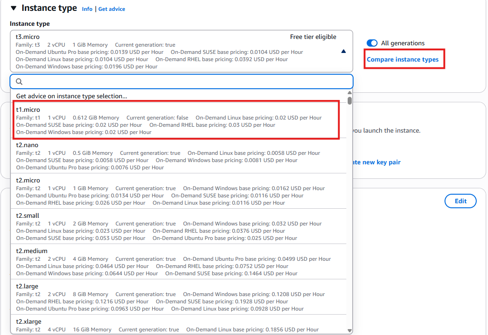{ width="640" }
<figcaption>Par de claves al lanzar la instancia.</figcaption>
</figure>

<figure markdown="span">
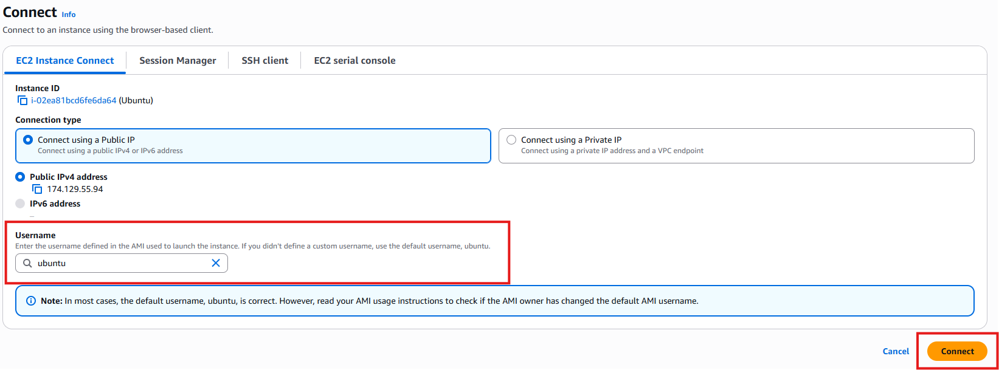{ width="720" }
<figcaption>Conectar desde consola (Instance Connect): el usuario suele venir de la AMI (`ubuntu`, `ec2-user`…).</figcaption>
</figure>

<figure markdown="span">
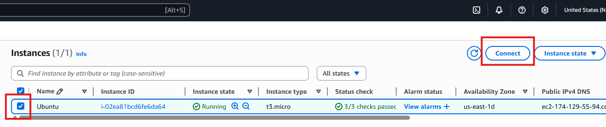{ width="640" }
<figcaption>Instancia en consola tras el lanzamiento.</figcaption>
</figure>

Abre el **Módulo 6** en tu clase de *Cloud Foundations* y sigue el lab que indique Aules. Usa la región del lab.

---

## Actividad / práctica

### PR401 — Lanzar y comparar cómputo

* :simple-neutralinojs: **PR401**. (RA3 // d, f // **PR 0–10**). Lanzas el lab Academy del **Módulo 6** (EC2 / AMI) y argumentas si ese mismo workload encajaría en **Lambda**, mirando estado, duración y coste 24/7.

  **Tareas:** sigue AMI/región del enunciado con tipo pequeño y SG mínimo; documenta evidencias del lanzamiento; en el `.md`, compara EC2 frente a Lambda (estado, tiempo, puerto persistente, coste); **terminate** las instancias y deja evidencia de lista vacía o parada.

  **Entrega:** según [Cómo entregar las prácticas](../index.md#entrega) — fichero `PR401.md` (o ZIP + `img/` si hay capturas).

  Guía de apoyo (no sustituye el enunciado): [Soluciones · PR401](../90-soluciones/pr/PR401.md).

| Criterio | Descripción | Puntos |
| --- | --- | --- |
| Lab EC2/AMI | Lanzamiento según enunciado | 0–3 |
| Comparación Lambda | Estado, duración, coste 24/7 | 0–4 |
| Limpieza | Terminate / evidencias | 0–2 |
| Claridad del `.md` | Sin quedarse solo en el logo | 0–1 |
| **Total** | | **/10** |

---

### Despliegue: de `npm start` al servicio

En tu portátil, `node server.js` abre el puerto 3000 y el navegador habla con ese proceso a través de `localhost`. Llevar la **misma API** a AWS no consiste en copiar ese comando, porque cambia quién te da la máquina, cómo llega el tráfico por la red y quién se encarga de que el proceso siga en marcha.

Si eliges **EC2**, primero preparas la red (la subred y el security group del Tema 3) y lanzas una instancia con una **AMI** que ya traiga Linux. Después instalas Node o PHP, clonas el repositorio y arrancas la aplicación. El security group debe dejar pasar el tráfico al puerto de la API **solo** desde el ALB o desde el origen que hayas previsto, no desde todo internet. Además, el proceso tiene que seguir funcionando cuando cierras la sesión SSH, y para eso se usa **systemd**, **PM2** o una herramienta parecida. Como la IP pública de la instancia cambia cada vez que la detienes, el front o el DNS deben apuntar al ALB y no a esa IP.

Si eliges **Lambda**, no subes un servidor que hace `listen`. Escribes un **handler**, una función que recibe los datos del evento y el contexto de ejecución, la despliegas y la conectas a un disparador (API Gateway, S3, una tarea programada…). Cada petición HTTP llega a API Gateway, que invoca la función; cuando la función termina, no queda ningún programa escuchando en el puerto 3000. Por eso tienes que adaptar las rutas y el estado: lo que antes guardabas en memoria entre peticiones pasa a RDS o a ElastiCache, o deja de guardarse.

Si eliges **ECS con Fargate**, construyes una **imagen Docker** de la API, la subes a **ECR**, defines una tarea (*task*) con la CPU y la memoria que necesita y creas un servicio que mantiene en marcha el número de tareas que indiques. El balanceador (ALB) reparte el tráfico entre esas tareas. Cuando cambia el código, actualizas la imagen; no tienes que entrar a parchear el sistema operativo de las máquinas.

**Ejemplo del proyecto DAW.** Para elegir no sirve preguntarse cuál suena más moderno, sino cuatro cosas: si la aplicación guarda **estado**, cuánto **dura** cada tarea, **quién mantiene** cada parte y cuánto **cuesta**, sobre todo si comparas una EC2 encendida las veinticuatro horas con invocaciones sueltas. Anota ese razonamiento en **PR401**, aunque el lab del Módulo 6 solo te haga lanzar una EC2.

!!! warning "Errores frecuentes"
    - Copiar `npm start` en AWS sin pensar quién mantiene el proceso en marcha cuando cierras la sesión.
    - Apuntar el front a la IP pública de la EC2, que cambia cada vez que la paras y la vuelves a iniciar.
    - Dejar en RAM entre peticiones de Lambda lo que debería estar en RDS.

---

## Autocheck del tema

Comprueba lo que has aprendido sobre cómputo en este tema. Para el CLF-C02 tienes más preguntas en [Certificación § Tema 4](../99-certificacion/certificacion.md#tema-4).

1. Una **AMI** es…  
   a) la instancia encendida · b) la plantilla para lanzar instancias · c) un tipo de precio
2. **V/F.** Spot es un tipo de instancia (`t3.micro`).
3. Un cron de 30 s cada hora: hipótesis más razonable en Foundations…  
   a) EC2 24/7 · b) Lambda · c) EKS obligatorio
4. **V/F.** Con Fargate administras tú el SO de cada nodo EC2 del clúster.
5. Empareja: **EC2** · **Lambda** · **ECS+Fargate** con: (a) handler sin `listen` · (b) SSH y SO custom · (c) contenedor sin gestionar nodos

Soluciones

1. **b**.

2. **Falso** — Spot es **modelo de precio**, no familia/tipo.

3. **b** (evento corto; EC2 24/7 suele sobrar).

4. **Falso** — Fargate quita la gestión del nodo.

5. **EC2** encaja con (b) SSH y SO a medida; **Lambda**, con (a) handler sin `listen`; **ECS+Fargate**, con (c) contenedor sin gestionar nodos.

Para preparar el examen de la 1.ª evaluación tienes una [práctica orientativa](../95-preparacion-examenes/practica-orientativa-1ev.md) que repasa en el Learner Lab lo visto en los temas 3 y 4.

---

## Glosario

**EC2**{: #ec2}
*Elastic Compute Cloud* (nube elástica de cómputo): servicio de **instancias** (máquinas virtuales) en AWS. Tú eliges AMI, tipo, red y almacenamiento; sueles parchear el sistema operativo. Es el análogo más cercano a «tengo un Linux donde instalo Node/Java», con factura por tiempo de vida de la instancia.

**instancia**{: #instancia}
Máquina virtual EC2 en ejecución o parada, creada a partir de una AMI y un tipo concreto. No confundir la instancia con la AMI ni con el tipo de instancia.

**AMI**{: #ami}
*Amazon Machine Image* (imagen de máquina de Amazon): plantilla (SO + software) a partir de la cual se lanzan instancias EC2. No es la instancia en ejecución. Si la «buena» AMI solo vive en el disco de un compañero, el despliegue no es repetible.

**tipo de instancia**{: #tipo-de-instancia}
Combinación publicada de vCPU, RAM y red (p. ej. `t3.micro`). Es hardware de plantilla, no modelo de precio.

**familia de instancia**{: #familia-de-instancia}
Letra inicial del tipo (`t`, `m`, `c`, `r`…): perfil de uso (propósito general, cómputo, memoria…). El rightsizing elige familia y tamaño acorde a la carga.

**vCPU**{: #vcpu}
*virtual CPU* (procesador virtual): unidad de cómputo asignada a la instancia según el tipo elegido.

**EBS**{: #ebs}
*Elastic Block Store* (almacenamiento en bloques elástico): volumen de disco en red asociado a EC2. Persiste aunque detengas la instancia; al terminarla, se borra o se conserva según el atributo *DeleteOnTermination*. El Tema 5 profundiza en sus tipos y en las copias.

**instance store**{: #instance-store}
Almacenamiento local en el host físico: alto rendimiento en algunos tipos, pero los datos se pierden si la instancia se detiene, hiberna o termina, o si falla el hardware.

**par de claves**{: #par-de-claves}
*Key pair*: credencial SSH pública/privada para acceder a instancias Linux. La privada (`.pem`) solo se descarga al crearla si la generas tú.

**SSH**{: #ssh}
*Secure Shell* (acceso remoto cifrado): protocolo habitual para administrar instancias Linux desde terminal. Requiere par de claves o método alternativo (Instance Connect).

**user data**{: #user-data}
Datos de arranque (script cloud-init) que la instancia ejecuta en el primer boot; sirve para preparar la instancia al arrancar sin tener que volver a crear la AMI.

**On-Demand**{: #on-demand}
Modelo de compra EC2 sin compromiso: pagas por tiempo de uso. Habitual en labs.

**Reserved Instances**{: #reserved-instances}
Compromiso de uso (plazo) a cambio de descuento sobre instancias con perfil estable.

**Savings Plans**{: #savings-plans}
Compromiso de gasto en $/h con flexibilidad entre familias y regiones; descuento frente a On-Demand.

**Spot**{: #spot}
Modelo de compra de capacidad sobrante interrumpible; no es un tipo de instancia.

**Lambda**{: #lambda}
Servicio de funciones *serverless*: ejecuta código ante eventos sin mantener una VM encendida. Se factura por invocaciones y duración.

**función Lambda**{: #funcion-lambda}
Unidad desplegada (código + runtime + configuración) que AWS invoca ante un evento.

**evento Lambda**{: #evento-lambda}
Disparador (API Gateway, S3, cola, cron…) que provoca una invocación de la función.

**cold start**{: #cold-start}
Latencia extra al arrancar un entorno nuevo para atender una invocación tras periodo inactivo.

**timeout Lambda**{: #timeout-lambda}
Tiempo máximo de una invocación; en la documentación oficial de AWS el límite configurable llega a **15 minutos** por invocación.

**contenedor**{: #contenedor}
Proceso aislado empaquetado con dependencias; en DAW suele ser la API dockerizada.

**imagen de contenedor**{: #imagen-contenedor}
Plantilla inmutable de capas a partir de la cual se crean contenedores (p. ej. `mi-api:1.0`).

**Docker**{: #docker}
Herramienta para construir, probar y publicar imágenes de contenedor en local y en CI.

**ECR**{: #ecr}
*Elastic Container Registry*: registro privado de imágenes Docker en AWS.

**ECS**{: #ecs}
*Elastic Container Service*: orquestación de contenedores gestionada por AWS (no Kubernetes nativo).

**EKS**{: #eks}
*Elastic Kubernetes Service*: Kubernetes gestionado en AWS; más piezas que ECS para un solo contenedor de prácticas.

**Fargate**{: #fargate}
Modo de ejecución serverless para contenedores en ECS/EKS: AWS gestiona nodos; tú defines task/pods.

**Elastic Beanstalk**{: #elastic-beanstalk}
PaaS de AWS que despliega aplicaciones sobre EC2 gestionadas con menos pasos manuales.

**Auto Scaling**{: #auto-scaling}
Servicio que ajusta el número de instancias EC2 (u otros recursos) según demanda; detalle en Tema 8.

**Lightsail**{: #lightsail}
Servicio de VPS simplificados con precio plano; atajo para sitios pequeños, no sustituto del diseño VPC+ALB+RDS del módulo de redes.

